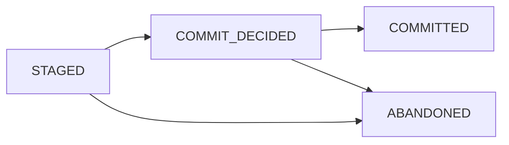

# Fluxway Architecture

This document is the English companion to [ARCHITECTURE_zh.md](ARCHITECTURE_zh.md).
Both files describe the same current implementation and protocol boundaries.

## Runtime ownership

The compiled graph is the single source of truth for SPMD declarations,
operator identity, dependencies, tensor transfers, placement inventory, and
worker routes. Workers receive immutable graph projections and do not rebuild
sharding or tensor identity metadata.

The Controller owns graph lifecycle, placement, drivers, heartbeats, drain,
checkpoint orchestration, and failure propagation. Drivers supervise workers
and forward control commands. Workers own local execution, admission, pending
step lifecycle, transport delivery, and local plan execution.

`ExecutionLifecycle` centralizes startup, restore, drain/checkpoint continuation,
admission delivery and failure ordering. Driver heartbeats report readiness only.
See [distributed execution lifecycle](execution_lifecycle.md) for the state flow
and ownership table.

## Coherence and data plane

The endpoint-local MESI directory is the sole coherence state owner. A
`CoherenceInstance(subject, epoch)` is the identity; `CoherenceDirectory.admit`
is the synchronous admission seam, while `CoherenceSequencer` orders per-subject
intents. Directory operations are event-loop local and do not own worker tasks
or transport queues.

`TransportTensor` is the canonical tensor ABI. Tensor slicing, frame assembly,
batching, routing, and lineage belong to the transport/data-plane layer rather
than the worker scheduler. Exact-step inputs are required; another step cannot
be substituted as a fallback.

## Compiled transfer plans

`TensorTransfer.unit_routing` declares whole-unit incidence independently of source
operators. `CompiledDependency` validates and binds the relation; `CompiledSendPlan`
lowers it alongside ordinary sharding and receipt routing. Execution groups separate
physical identities from logical layout coordinates. All payloads use the existing
DataPlane. See [transfer planning](transfer_planning.md).

## Coherence fanout publication

One worker local step submits its complete immutable target-batch tuple to
`CoherenceBatchRetireRuntime.retire_publication()`. The runtime admits the
publication's instance set once, registers each unique child receipt, and starts
all target enqueues concurrently. `CoherenceSequencer` retains only subject
epoch admission and terminal retirement ordering; it does not serialize sibling
readonly deliveries for one instance.

For the CPU/Ray carrier, receiver completion means the frame was admitted and
deposited into the receiver mailbox. The receiver then owns its materialized
carrier, while the publication keeps the producer outbound references only until
all child results terminate. Same-worker aliases remain protected by their
consumer leases. This avoids a general variable-size buffer ring and does not
claim cross-process zero-copy. A target failure cancels unfinished siblings and
fails the complete publication through its single receipt owner.

## Drain and restore

One `DrainBoundary` reducer owns observed, admitted, drained and committed cuts.
Controller derives `DrainAdmission(revision, target, terminal_cut)` from that reducer
and carries it only on control messages and completion reports. Driver and Worker
reject stale or conflicting admissions before opening a new finite gate. Completion
requires the registered participant set and the active admission identity.

Controller mutation locks contain state reduction, not Driver RPC, source ACK waits
or checkpoint cancellation waits. Source ACK coverage is checked after drain and
before checkpoint preparation. Restore rebuilds canonical plans and physical bindings,
applies the committed cut, and restores model/runtime state with the Worker gate
closed at that cut. Driver `resume` resets checkpoint bookkeeping without clearing
the Worker gate; the next admission supplies its finite target.

## Checkpoint transaction ownership

Controller/Repository checkpoint coordination uses `CheckpointTransactionState`,
distinct from the Worker-local `CheckpointSaveState`:

`COMMIT_DECIDED` records that physical publication has started. Because a crash
loses component sessions and pending publication context, startup fences both
`STAGED` and `COMMIT_DECIDED` records to `ABANDONED`. Only `COMMITTED` manifests
are restorable and visible.

## Placement and execution

Placement declarations come from compiled SPMD declarations and
`ResourceProfile`. `PlacementRecipe` expresses constraints and lexicographic
objectives without duplicating resource ownership. Each solved NodeID maps to one
composite bundle in a shared heterogeneous placement group. Ray's `ray.io/node-id`
bundle label selector pins the exact identity under `STRICT_SPREAD`; IP resource
markers are not node identities. CPU, GPU and custom accelerator resources retain
the quantities selected by the planner. Workers attest their actual NodeID against
the plan. Multi-node execution requires compatible node environments and a shared
checkpoint repository when recovery is enabled.

The worker admission owner contains gating and pending-state promotion.
`SourcePipelineMaintenance.request()` coalesces requests to fill the Worker source
step queue; `fill()` checks running state, pipeline depth, drain boundaries and
the total step target before enqueueing work. This queue maintenance does not
discover source revisions or publish new ingestion windows. The execution lane
consumes owned queue items, evaluates admission, dispatches plans, and completes
`task_done()`.

## Ingestion layout and source coordination

`IngestionSourceAdapter` captures immutable revision metadata in bounded
`CatalogViewObservation` windows. The compiler first creates canonical assignments,
identified by `SourceWorkKey(epoch, step, assignment_id)`, then binds them to current
reader quotas in transient `WorkerLayoutDescriptor` values. `LogicalWorkLedger`
alone owns leases, ACK frontiers and committed cuts. Driver activation checkpoint
state is empty. Restore reconstructs plans
and bindings before applying the logical committed cut.

`IngestionLayoutPlanningComponent` owns descriptor construction and adapter capture
on a dedicated `IOLane`, and pure compilation on a persistent spawn process pool.
Accepted operations survive cancellation of their callers. Close rejects new work,
joins accepted operations, and joins the compiler on a separate lifecycle lane
before closing the adapter lane. Planner and ledger publication is installed in
one owner-loop section without suspension; validation and installation costs still
scale with window size. I/O threads isolate blocking calls but do not remove the
GIL for Python CPU work.

`SourceExecutionScope` owns Worker window installation, the active-step index and
transient grants. Acquisition batches active steps up to operator pipeline depth;
the authority returns the complete-step prefix permitted by current credit.
Normal checkpoint continuation retains the scope. Restore uses fresh actors before
source activation. ACK submission uses a bounded asynchronous queue; full capacity
applies backpressure. Controller startup activates one layout. The planner component
supports idle observations and pending tails, but the startup API does not run
automatic adapter discovery or replenishment. Committed planning windows and
physical bindings remain retained, so metadata grows with installed window count.
See [source coordination](source_coordination.md) and
[formal protocol](source_spmd_formal_protocol.md) for the supported contracts.

## Process diagnostics and signal capture

To reliably attribute worker process exits caused by external preemption, evictions, or operating system signals, Fluxway provides non-blocking process-level diagnostic interception in `fluxway.diagnostics`:

- **Bootstrap hook injection**: `prepare_worker_runtime_env` injects `worker_process_setup_hook` via Ray's `WORKER_PROCESS_SETUP_HOOK_ENV_VAR`, initializing signal interceptors before worker execution while chaining user hooks.
- **Ray SIGTERM interception**: Intercepts Ray's internal `set_sigterm_handler` to record previous handlers and Ray's own SIGTERM callback without altering Ray's teardown protocol.
- **Non-blocking signal delivery**: Signal handlers enqueue events and wake a background emitter daemon thread via a non-blocking pipe (`os.pipe2(O_NONBLOCK | O_CLOEXEC)`), preventing deadlocks or blocking I/O inside OS interrupt context.
- **Faithful delegation**: Handlers always forward signals to prior handlers (`callable`, `SIG_DFL` via `raise_signal`, or `SIG_IGN`), preserving native process termination semantics.
- **Thread safety**: Signal handlers are only installed on the process main thread; asynchronous actor worker threads publish diagnostic metadata without attempting invalid signal registrations.

See [coherence_protocol.md](coherence_protocol.md),
[placement_recipe.md](placement_recipe.md),
[placement_mathematics.md](placement_mathematics.md), and the detailed Chinese
companion for the complete section-by-section specification.
