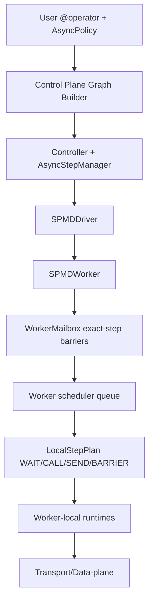

# Fluxway Architecture

Fluxway 是面向多 SPMD 图训练的异步数据流框架。当前架构的核心原则是：

- 用户算法语义由 `AsyncPolicy` 表达。
- 单个 `(operator, step)` 的 worker-local 执行统一 lower 到 `LocalStepPlan`。
- 用户 `CALL`、输入 prepare、输出 delivery 分别由 worker-local runtime 管理，避免阻塞 Ray actor event loop。
- tensor 切分、frame 构造、batch 分组属于 transport/data-plane 层，不在 worker 调度层重复实现。
- 所有 tensor/control/state 都是 exact-step 输入，Fluxway 不会用另一个 step 的数据替代当前 step。

## Layering



## Control Plane

`Controller` 负责图生命周期、资源调度、driver 管理、心跳和全局错误传播。`AsyncStepManager` 只处理跨 SPMD ahead limit：某个 SPMD/operator 允许跑多远由 `AsyncPolicy` lowering 后的上限决定，实际放行仍通过现有 block/unblock 机制完成。

控制平面不直接参与 tensor 切分、重组或发送。它只下发拓扑、sharding、operator metadata 和跨 SPMD 进度约束。

## SPMD Driver

`SPMDDriver` 是每个 SPMD 的局部监督者：

- 启动和注册 worker。
- 转发 controller 的 block/unblock、drain、checkpoint、stop。
- 汇总 worker committed watermark。
- 在 checkpoint/drain/export/stop 前触发 worker fence。

driver 不执行用户算子，也不构造 transport frame。

## Worker Scheduler

`SPMDWorker` 是 Ray async actor。它只负责：

- 接收 mailbox ready 事件。
- 根据 `_effective_schedule_key(op_name, step)` 排队。
- 检查 `AsyncPolicy` lowering 后的 depth/ahead/resource 约束。
- 提交 `LocalStepPlan`。
- 在 drain/checkpoint/export/stop 时 fence worker-local runtime。

跨 operator 联动不写进 `LocalStepPlan`。例如 sparse embedding 的 update 在接近 lag 边界时优先于 lookup，或 pipeline parallel 的 forward/backward phase order，都由 scheduler policy 和现有 worker queue 表达。

## AsyncPolicy

`AsyncPolicy` 是算法工程师面对的唯一异步入口：

- `AsyncPolicy.sync()`：exact-step input、depth=1、ordered commit、exclusive state。
- `AsyncPolicy.pipelined(depth=N)`：exact-step input，可多 step overlap，不允许跨 step 数据替代。
- `AsyncPolicy.bounded_stale(depth=N, max_staleness=M)`：bounded operator lag，用于 sparse embedding 半异步半同步训练。它限制 lookup/update 能领先依赖进度多少步，但输入仍然是 exact-step tensor/control/state。
- `AsyncPolicy.pipeline_parallel(...)`：把 phase scheduling lowering 到 worker scheduler，不改变 Local DAG ABI。

旧式跨 step 数据替代语义已删除。`max_staleness` 是 operator lag window，不是 tensor 版本选择策略。

## Worker-Local DAG

每个 ready step lower 成固定 ABI 的 `LocalStepPlan`：

```text
WAIT -> CALL -> SEND -> BARRIER
```

- `WAIT`：消费 `LocalInputPrepareRuntime` 的 prepare token；sync operator 可 inline assemble，async operator 在 mailbox ready 时提前启动 prepare。
- `CALL`：通过 `UserCallableExecutor` 选择执行 lane。process-affine 同进程算子提交到 `WorkerProcessCallRuntime`，不会同步占住 worker actor event loop。
- `SEND`：注册 `LocalSendToken` 并把 frame build / batch enqueue / delivery 交给 `OutboundDeliveryRuntime`。
- `BARRIER`：只 observe token 注册、清理 exact-step mailbox 数据、推进 contiguous committed watermark；不等待完整 transport delivery。

`LocalStepPlan` 不表达训练算法。forward/backward/update 的顺序、embedding lookup/update 的 ahead 边界、pipeline phase order 都属于 scheduler/AsyncPolicy 层。

## Worker-Local Runtimes

`fluxway/spmd/worker/runtime.py` 是 worker-local lifecycle owner：

- `WorkerProcessCallRuntime`：让 `@requires_worker_process` 的同步用户代码在线程 runtime 中执行；event loop 只 await future。
- `LocalInputPrepareRuntime`：管理 mailbox-triggered prepare token、后台 assemble、consume、cancel、drain。
- `OutboundDeliveryRuntime`：管理 `LocalSendToken` 注册、delivery semaphore、delivery task、异常 poison、drain/checkpoint/export/stop fence。

这些 runtime 共享一个原则：event-loop nonblocking。它们不重新实现 mailbox、assemble、transport 或 routing 逻辑，只移动执行位置和生命周期所有权。

## Mailbox And Assembly

`WorkerMailbox` 只维护 exact-step barriers。一个 step ready 的条件是该 step 的 expected tensors/states 全部到达；旧 step 数据不会满足 future step。

tensor 组装由 worker-local assembly 模块负责：

- `CompiledAssemblePlan` 缓存 input layout、predecessor topology、provider 信息和静态 routing 前提。
- 热路径只处理 step-local shards、arrivals、dynamic indices、counts、receipt、`TransportTensor`。
- dynamic unique/inverse/grad 均与 step 强绑定，不跨 step 复用或替代。

## Transport And Data Plane

transport 层拥有 routing、sharding、frame template 和 batch plan：

- `AsyncDataDistributor.plan_and_shard()` 负责 sharding/split。
- `TransportFrameTemplate` 缓存可模板化的 header/table 骨架。
- `TransportBatchPlan` 按 transport 语义把 frame groups 转成 batch。
- data-plane executor 只消费 compiled send plan 和 transport batch，不重新实现 target grouping 或 frame construction。

static-to-static 只 patch step 和 payload refs。dynamic 路径只缓存稳定 schema/tuuid/role 骨架；shape/count/routing/origin/inverse/payload 每 step 输入。

Ray 和 Axon 共享 batch-first ABI。缺失 batch ABI 或非法 backend state 直接抛错。

## Commit, Fence, And Failure

step commit 和 delivery completion 分离：

- `SEND` 返回 `LocalSendToken` 表示 delivery 已注册。
- `BARRIER` 不等待 frame build、batch RPC 或 receiver deposit。
- delivery 异常由 `OutboundDeliveryRuntime` poison worker。
- drain/checkpoint/export/stop 是唯一等待 registered delivery 的 fence。

checkpoint、heartbeat、driver report 只读取 contiguous committed watermark。

## Profiler Semantics

local-step span 和 data-plane span 分层显示：

- `local_step.wait_inputs`
- `local_step.call_user`
- `user_callable.execute`
- `local_step.send_output`
- `local_step.await_send`
- `local_step.commit`
- `data_plane.frame_build`
- `data_plane.frame_submit`
- `data_plane.enqueue_batch`
- `data_plane.batch_rpc`
- `data_plane.receiver_wait`
- `data_plane.delivery_fence`

`send_output` 与 `await_send` 用 `(source_spmd_code, source_rank, op_id, step)` 关联；batch 级分析再加 `target_spmd_id`, `target_rank`, `batch_seq`。
`user_callable.execute` 记录 callable/function/operator 名称、`ctx.step`、输入 tensor/control/static 名称和 lane，字段以 interned id 写入 trace metadata。

用户函数内部的细分插桩使用 `fw.profiler.scope(name, **attrs)` 和
`fw.profiler.event(name, **attrs)`。它们记录为 `user.<name>`，显示在
`compute/user_custom/<lane>`，并继承当前 operator 的 `op_id`, `step`,
`rank`, `lane_id` 关联信息。它们只用于标记 User CALL 内部子阶段，不替代
外层自动记录的 `user_callable.execute`。详细用法见
[`docs/user_profiler.md`](user_profiler.md)。

## Recommendation Training Pattern

大规模稀疏 embedding 推荐训练的目标是：

- sparse lookup/update 可在 bounded operator lag 内推进。
- step N+1 的切分、传输、组装可以与 step N 的 Dense GPU `CALL` 并行。
- lookup/update 的先后关系由 Local DAG 和 scheduler policy 表达。
- tensor/control/state 仍然 exact-step，不允许数据版本替代。

因此推荐写法是 sparse worker 使用 `AsyncPolicy.bounded_stale(...)`，dense worker 默认使用 `AsyncPolicy.sync()` 或显式确认安全后使用 pipelined policy。
