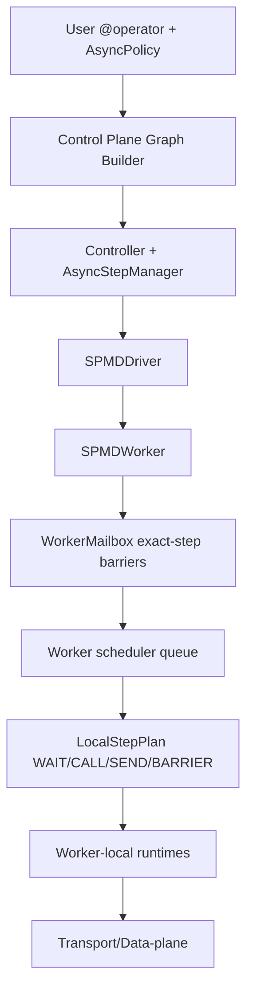
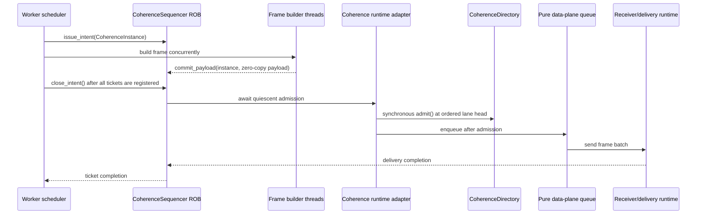

# Fluxway Architecture

Fluxway 是面向多 SPMD（Single Program, Multiple Data，单程序多数据）图训练的异步
数据流框架。当前架构的核心原则是：

- 用户算法语义由 `AsyncPolicy` 表达。
- 单个 `(operator, step)` 的 worker-local 执行统一 lower 到 `LocalStepPlan`。
- 用户 `CALL`、输入 prepare、输出 delivery 分别由 worker-local runtime 管理，避免阻塞 Ray actor event loop。
- tensor 切分、frame 构造、batch 分组属于 transport/data-plane 层，不在 worker 调度层重复实现。
- 所有 tensor/control/state 都是 exact-step 输入，Fluxway 不会用另一个 step 的数据替代当前 step。
- 同 worker 内部流水线用显式 local-only edge，共享 canonical `TransportTensor` 语义 ABI
  （Application Binary Interface，应用二进制接口），但优先直接传对象引用，不强制编码
  wire frame，也不注册 Ray/Axon self-loop handler。

## Endpoint-Local MESI Directory Coherence Tree

MESI（Modified, Exclusive, Shared, Invalid，修改、独占、共享、无效）描述一个 tensor
instance 在 endpoint-local directory 中的访问权限，不描述 Python 对象类型。

TUUID（Tensor Universally Unique Identifier，tensor 通用唯一标识）是 logical tensor
identity。DLPack（Deep Learning Pack）是跨 component tensor payload 接口。BusRd（Bus Read）
对应 wire action `BUS_RD`；Snoop Invalidate（嗅探无效化）对应
`SNOOP_INVALIDATE`；Grant Return（授权归还）对应 `GRANT_RETURN`。

Fluxway 使用 endpoint-local 的层次化 directory。每个 endpoint 只维护本地状态、direct
parent authority 和 direct-child sharing bitmap；禁止全局 holder list、跨层广播和全局
coherence lock。任一跃迁只访问一个 entry 和它的 direct edges，延迟只反压相关子树。

用户接口只有 `TensorAccessIntent.READONLY`、`WRITABLE` 和 `DONATE`，按 operator 的
data input port 声明：

```python
@operator(tensor_access={
    "input_ids": TensorAccessIntent.READONLY,
    "cache": TensorAccessIntent.WRITABLE,
    "activation": TensorAccessIntent.DONATE,
})
```

未声明的 data input port 默认是 `READONLY`；mirror/follow 只继承 receipt/origin lineage，
不会改变 intent。Graph compile、local-only fast path 和 worker CALL 都消费同一份冻结的
`OperatorSpec.tensor_access`，不再从 `AsyncPolicy` 或 `StatePolicy` 推导第二份事实。
runtime 在 CALL 前把 intent 转为本地 grant 或 RFO（Request For Ownership，请求所有权）；write grant 未 ready 时 coroutine
挂起，用户函数绝不会提前执行。完整状态机、
动作定义和证明见 [Endpoint-Local MESI Directory Protocol](coherence_protocol.md)。

当前 wire 协议只实现 `BUS_RD`、`RFO`、`SNOOP_INVALIDATE`、`GRANT_RETURN`、
`OWNERSHIP_GRANT` 和 CALL 前的 `OWNERSHIP_CANCEL`。`BUS_UPGR` 是 directory 内部的
`S -> M` 概念跃迁，不产生 frame。`FLUSH` 在 MESI 中表示 dirty writeback，但 copied
Ray/Axon data-plane 无法用 header-only frame 恢复 parent payload，因此一执行协议将其 action code
保留为非法值，不实现 remote writeback。

parent grant 归还由 worker-local `ParentGrantReturnRuntime` 统一管理。worker 只提交
`ParentReturnRoute`；该 module 在发送 `GRANT_RETURN` 前原子安装显式 return transaction、
清除 stable parent authority，按 direct parent 和 epoch 聚合 frame，并以 exact-once token 完成事务。交叉到达的同 epoch
`SNOOP_INVALIDATE` 由 directory 合并到已有 return transaction，future epoch `BUS_RD`
可以把该事务作为父端已观察归还的证明。该路径保持 event-loop 无锁和 O(1) directory
操作，但不是形式化 lock-free，也不是零开销：每个 return 会分配一个小 token 并执行
常数次表查找。runtime 仅在 send 和 token completion 全部成功后返回 epoch-scoped
returned-instance 集合，allocation retirement 消费该集合，避免用已推进的新 epoch entry
反查旧 instance；集合外的 instance 仍执行完整 quiescence 校验。

输入生命周期由 `InputCoherenceReleasePlan` 和 `InputCoherenceRelease` 组成。plan 是
不可变的执行数据，集中保存 grants、alias `CoherenceInstance`、tensor payload 和 retirement
候选，并从 grant 元数据校验、派生 parent-return routes；release 只暴露一个
`complete()` 入口。它按“释放 local token -> grant/alias/descendant quiescence -> tensor
invalidation -> parent return -> payload release -> retirement proof”顺序完成，remote 与
local-only 输入使用同一条路径。`InputCoherenceRelease` 是生命周期 release，不是可回滚
transaction。在 Worker 调度边界，Step 提交与输入 Quiescence 归还解耦：算子计算完成时
通过 `_spawn_background_task` 将 `InputCoherenceRelease.complete()` 交给受监管的后台任务，
后台协程取得该 step 的 release 资源所有权后再执行第一个可能挂起的 quiescence await；
控制面调度水印 `_advance_step` 不等待这条归还路径，以解除下游 Phase 依赖。Worker 退出或
异常清理时统一追踪并 await 全部后台归还任务，确保零拷贝物理内存由 Directory 状态机严格
保障。这个解耦边界不等于“归还已完成”：只有 `complete()` 返回才表示该输入生命周期结束。

epoch 转换同样只有一个事实来源。`CoherenceInstance(subject, epoch)` 是唯一 coherence
身份；`CoherenceDirectory.admit()` 是唯一同步 admission 入口。乱序 frame build 不进入
directory，而由 `CoherenceSequencer` 的 per-subject ROB 收敛。Sequencer 只在队头 intent
调用 `admit()`，同一 epoch 的 delivery 可并发，下一 epoch 必须等待前一 intent 的所有
delivery 完成；Sequencer 延迟分配 completion Future，快速路径在队头就绪时直接内联退休，
降低热路径进入 asyncio 的延迟；冲突 coroutine 由 `coherence_runtime.py` 的异步 adapter 通过
Directory progress signal 挂起，不在 Directory 内创建 Future。
Directory 只保留同步协议事实，不持有 worker task 或 transport queue；整个路径不轮询、不阻塞
event loop。

逻辑 identity 是 `(owner_spmd_code, owner_rank, logical_tuuid, epoch)`；physical allocation
identity 由 component 证明。`donate` 只允许 endpoint-local、exact byte-span 的 Allocation
Handoff：旧 SSA（Static Single Assignment，静态单赋值）instance 进入 I，新 SSA instance
获得同一 storage owner 并进入 E。跨
endpoint 仍是普通 tensor payload，不是 FLUSH，也没有 Parameter Server 特例。

正常回收只删除已证明没有 reader、writer、child、delivery、parent authority、pending
continuation 和 live binding 的 retired instance。watermark 只是 endpoint-local 的回收调度
frontier，不是安全证明。协议不一致或 progress failure 会 fence 整次 execution：停止 frame
admission、取消任务、关闭 transport、清空受控 binding 并显式终止 worker actor；当前不支持
同一 execution 内的 rank replacement。

## Layering



异步 coherence/data-plane 工作流如下：



## Control Plane

`Controller` 负责图生命周期、资源调度、driver 管理、心跳和全局错误传播。`AsyncStepManager` 只处理跨 SPMD ahead limit：某个 SPMD/operator 允许跑多远由 `AsyncPolicy` lowering 后的上限决定，实际放行仍通过现有 block/unblock 机制完成。

控制平面不直接参与 tensor 切分、重组或发送。Graph build 只编译一次
`CompiledGraph`，每个 worker 接收对应的 `SPMDGraphView` 投影以及跨 SPMD
进度约束。

### SPMD Registry And Execution Modes

Builder 中的 Graph node 收集真实 Python class、`SPMDConfig` 和 `ResourceProfile`。build 完成后，frozen `CompiledSPMDDeclaration` 是 SPMD identity、mesh 和资源的唯一编译事实；`SPMDGraphView` 直接引用该对象。`OperatorSpec` 从 decorator 声明、Graph 编译到 worker 执行保持同一个 frozen 模型，不再 lowering 为第二套 runtime metadata。

Graph、Recipe、SPMD class、静态参数、condition function 和动态 routing function 都通过 Ray actor 参数直接传输。Fluxway 不建立 JSON 对象重建协议，也不要求 class、lambda、局部函数或闭包能通过字符串重新导入。每个 rank worker 构造一份 owner 实例，同一 owner class 的全部 operator 共享这份对象；state resource 只决定锁。

运行时控制面和数据面不使用 JSON 传输对象。仓库中的 JSON 只存在于明确的外部格式 adapter：Graph visualization bundle、Perfetto 用户属性、safetensors metadata、示例 Reader 状态和业务 JSONL trace。它们面向磁盘或第三方工具，不参与 Ray actor、Graph、Recipe、operator 或 tensor 运行时通信。

`AsyncPolicy` 是异步调度语义的唯一事实来源。`common.schedule_semantics`
在初始化冷路径将 phase policy 编译为不可变 gate 和 relation；worker 热路径
与 Model Explorer overlap projection 复用同一编译结果，不分别实现 phase
ordering。

静态图 build 后，`CompiledGraph` 是 SPMD declaration、operator identity、dependency 和 tensor
transfer 的唯一编译事实来源。`DependencySpec` 保存逻辑 operator 依赖，
`CompiledDependency` 和 `CompiledTensorTransfer` 只增加 dependency/transfer code、TUUID、
mesh 和 world size 等编译结果。零条 tensor transfer 表示纯执行顺序依赖。
worker route、Model Explorer projection 和 profiler identity 都从 compiled graph
派生，不允许反向重建或双写。condition callable 作为原生 Python 对象由 Ray
传输，不转换为字符串 ID。

`CompiledTensorTransfer.source_sharding/checkpoint_object_sharding` 保留用户声明的
mirror/follow 关系。GraphCompiler 沿完整端口引用图求闭包后，producer 侧非引用执行
几何只保存在 canonical `CompiledLogicalTensor.effective_sharding`，checkpoint_object port 侧只保存在
`CompiledOperator.effective_input_sharding`；transfer 不复制这两项。TUUID 只承担 logical
tensor 的 wire identity，不承担运行时 sharding 推导。编译器对引用闭包做 memoized DFS，
循环、缺失端口和当前未实现的非 identity dimension map 都在启动前用
`SPMD.operator:port` 链抛错。`SPMDGraphView` 按引用传递闭包投影同一批 canonical logical
tensor 对象，Worker 不重建 TUUID-to-sharding 映射。

placement 从 `CompiledGraph` 的 declaration 建立 inventory，不读取 build 后仍可变的 Graph node 字段；Ray actor 生命周期使用 Graph node 中的运行参数和同一个 compiled declaration。
静态 Graph 在启动前解析 dependency、condition、tensor tree 和 sharding，worker
从固定的 `SPMDGraphView` 构造并缓存 runtime route；step 热循环中没有
execution-mode 分派，也没有 referential sharding DFS。future eager generation
继续调用同一个 `GraphCompiler`，因此 graph/eager 共享 transfer ABI 和错误语义。

`Scheduler` 构造器接收 Graph 和 Recipe，并分别公开资源分配、topology 注册和 SPMD 启动步骤。静态 Controller 使用 `build_topology(compiled_graph)` 提供邻接关系；未来 eager adapter 可以跳过静态邻接关系并复用同一组资源与 actor 生命周期方法。

未来 eager adapter 负责运行时 invocation、dynamic tensor layout 和 route plan，但必须复用同一个 SPMD registry、PlacementPlanner、PlacementGroup、SPMDDriver 和 SPMDWorker。eager 不能复制资源分配或 actor 生命周期实现。当前版本没有提供半成品 eager 入口。

### Placement

`create_controller(graph, placement_recipe=...)` 在同一次 Ray actor 创建中传输 Graph 和 Recipe。`PlacementPlanner` 接收由 compiled declarations 建立的 `PlacementInventory`、Recipe 和 Ray node resource snapshot，不依赖 dependency；dependency 只属于执行拓扑。

公开 placement 接口只包含 worker/node 集合表达式、数学约束和严格字典序 objective；逻辑 slot、rank mapping 和 solver variables 都是内部表示。资源声明属于独立的 `fluxway.resources` 模块，数学 Recipe 不保存第二份 class-to-profile 映射。

placement 内部分为六个单向职责层：`mathematics.py` 定义 frozen AST，`inventory.py` 从 compiled declarations 建立只含 placement 所需字段的内部视图，`models.py` 定义报告与异常契约，`semantics.py` 解析集合并提供独立 attestation oracle，`compiler.py` 注册各 AST 节点的 CP-SAT lowering，`planner.py` 只编排模型组装、严格字典序求解和 materialization。新增 AST 节点通过类型注册 handler 扩展，不修改中心条件分派链。

所有 SPMD 共用一个异构 Ray PlacementGroup。一个求解结果节点对应一个 composite bundle，bundle 使用 Ray 自动提供的 `node:<ip>` resource 精确绑定并采用 `STRICT_SPREAD`。`Controller` 是 PG 唯一 owner；`SPMDManager` 和 `SPMDDriver` 只借用 `SPMDWorkerGroup` 中的 rank-to-bundle 映射。

`ResourceProfile.base` 和 `scale` 进入 Ray actor bundle，形成 Fluxway worker 的硬资源约束。`ResourceProfile.ray_component_limits` 只描述该 worker 触发的 Ray 原生组件软上限；它进入 placement 容量核算和 operator context，但不进入 PlacementGroup bundle，也不参与 worker node attestation。

`Controller` 负责 PlacementGroup 创建、释放和 attestation 协调；每个 driver 只上报各 rank 的实际 Ray node ID。

配置、运行状态与错误处理见 [Placement Recipe](placement_recipe.md)；AST、objective 顺序、整数化和复杂度边界见 [Placement Mathematics](placement_mathematics.md)。

## SPMD Driver

`SPMDDriver` 是每个 SPMD 的局部监督者：

- 启动和注册 worker。
- 转发 controller 的 block/unblock、drain、checkpoint、stop。
- 汇总 worker committed watermark。
- 在 checkpoint/drain/export/stop 前触发 worker fence。

driver 不执行用户算子，也不构造 transport frame。worker 错误由 driver 上报，整作业失败清理由 Controller 负责。

### Driver Components And Source Coordination

Controller 和每个 SPMD Driver 分别承载 `ControlPlaneComponentRegistry` 与
`DriverComponentRegistry`，两个宿主复用同一个内部 `ControlPlaneComponent` 协议。
组件通过 `on_state(state)` 响应宿主的生命周期 FSM 转换（Controller 对应 `ControllerState`，
Driver 对应 `DriverState`），并通过 `checkpoint_state()` 与 `restore_state()` 统一参与控制面状态快照与容错恢复。
Driver 的冷路径生命周期由单一状态机管理：`READY → RESTORING → READY` 与
`RUNNING → DRAINING → DRAINED → SNAPSHOTTING → RUNNING`；terminal drain 只是在该
状态机上的目标步 admission，不建立第二套状态源。
source descriptor 只存在于 compiled `OperatorSpec`；source coordinator 由对应 Driver 构造并复用
`DriverState`、drain 和 snapshot，不建立第二套 source lifecycle 或 barrier。

terminal source 收敛沿用同一条状态链：

```text
Worker 发现 virtual source 的 first-missing step T
  -> Worker -> Driver -> Controller 提交通用 boundary event
  -> DrainBoundary reducer 取所有 observation 的最小值 T
  -> 与周期 drain 相同的 request_drain(T, terminal_cut=T)
  -> Worker 丢弃 source pipeline 中 step >= T 的 speculative work
  -> SPMDSynchronizer 将所有 physical rank 的 committed frontier 收敛到 T
  -> Driver DRAINED -> SNAPSHOTTING -> Controller COMPLETING -> COMPLETED
```

Controller 只持有一个 `DrainBoundary` reducer 状态，字段为
`observed_cut`、`admitted_cut`、`drained_cut`、`committed_cut` 和版本号。Driver 不再维护
第二份 boundary；Synchronizer 与 Worker 只保存带版本的本地快照，用于本地 late-report
clamp 和 restore 校验，不能独立改变 Controller 的 admission。`OPEN → OBSERVED →
DRAINING → DRAINED → SNAPSHOTTING → COMPLETED` 是该 reducer 在既有宿主 FSM 上的投影，
不是第三套生命周期。

`OPEN` 表示没有 active boundary；`OBSERVED` 表示已记录 terminal 事实但尚未完成
admission；`DRAINING` 等待所有 rank 到达目标；`DRAINED` 表示物理 drain 完成；
`SNAPSHOTTING` 表示 checkpoint 正在进行；`COMPLETED` 表示 terminal checkpoint 已
原子发布。周期请求、terminal observation、drain completion、snapshot begin、checkpoint
commit、restore 和 late completion 都进入同一个 reducer；late completion 只产生 clamp
后的报告视图，不改变 raw execution cursor。

Worker 的 `execution cursor` 允许先到达 `T+1`，但它不是 checkpoint 进度；只有
`committed cut` 才能进入 runtime snapshot、driver report 和 Controller checkpoint。
因此一个 rank 执行到 14、另一个 rank 在 13 发现 EOF 时，terminal checkpoint 的统一边界仍是 13，
不会通过回写 execution cursor 伪造收敛。

Drain boundary 更新与 source refill 解耦：boundary 只收缩 admission、清理 cut 之后的
speculative source pipeline 并唤醒等待者，不会在 boundary 内重新填充 source。source
refill 只由 `_fill_source_pipeline()` 执行，并在 enqueue 前检查 terminal cut、pipeline
depth、worker running 状态和有限 `max_steps`。

全局 `ControlLedger` 只实现 opaque ordered metadata retention、等待式共享读取、durable
checkpoint cut、sealed end 和 replay。持久 identity 只有
`(stream_id, position)`；virtual owner 由当前 operator step 与 interleave topology 推导。
ledger 本身不包含 virtual unit、source revision、文件 lineage 或 executor lane 语义。完整协议与 exactly-once 不变量见
[Source Coordination](source_coordination.md)。

ControlLedger 的 `durable_cut`、`published_end` 和 `sealed_end` 是内部 source-coordination
事实，不通过 `GraphExecution` 暴露；它们不是 terminal FSM 的状态查询。interleaved source 的
terminal progress 走 `Worker -> Driver -> Controller -> request_drain` boundary-event 链，不通过轮询 API
参与 drain admission 或 committed-cut 收敛。

## Worker Scheduler

`SPMDWorker` 是 Ray async actor。它只负责：

- 接收 mailbox ready 事件。
- 根据 `_effective_schedule_key(op_name, step)` 排队。
- 检查 `AsyncPolicy` lowering 后的 depth/ahead/resource 约束。
- 提交 `LocalStepPlan`。
- 在 drain/checkpoint/export/stop 时 fence worker-local runtime。

跨 operator 联动不写进 `LocalStepPlan`。例如 sparse embedding 的 update 在接近 lag 边界时优先于 lookup，或 pipeline parallel 的 forward/backward phase order，都由 scheduler policy 和现有 worker queue 表达。

## AsyncPolicy

`AsyncPolicy` 是算法工程师面对的唯一异步入口：

- `AsyncPolicy.sync()`：exact-step input、depth=1、ordered commit、exclusive state。
- `AsyncPolicy.pipelined(depth=N)`：exact-step input，可多 step overlap，不允许跨 step 数据替代。
- `AsyncPolicy.bounded_stale(depth=N, max_staleness=M)`：bounded operator lag，用于 sparse embedding 半异步半同步训练。它限制 lookup/update 能领先依赖进度多少步，但输入仍然是 exact-step tensor/control/state。
- `AsyncPolicy.pipeline_parallel(...)`：把 phase scheduling lowering 到 worker scheduler，不改变 Local DAG ABI。phase 可以用全序 `SchedulePolicy.phase_order(...)`，也可以用部分序 `SchedulePolicy.phase_graph(...)`。

旧式跨 step 数据替代语义已删除。`max_staleness` 是 operator lag window，不是 tensor 版本选择策略。

## Worker-Local DAG

每个 ready step lower 成固定 ABI 的 `LocalStepPlan`：

```text
WAIT -> CALL -> SEND -> BARRIER
```

- `WAIT`：消费 `LocalInputPrepareRuntime` 的 prepare token；sync operator 可 inline assemble，async operator 在 mailbox ready 时提前启动 prepare。
- `CALL`：通过 `UserCallableExecutor` 选择执行 lane。process-affine 同进程算子提交到 `WorkerProcessCallRuntime`，不会同步占住 worker actor event loop。
- `SEND`：注册 `LocalSendToken` 并把 frame build / batch enqueue / delivery 交给 `OutboundDeliveryRuntime`。
- `BARRIER`：只 observe token 注册、清理 exact-step mailbox 数据、推进 contiguous committed watermark；不等待完整 transport delivery。

`LocalStepPlan` 不表达训练算法。forward/backward/update 的顺序、embedding lookup/update 的 ahead 边界、pipeline phase order 都属于 scheduler/AsyncPolicy 层。

## Worker-Local Runtimes

`fluxway/spmd/worker/runtime.py` 是 worker-local lifecycle owner：

- `WorkerProcessCallRuntime`：将普通 Python callable 异步提交到线程 runtime；event loop 只 await future。
- `LocalInputPrepareRuntime`：管理 mailbox-triggered prepare token、后台 assemble、consume、cancel、drain。
- `OutboundDeliveryRuntime`：管理 `LocalSendToken` 注册、delivery semaphore、delivery task、异常 poison、drain/checkpoint/export/stop fence。

这些 runtime 共享一个原则：event-loop nonblocking。它们不重新实现 mailbox、assemble、transport 或 routing 逻辑，只移动执行位置和生命周期所有权。

## Mailbox And Assembly

`WorkerMailbox` 只维护 exact-step barriers。一个 step ready 的条件是该 step 的 expected tensors/states 全部到达；旧 step 数据不会满足 future step。

tensor 组装由 worker-local assembly 模块负责：

- `CompiledAssemblePlan` 缓存 input layout、predecessor topology、provider 信息和静态 routing 前提。
- 热路径只处理 step-local shards、arrivals、dynamic indices、counts、receipt、`TransportTensor`。
- dynamic unique/inverse/grad 均与 step 强绑定，不跨 step 复用或替代。

## Transport And Data Plane

transport 层拥有 routing、sharding、frame template 和 batch plan：

- `AsyncDataDistributor.plan_and_shard()` 负责 sharding/split。
- `TransportRoutingMode.ALGEBRAIC/RECEIPT` 明确选择代数几何或 receipt 路由；
  transport 不再从 `PhysicalLayout` 猜测 mirror 语义。
- `TransportFrameTemplate` 缓存可模板化的 header/table 骨架。
- `TransportBatchPlan` 按 transport 语义把 frame groups 转成 batch。
- data-plane executor 只消费 compiled send plan 和 transport batch，不重新实现 checkpoint_object grouping 或 frame construction。

`TransportFrame.entry_i32` 只包含三类固定宽度 entry：tensor transfer、
ordering completion、dependency decision。dependency decision 以
`DependencyDecision.PROCEED/SKIP` 表达，使用 dependency code 作为 identity。
tensor transfer 的状态只有 `TensorEntryKind.TENSOR`、
`TensorEntryKind.ROUTING_MISS` 和
`TensorEntryKind.COMPLETED_WITHOUT_TENSOR`；合法的零元素 tensor 仍属于
`TensorEntryKind.TENSOR`。ordering completion 与 dependency decision 不描述
tensor，因此固定使用 `TensorEntryKind.NOT_APPLICABLE`。operator 异常不会编码成
tensor entry。checkpoint_object 收齐同一 dependency 的全部
source rank decision 后要求一致，混合 decision 直接抛协议异常。`SKIP` 只旁路该
dependency 的 tensor 输入，其他因果 dependency 仍须完成。condition 可以直接作用于
没有 tensor transfer 的 dependency：`PROCEED` 完成该因果依赖，`SKIP` 跳过 checkpoint_object
step。上游 operator 被跳过时，所有下游 dependency 都传播 `SKIP`，不会把 ordering-only
dependency 伪装成成功完成。condition 可以直接返回严格 `bool`，也可以返回最终解析为
严格 `bool` 的 awaitable；graph 与 future eager adapter 复用同一个 async evaluator，
无 condition 的 graph step 不创建 coroutine。

static-to-static 只 patch step 和 payload refs。dynamic 路径只缓存稳定 schema/tuuid/role 骨架；shape/count/routing/origin/inverse/payload 每 step 输入。

Ray 和 Axon 共享 batch-first ABI。缺失 batch ABI 或非法 component state 直接抛错。

local-only edge 只允许 `source_node == checkpoint_object_node`。scheduler 建立全局 SPMD
topology 时跳过这类边，因此同 rank 内部 operator 不等待 self-loop remote
handler。worker 发送边界仍校验编译后目标 rank 必须等于 sender rank；不满足时直接
抛错，不做 remote fallback。

local-only 与跨 worker 路径共享 logical TUUID（Tensor Universally Unique Identifier，
tensor 通用唯一标识）、epoch、route、grant 和 `TransportTensor` 语义，不共享同一种物理
carrier。跨 worker 使用 9-column flat frame 和 DLPack（Deep Learning Pack）payload；
同 worker 优先把 `TransportTensor` 引用写入 direct-local slot，不满足严格快速路径条件时
直接 deposit local mailbox。两条 local 路径都避免无意义的 frame 编解码。

`CoherenceDirectory` 由单个 event loop 拥有。同一 event loop 上的多个 coroutine 直接走
O(1) grant 快速路径；冲突时只挂起相关 coroutine。OS（Operating System，操作系统）线程
不得直接并发修改 directory，而应通过 thread-safe submission 把请求投递到 owner event
loop。Fluxway 不为 directory 增加跨线程共享锁，Python 的 GIL（Global Interpreter Lock，
全局解释器锁）也不构成 tensor coherence 证明。

## Commit, Fence, And Failure

step commit、delivery completion 与 input coherence quiescence return 三者正交分离：

- `SEND` 返回 `LocalSendToken` 表示 delivery 已注册。
- `BARRIER` 不等待 frame build、batch RPC 或 receiver deposit。
- `_commit_finished_steps` 在 step 计算完成时立即提交结果并推进 `_advance_step` 控制面调度水印，输入 Quiescence 归还作为受监控的后台生命周期任务并发执行，不阻塞控制面调度流水线。
- drain/checkpoint/export/stop 是唯一等待 registered delivery 和 background input release 的 fence。

`ExecutionFailure` 是运行时失败的唯一事实。first failure 在 Worker 中一次性锁存
SPMD、rank、operator、step、phase、异常类型、消息和 traceback；user CALL、SEND、
background delivery 与 scheduler 异常复用同一入口。锁存后 Worker 停止新 step admission、
唤醒所有 execution lane、取消未完成任务，并立即调用 Driver 的
`receive_worker_failure`。heartbeat 只携带同一个对象，不复制 error string。

Driver 的 worker heartbeat timeout 和 Controller 的 driver heartbeat timeout 也构造
`ExecutionFailure`。Controller 在 `INITIALIZING`、`PENDING`、
`TOPOLOGY_REGISTERING` 或 `RUNNING` 收到首错后都进入 `FAILING`，并发停止全部
SPMD。业务方等待成功时得到
`True`，失败时得到包含结构化失败的 `ExecutionFailedError`，调用超时时得到内置
`TimeoutError`。异常绝不表示为 tensor entry，因此 graph 成功热路径不新增错误
frame、mailbox polling 或逐 tensor 分支；future eager 复用同一控制面 ABI。

Worker 的 execution cursor 可以先于 durable 边界推进；terminal drain 将所有 rank 的
committed cut 单调收敛到同一个逻辑边界，并丢弃该边界之后的 source pipeline。checkpoint、
heartbeat、driver report 只读取 contiguous committed watermark，不能把 speculative execution
cursor 当成 checkpoint 进度。

checkpoint object 使用一套 `CheckpointComponentRegistration` transaction：Worker coordinator 负责 component
的 `prepare_save/save/finish_save/commit_save/rollback_save/publish_save/restore/close` 调度，Driver 只聚合
`WorkerSaveResult` 与 `CheckpointComponentPublication`，Controller-side checkpointer 负责 cut、Manifest、
reference 和 publication ordering。component 独占物理 storage_locator、版本、lease 与 cleanup；Manifest 对 storage_locator
保持 opaque。`finish_save` 成功前禁止 commit_save 和 Manifest publish；publish 前失败执行 rollback_save，已发布版本
的保留策略执行 cleanup。terminal checkpoint 恢复后复用现有 drain completion，不增加 source gate。

## Profiler Semantics

local-step span 和 data-plane span 分层显示：

- `local_step.wait_inputs`
- `local_step.call_user`
- `user_callable.execute`
- `local_step.send_output`
- `local_step.await_send`
- `local_step.commit`
- `data_plane.frame_build`
- `data_plane.frame_submit`
- `data_plane.enqueue_batch`
- `data_plane.batch_rpc`
- `data_plane.receiver_wait`
- `data_plane.delivery_fence`

`send_output` 与 `await_send` 用 `(source_spmd_code, source_rank, op_id, step)` 关联；batch 级分析再加 `checkpoint_object_spmd_id`, `checkpoint_object_rank`, `batch_seq`。
`user_callable.execute` 记录 callable/function/operator 名称、`ctx.step`、输入 tensor/control/static 名称和 lane，字段以 interned id 写入 trace metadata。

用户函数内部的细分插桩使用 `fw.profiler.scope(name, **attrs)` 和
`fw.profiler.event(name, **attrs)`。它们记录为 `user.<name>`，显示在
`compute/user_custom/<execution_mode>`，并继承当前 operator 的 `op_id`, `step`,
`rank`, `execution_mode` 关联信息。它们只用于标记 User CALL 内部子阶段，不替代
外层自动记录的 `user_callable.execute`。详细用法见
[`docs/user_profiler.md`](user_profiler.md)。

## Recommendation Training Pattern

大规模稀疏 embedding 推荐训练的目标是：

- sparse lookup/update 可在 bounded operator lag 内推进。
- step N+1 的切分、传输、组装可以与 step N 的 Dense GPU `CALL` 并行。
- lookup/update 的先后关系由 Local DAG 和 scheduler policy 表达。
- tensor/control/state 仍然 exact-step，不允许数据版本替代。

因此推荐写法是 sparse worker 使用 `AsyncPolicy.bounded_stale(...)`。Dense
worker 可以拆成本地流水阶段：

- `prepare_dense_inputs`：NumPy/CuPy gather、dense inverse、输入校验，使用 thread-safe pipelined lane。
- `train_core`：JAX/NNX forward+grad，独占 dense model state。
- `scatter_sparse_grads`：JAX 输出后的 sparse grad scatter，使用 thread-safe pipelined lane。
- `update`：独占 dense model/grad_accum state。

这些阶段之间的 Dense 内部边使用 `local=True`。Dense 的推荐 scheduler 是
`SchedulePolicy.phase_graph`，用依赖边表达训练语义：

- `prepare_dense_inputs(N) -> train_core(N)`
- `train_core(N) -> scatter_sparse_grads(N)`
- `train_core(N) -> update(N)`
- `update(N) -> train_core(N+1)`

这不是全序 phase list。`scatter_sparse_grads(N)` 和 `update(N)` 只依赖同一个
`train_core(N)`，因此可以并行；`train_core(N+1)` 必须等待 `update(N)` 提交，
保证 dense model 训练顺序不变。`phase_order` 仍适合真正全序的 phase pipeline，
但会把 Dense 的 scatter/update 误串行化。

## Dense Split Performance Notes

2026-07-09 的 Dense split trace 和性能探针（Probe）分析给出两个当前热点：

- `update` 的 Python flat split/slice/unflatten/add 路径约 350ms；改成预编译
  JAX accumulator 后，独立 `_update_impl` probe 为 14.5ms mean，trace 中
  `update` mean 从 572.8ms 降到 115.0ms。数值 probe 的最大误差为 0，错误
  flat size/sharding 会直接抛异常。
- `scatter_sparse_grads` 的 `data_plane.frame_build` 仍是 100ms 级热点。trace
  child profile 显示 frame_build mean 117.5ms，其中 `transport.distribute`
  子阶段 mean sum 109.7ms，frame header/template 残差只有 7.8ms。下一步优化应
  在 transport routing/split 复用上做通用重构，而不是给 Dense 写 data-plane
  特例。
