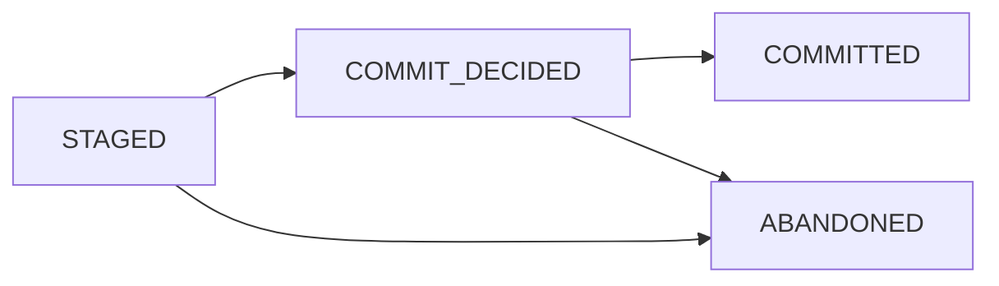

# Fluxway 架构

本文档是 [ARCHITECTURE.md](ARCHITECTURE.md) 的中文对应版本。
这两个文件描述了相同的稳定实现与协议边界。

## 运行时所有权 (Runtime ownership)

编译后的计算图是 SPMD 声明、算子身份、依赖关系、张量传输、placement 资源清单和 worker 路由的唯一事实来源。Worker 接收不可变的图投影，不重建分片（sharding）或张量身份元数据。

Controller（控制器）拥有图生命周期、placement、driver、心跳、排空（drain）、检查点编排以及故障传播的所有权。Driver 监督 worker 并转发控制命令。Worker 拥有本地执行、准入（admission）、挂起（pending）step 的生命周期、传输交付（transport delivery）以及本地执行计划的所有权。

`ExecutionLifecycle` 集中管理启动、恢复、drain/checkpoint 后的继续执行、准入交付以及故障排序。Driver 心跳仅报告就绪状态。
有关状态流和所有权表，请参阅 [分布式执行生命周期](execution_lifecycle_zh.md)。

Controller 和 Driver 状态机使用纯转移关系。转移只提交状态和失败记录，effect 在释放
锁后由唯一 lifecycle owner 执行。Source progress 只有一个带 generation 的 supervisor，
terminal cleanup 只有一个共享 future，Worker close 只有一个 release future。Ray、
checkpoint、transport 和资源释放工作不会进入状态 reducer 的临界区，因此不会制造重复
task 或占用 Controller 状态锁。

生命周期 effect 统一由 `BoundedLifecycleEffectScheduler` 执行，使用有界队列和固定 worker
明确限制容量。`ASYNC` 只用于真正的 awaitable I/O；短阻塞或释放 GIL 的调用使用固定
thread lane，可 pickle 的纯 Python CPU 工作使用 spawn 进程 lane。同一 key 严格有序，不同
key 在固定上限内并发，队列满立即抛出背压异常。结果携带 `state_revision`，owner 在发出
fact event 前丢弃过期结果。CPython 事件循环仍是单线程协作式调度，因此仅把函数声明为
`async def` 不能证明它不会阻塞。

## 连贯性与数据面 (Coherence and data plane)

端点本地的 MESI 目录（endpoint-local MESI directory）是唯一的连贯性状态拥有者。`CoherenceInstance(subject, epoch)` 是其标识；`CoherenceDirectory.admit` 是同步准入接缝，而 `CoherenceSequencer` 负责对每个 subject 的意图进行排序。目录操作是 event-loop 本地的，不持有 worker 任务或 transport 队列。

`TransportTensor` 是规范的张量 ABI。张量切片、数据帧组装（frame assembly）、批处理、路由和谱系（lineage）属于传输/数据面（transport/data-plane）层，而不是 worker 调度器。要求提供精确的 step 输入；不能用另一个 step 替代作为 fallback。

## 编译后的传输计划 (Compiled transfer plans)

`TensorTransfer.unit_routing` 声明完整单元的关联，独立于源算子。`CompiledDependency` 验证并绑定该关系；`CompiledSendPlan` 将其与普通的分片和接收路由一起降低（lowers）为执行指令。执行组（Execution groups）将物理身份与逻辑布局坐标分离。所有数据负载均使用现有的 DataPlane。参见 [传输计划](transfer_planning_zh.md)。

## 连贯性扇出发布 (Coherence fanout publication)

一个 worker 的 local step 将其完整的不可变 target-batch 元组提交给 `CoherenceBatchRetireRuntime.retire_publication()`。该 runtime 对发布实例集合执行一次准入，注册每个独有的子接收凭证（receipt），并并发启动所有 target 入队。`CoherenceSequencer` 仅保留 subject epoch 的准入和终端回收（terminal retirement）排序；它不会将同一实例的兄弟只读交付序列化。

对于 CPU/Ray 载体（carrier），接收器完成（receiver completion）意味着数据帧已被准入并存入接收器邮箱。随后接收器拥有其具体化的载体，而发布端仅在所有子结果终止之前保留生产者的出站引用。同一 worker 的别名（aliases）仍受其 consumer lease 保护。这避免了通用的可变大小环形缓冲区，并且不宣称跨进程的零拷贝。一个 target 的失败会取消未完成的兄弟目标，并通过其单一的 receipt 所有者使整个发布失败。

## 排空与恢复 (Drain and restore)

一个 `DrainBoundary` reducer 拥有已观察（observed）、已准入（admitted）、已排空（drained）和已提交（committed）的分界线（cuts）。Controller 从该 reducer 派生出 `DrainAdmission(revision, target, terminal_cut)`，并仅在控制消息和完成报告中携带它。Driver 和 Worker 在开启新的有限闸门（gate）之前会拒绝过期或冲突的准入。完成（Completion）需要注册的参与者集合和活跃的准入身份。

Controller 的修改锁仅包含状态归约，不包含 Driver RPC、源 ACK 等待或 checkpoint 取消等待。源 ACK 覆盖率在 drain 之后、checkpoint 准备之前进行检查。恢复（Restore）会重建规范的执行计划和物理绑定，应用已提交的分界线，并在该分界线处关闭 Worker 闸门来恢复模型/运行时状态。Driver `resume` 会重置 checkpoint 簿记而不清除 Worker 闸门；下一次准入将提供其有限的目标。

## 检查点事务所有权 (Checkpoint transaction ownership)

Controller/Repository 检查点协调使用 `CheckpointTransactionState`，这与 Worker 本地的 `CheckpointSaveState` 不同：

`COMMIT_DECIDED` 记录物理发布已经启动。若崩溃发生在全局 commit marker 写入之前，启动时 fencing 将调用 `abort_save(permit)` 并将记录转为 `ABANDONED`；若 commit marker 已持久化成功，启动时 fencing 将回放组件的 `acknowledge_save(permit)` 并推进事务至 `COMMITTED`。只有 `COMMITTED` 的清单（manifests）才是可恢复和可见的。Manifest 清单、事务和清理意图统一使用 MessagePack（`msgpack_codec`）二进制格式持久化，而非未紧凑的 JSON，保障低延迟元数据交互与紧凑存储。

## 放置与执行 (Placement and execution)

Placement 声明来自于编译后的 SPMD 声明和 `ResourceProfile`。`PlacementRecipe` 表达约束和字典序（lexicographic）目标，而不重复声明资源所有权。每个解出的 NodeID 映射到共享异构 placement group 中的一个复合 bundle。Ray 的 `ray.io/node-id` bundle 标签选择器在 `STRICT_SPREAD` 下固定确切的身份；IP 资源标记不是节点身份。CPU、GPU 和自定义加速器资源保留规划器（planner）选择的数量。Worker 验证其实际的 NodeID 是否符合规划。多机执行要求兼容的节点环境，启用恢复时需要共享的检查点存储库。

运行期绑定的动态资源（如动态路由表、设备网格实例或运行时 Rank Provider）由 `ResourceRegistry`（`fluxway.common.resource_registry`）统一管理，通过 `ResourceHandle(namespace, resource_id)` 引用，并在 `bind_resource_registry` 激活的上下文中动态解析。`LogicalPartitionBinding` 建立逻辑分片坐标到物理 Rank 的映射，使 Placement 和路由解耦于底层物理 Worker 编号重排。

Worker 的准入拥有者（admission owner）包含闸门（gating）和挂起状态的提升（pending-state promotion）。`SourcePipelineMaintenance.request()` 合并填充 Worker 源 step 队列的请求；`fill()` 在将工作入队之前检查运行状态、pipeline 深度、drain 边界和总 step 目标。这种队列维护不会发现数据源修订版本或发布新的摄取窗口。执行通道（execution lane）消耗其拥有的队列项，评估准入，分发计划，并完成 `task_done()`。

## 摄取布局与数据源协调 (Ingestion layout and source coordination)

`IngestionSourceAdapter` 为有界扫描请求返回不可变的 `SourceScanResult`。Controller 的
`SourceProgressSupervisor` 拥有事件驱动的扫描和 activation 发布。编译器首先创建规范分配
（由 `SourceWorkKey(epoch, step, assignment_id)` 标识），然后将它们绑定到瞬态
`WorkerLayoutDescriptor` 值中当前的读取器配额。`LogicalWorkLedger` 独自拥有租约（leases）、
ACK 边界（frontiers）和已提交的分界线（committed cuts）。Driver 激活 checkpoint 状态为空。
恢复（Restore）在应用逻辑上已提交的分界线之前重建计划和绑定。

`IngestionLayoutPlanningComponent` 拥有专用 `IOLane` 上的描述符构造和适配器扫描的所有权，并在持久的生成（spawn）进程池上进行纯编译。已接受的操作在其调用者取消后仍然存活。关闭（Close）操作拒绝新工作，合并（join）已接受的操作，并在单独的生命周期通道上合并编译器，最后关闭适配器通道。Planner 和 ledger 的发布是在所有者循环的一个区段内安装的，没有挂起；验证和安装成本仍然随窗口大小而增长。I/O 线程隔离了阻塞调用，但不解除 Python CPU 工作的 GIL 限制。

`SourceExecutionScope` 拥有 Worker 窗口的安装、活跃 step 索引和瞬态授权（transient grants）的所有权。获取（Acquisition）批量处理活跃 step 直至算子 pipeline 深度；权限返回当前信用允许的完整 step 前缀。常规的 checkpoint 继续执行（continuation）保留了该 scope。恢复（Restore）在 source 激活之前使用全新的 actor。ACK 提交使用有界的异步队列；满容量会施加反压。Controller 启动时会激活一个布局并启动来源进度生命周期；`SourceProgressSupervisor` 负责事件驱动的适配器扫描和补充，适配器本身不拥有补窗。已提交的 planning 窗口和物理绑定仍被保留，因此元数据随着安装的窗口数量而增长。
支持的协议详见 [数据源协调](source_coordination_zh.md) 和 [形式化协议](source_spmd_formal_protocol_zh.md)。

## 进程诊断与信号捕获 (Process diagnostics and signal capture)

为了可靠地归因于外部抢占、驱逐或操作系统信号造成的 worker 进程退出，Fluxway 在 `fluxway.diagnostics` 中提供了非阻塞的进程级诊断拦截：

- **Bootstrap 钩子注入**：`prepare_worker_runtime_env` 通过 Ray 的 `WORKER_PROCESS_SETUP_HOOK_ENV_VAR` 注入 `worker_process_setup_hook`，在 worker 执行前初始化信号拦截器，同时链式调用用户钩子。
- **Ray SIGTERM 拦截**：拦截 Ray 内部的 `set_sigterm_handler` 以记录先前的处理器和 Ray 自身的 SIGTERM 回调，而不改变 Ray 的卸载协议。
- **非阻塞信号传递**：信号处理器将事件入队并通过非阻塞管道 (`os.pipe2(O_NONBLOCK | O_CLOEXEC)`) 唤醒后台发射器守护线程，防止在 OS 中断上下文中死锁或阻塞 I/O。
- **保真委托**：处理器总是将信号转发给先前的处理器（`callable`，通过 `raise_signal` 的 `SIG_DFL`，或 `SIG_IGN`），保留原生进程的终止语义。
- **线程安全**：信号处理器仅安装在进程的主线程上；异步 actor worker 线程发布诊断元数据而不尝试无效的信号注册。

完整分节规范详见 [coherence_protocol_zh.md](coherence_protocol_zh.md)、[placement_recipe_zh.md](placement_recipe_zh.md)、[placement_mathematics_zh.md](placement_mathematics_zh.md)。
