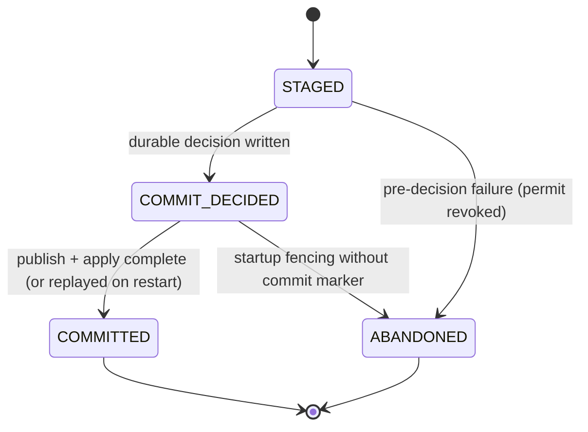

# Checkpoints

Source metadata uses canonical MessagePack through `fluxway.common.metadata`,
including opaque source cursor envelope validation and component transaction digests.
Source components participate in the same transaction as model and operator state.
The target source state is a consumption bookmark and cut-aligned logical progress;
prefetched layouts are reconstructed. These component images have one current field
set; they do not carry a Fluxway release
version or a numeric migration layer.
The global `CheckpointManifest` also has no schema version field. Its dataclass
defines the accepted root fields; decoding rejects missing or extra fields.
Physical Worker descriptors are transient. User-owned binary metadata
survives component prepare/apply/restore without conversion to text.

This encoding contract does not by itself establish continuous source recovery. The
planner accepts ordered immutable windows and excludes physical topology from
checkpoints. Workers accept contiguous published source windows; event-driven window
replenishment remains part of the source coordination contract. A serialized
cursor alone does not prove that cursor advancement and work publication were committed
at the same cut.

A checkpoint is the complete, restorable state of one Fluxway execution at one
progress cut. Its public identity is intentionally small:

```text
checkpoint_id -> component_id -> checkpoint_object_id
```

`checkpoint_id` identifies the whole published checkpoint. `component_id`
identifies the subsystem that owns state, such as `dense`, `reader`, or
`embedding`. A component that writes more than one independently restorable
object gives each one a `checkpoint_object_id`. A single-object component uses
`"state"` by default.

Fluxway owns the checkpoint transaction, progress cut, topology, checkpoint
references, and cleanup decisions. A component owns serialization, physical
storage, restore mapping, and physical cleanup. This keeps Fluxway independent
of filesystems, object stores, Lance, catalogs, and data formats.

The checkpoint root directory is managed by `CheckpointDirectory` (`fluxway.control_plane.checkpointer.directory`).
It can be pre-created externally or created automatically by Fluxway via `CheckpointDirectory.open()`.
It must be a regular directory and cannot be a symlink. When Fluxway creates a new root directory, it writes the
`CHECKPOINT_ROOT_MARKER` (`.fluxway-checkpoint-root`) ownership marker containing `fluxway-checkpoint-root\n`.
Opening an existing unmarked directory does not add a marker or claim ownership. If an existing directory contains this
marker, it must be a regular, non-symlink file with a valid format; any mismatch raises `CheckpointDirectoryOwnershipError`.
Destructive cleanup via `CheckpointDirectory.clear()` strictly validates ownership before removing the
directory to prevent accidental deletion of unmanaged paths.

Manifest records, cleanup intents, transactions, and references are serialized to disk using compact binary MessagePack
via `msgpack_codec` (`packb(..., use_bin_type=True)` and `unpackb(...)`) rather than uncompacted JSON, ensuring fast
metadata reads and bounded coordinator storage overhead. Unknown marker contents and old manifest fields fail; opening a
repository does not migrate its files.

## Saving and restoring

Checkpoint publication is coordinated by one durable decision record named
`CheckpointTransactionState`. This Controller/Repository state machine is
separate from the Worker-local `CheckpointSaveState`.
The manifest is staged first; it is not visible to restore until the commit marker
is written.

Fluxway uses a **fail-stop protocol** with four canonical transaction states:



`COMMIT_DECIDED` records that physical checkpoint publication has started.
If a crash occurs before the global commit marker (`committed.<checkpoint_id>`) is written,
startup fencing invokes `abort_save(permit)` on registered components and moves the record
to `ABANDONED`; physical artifacts are left for GC. If the global commit marker has already been
written, the checkpoint commit is logically decided and complete; startup fencing replays
`acknowledge_save(permit)` with the persisted permit and advances the transaction to `COMMITTED`.
Only `COMMITTED` records enter `latest`, reference resolution, retention cleanup, and restore.

The checkpointer creates one monotonic deadline for each global snapshot and
passes it to all participant invocations in parallel. A custom Controller implementation
that does not accept the `deadline` parameter violates the current snapshot protocol; dropping the parameter or retrying without it is not a valid fallback.

The sparse-embedding integration exposes `load_optimizer_state` as an explicit
training-restore option. It is passed directly to the sparse storage adapter;
`true` requires an optimizer-enabled target store, while `false` restores only
embedding values. Inference does not use the training component: it creates an
optimizer-disabled sparse store and loads a weight snapshot.

For continued sparse training, register the optimizer state with the embedding
state. Optimizer restore defaults to `True`; the explicit form is:

```python
from fluxway.integrations.sparse_embedding.checkpoint import (
    LocalLanceStorageFactory,
    SparseEmbeddingCheckpointComponent,
)

embedding_checkpoint = SparseEmbeddingCheckpointComponent(
    LocalLanceStorageFactory(),
    load_optimizer_state=True,
).registration()
```

Pass this registration through `@spmd(checkpoint_components=(embedding_checkpoint,))`.
The operator owner exposes its native embedding store as `store`. Compare restored
state by logical key and dimension; physical page IDs and slots can change during
elastic restore. Restoring weights without Adam moments and update steps does not
restore the same training state.

If a failure occurs **before** `COMMIT_DECIDED` (including deadline timeout),
the attempt is immediately fenced: the `CheckpointCommitPermit` is revoked,
logical visibility is prevented, and the transaction transitions to `ABANDONED`.
Physical cleanup of staging artifacts and uncommitted storage fragments is
deferred to GC; it is not a correctness requirement.

```mermaid
flowchart LR
    A[Capture immutable state envelope] --> B[Prepare all participants]
    B --> C[Stage manifest + decision record]
    C --> D[Write COMMIT_DECIDED]
    D --> E[Publish worker artifacts]
    E --> F[Apply Controller tokens]
    F --> G[Write COMMITTED marker]
    G --> H[Acknowledge component save]
    H --> I[Complete transaction -> COMMITTED]
```



Participant preparation performs all fallible validation. Apply is a validated
in-memory state swap and does not reserialize checkpoint state. This keeps the
global transaction seam explicit while retaining source-neutral component
ownership.

### Execution ownership and shutdown

The Controller owns checkpoint orchestration and in-memory participant transitions.
`prepare_checkpoint_transaction` and `apply_prepared_checkpoint_transaction` run on
its event loop. Storage operations never mutate Controller ledger state or wake its
asyncio waiters from a foreign thread.

Each checkpointer owns a `CheckpointRepositorySession` with a dedicated I/O event
loop and thread. Directory opening, coordinator-generation claims, manifest and
transaction operations, restore queries, and retention metadata use this session.
The session serializes repository metadata operations with one in-flight slot;
it does not carry tensor payloads or share the caller's default executor. Pure
Python planning and user computation are outside this I/O resource's contract.

Internal coordinators are created with
`await FluxwayCheckpointer.create(controller, repository_dir, interval_steps=...)`.
`latest()` and `list_steps()` are also awaited. Applications normally configure
checkpointing through the graph runtime, which creates and closes the coordinator.

Cancelling a repository operation's waiter leaves the accepted operation owned by
the session until completion. Its capacity is released only at completion. A failure
after waiter cancellation is retained and raised by subsequent submissions or close;
a failure delivered to a live waiter can be handled by transaction compensation.

`close()` fences new saves, waits for the active save, joins cleanup operations,
closes component resources, and stops and joins the repository thread. Cancelling a
close waiter does not cancel that cleanup; awaiting `close()` again observes the
same result. Completed cleanup failures remain observable even after their tasks
leave the running-task set.

This ownership isolates repository I/O scheduling and executor capacity. It does
not provide a hard latency bound for GIL-holding serialization, native global locks,
or shared storage hardware, and does not specify component-internal executors.

Use `SaveCheckpointRequest.for_step(step)` for normal synchronous training.
It creates a unique save attempt, a step cut, and the step reference. Add names
when a checkpoint should also be selected as `best_model`, `final`, or another
application name.

```python
manifest = await checkpointer.save(
    SaveCheckpointRequest.for_step(1200, names=("best_model",))
)

await checkpointer.restore_step(1200)
await checkpointer.restore_named("best_model")
await checkpointer.restore_latest()
```

A step reference is a convenient lookup, not a storage-path convention. The
filesystem components happen to create a readable `steps/<step>/...` layout;
other components may store the same checkpoint in a catalog or object store.
Restore always resolves the published manifest, so it never needs a physical
path from application code.

For a non-step execution, construct `SaveCheckpointRequest` with a
`CheckpointCut` containing stream cuts and a named reference. The cut is the
only progress fact in the manifest.

### Durable position and transient execution

The runtime meaning of the cut is a `position`: the single boundary at
which every operator's persisted cursor is defined. `CheckpointCut.position` is
the manifest's canonical value; each SPMD runtime projection stores the same
value as `drain_boundary.committed_cut`, and publication rejects any mismatch.
Reader cursors,
virtual-interleave units, and model update counts may use different coordinate
systems; each component maps the durable position to its own checkpoint state.

Worker execution cursors, mailbox entries, coherence leases, ready queues, and
credit observations are transient. Drain makes the durable position quiescent;
save records that position, and restore starts a new empty execution runtime at
it. No mailbox/coherence generation or credit-reset restore API is part of the
checkpoint contract.

### Source elasticity and exactly-once

Source checkpointing is defined over logical output positions, not over a
reader class, physical rank, or iterator implementation. A source component
must persist state that reconstructs its output at the durable
`CheckpointCut.position`; the checkpointer only applies the component SPI and
does not inspect or special-case the reader. For a `GLOBAL_RESHARD` component,
the restored state is topology-independent and the current virtual owner is
derived from the current `(position, world_size, interleave_unit_size)`.

This gives the checkpoint-relative invariant
`Committed = [0, position)` and `Replay = [position, ...)`, with an empty
intersection, even when the number of virtual-interleave workers changes.
Internal reader records or batches are outside Fluxway's inference boundary;
their mapping to logical output positions belongs to the source component's
state contract.

## Component SPI and Capability Composition

`CheckpointComponent` only supplies the descriptor. Runtime behavior is
composed from independent SPI contracts; a component does not need to expose
every contract.

```python
class MyComponent(
    CheckpointComponent,
    CheckpointComponentLifecycle,
    CheckpointComponentFinalize,
    CheckpointComponentSave,
    CheckpointComponentRestore,
):
    @property
    def descriptor(self) -> CheckpointComponentSpec: ...

    async def open(self, runtime): ...
    async def close(self): ...
    async def finalize_save(self, session): ...
    async def prepare_save(self, session): ...
    async def save(self, session) -> WorkerSaveResult: ...
    async def finish_save(self, session): ...
    async def commit_save(self, session) -> CheckpointComponentPublication: ...
    async def rollback_save(self, session): ...
    async def publish_save(self, session): ...
    async def abort_save(self, permit): ...
    async def acknowledge_save(self, permit): ...
    async def restore(self, session): ...
```

The six capability names map directly to the six SPI contracts:
`COMPONENT_LIFECYCLE` (`open`/`close`), `FINALIZE` (`finalize_save`), `SAVE`, `RESTORE`,
`OBJECT_LIFECYCLE` (holds and cleanup reservations), and `OBJECT_CLEANUP`
(`cleanup`). `SAVE` is one atomic transaction contract; its phases are not
independent capabilities. `commit_save` creates the component publication;
`publish_save` runs on each worker after the commit decision and before the global
committed marker. `rollback_save` also requires a live worker session. Control
recovery calls `abort_save(permit)` before the marker, or
`acknowledge_save(permit)` after it, with the original persisted permit. Both
control phases must be idempotent and propagate failures so the transaction stays
retryable. Built-in filesystem components group payloads by attempt ID so
control cleanup can remove every rank without reconstructing a worker session.

### Worker Transaction: FINALIZING vs PREPARED

The worker transaction separates **in-memory algorithm canonicalization** from **storage resource allocation**:

```text
WorkerCheckpointCoordinator.prepare_save()
  │
  ├─ 1. FINALIZING Stage (CheckpointComponentFinalize.finalize_save)
  │      └─ In-memory model canonicalization (e.g., flush partial gradient accumulation)
  │         [Scope: ALL_RANKS, Semantics: Fail-Stop, Storage I/O: None]
  │
  ├─ 2. Storage Staging Stage (CheckpointComponentSave.prepare_save)
  │      └─ Staging path / lease reservation (e.g., mkdir, storage lock)
  │         [Scope: LEADER / ALL_RANKS, Semantics: Rollbackable, Storage I/O: Yes]
  │
  ├─ 3. State -> PREPARED
  │
  ▼  [Driver SPMD-Local Barrier: Driver waits for all ranks to reach PREPARED]
SAVING Stage (CheckpointComponentSave.save)
  └─ Concurrent serialization & fragment upload (memory is 100% frozen and clean)
```

| Dimension | FINALIZING Stage (`finalize_save`) | PREPARED Stage (`prepare_save`) |
| :--- | :--- | :--- |
| **Target Object** | Local RAM / VRAM / Optimizer moments | Disk staging directory / Cloud storage path / Lease |
| **Execution Scope** | Mandatory `ALL_RANKS` (every worker) | Configurable `LEADER` (Rank 0) or `ALL_RANKS` |
| **Failure Semantics** | **Fail-Stop** (`SNAPSHOT_FAILED -> ERROR`) | **Rollbackable** (abort & delete staging directory) |
| **Primary Duty** | Canonicalize dynamic runtime state into frozen state | Allocate physical storage resources |
| **Storage I/O** | None | Yes |

`FINALIZE` canonicalizes worker-local algorithm state before that worker's
storage component reserves staging or writes bytes. It runs on every worker rank,
regardless of a `SAVE` component's leader-only scopes. This is the extension
point for a drained training runtime that must apply a partial accumulation
window before serializing model state. It must not perform storage I/O, and a
failure is fail-stop because an implementation may have mutated local state.

The worker transaction order is:
```text
FINALIZING -> all local FINALIZE -> SAVE.prepare -> PREPARED -> SAVE.save -> SAVE.finish -> SAVE.commit -> SAVE.publish
```
The Driver waits for all ranks to reach `PREPARED` before `SAVE.save`; no Controller-wide finalize phase exists or is required.

### Layered API Architecture

Fluxway enforces a strict separation of concerns across developer personas so business users are never exposed to internal coordinator state machines:

```text
┌──────────────────────────────────────────────────────────────────────────┐
│ Level 1: Business & Model Author (95% of Users)                          │
│ DX: Zero state machine concepts. Implement simple Python callables.      │
│ e.g., OrbaxCheckpointComponent(..., finalize_state=flush_fn)             │
└────────────────────────────────────┬─────────────────────────────────────┘
                                     │ Direct capability dispatch
                                     ▼
┌──────────────────────────────────────────────────────────────────────────┐
│ Level 2: Storage Plugin Author (5% of Users)                             │
│ DX: Implement CheckpointComponentSave / CheckpointComponentFinalize SPIs │
└────────────────────────────────────┬─────────────────────────────────────┘
                                     │ Internal transactional state guards
                                     ▼
┌──────────────────────────────────────────────────────────────────────────┐
│ Level 3: Fluxway Core Engine (Coordinator / Orchestrator)                │
│ DX: FINALIZING, PREPARED, SAVING, COMMITTED defensive state assertions   │
└──────────────────────────────────────────────────────────────────────────┘
```

Register each implemented SPI explicitly. The registration's non-null SPI
fields are the only source of truth for `registration.capabilities`:

```python
registration = CheckpointComponentRegistration(
    component=component,
    component_lifecycle=component,
    finalize=component,
    save=component,
    restore=component,
)
```

All stable authoring imports live in `fluxway.checkpoint`.

`SaveSession` is passed to worker-side save methods. It contains the component
instance, `checkpoint_id`, save attempt, commit permit, progress cut, SPMD,
rank, source topology, and component identity. `CommitSaveSession` adds every
worker's `WorkerSaveResult`. `RestoreSession` contains the selected checkpoint,
the saved topology, current topology, and the `CheckpointComponentPublication` to restore.

Use session helpers instead of building manifest records by hand:

```python
async def save(self, session):
    staging = await self.storage.write(session.instance)
    return session.worker_save_result(staging)

async def commit_save(self, session):
    locator = await self.storage.commit(
        session.worker_results,
        session.commit_authority("embedding"),
    )
    state = session.checkpoint_object_ref(
        "state", locator.version_id, locator.to_bytes()
    )
    return session.component_checkpoint((state,))
```

`storage_locator` is opaque bytes. Fluxway stores it and passes it back at
restore or cleanup, but never decodes it. A user-side integration adapter may
translate it to a filesystem location, a catalog version, or a storage-specific
locator. The returned `CheckpointObjectRef` is the manifest's logical record of
that saved object. Fluxway does not import the integrated component's package, and the
integrated package does not import Fluxway.

For small manifest-only state such as a reader cursor, use the convenience
factory. It has no physical checkpoint object and therefore no physical cleanup
policy.

```python
from fluxway.checkpoint import state_checkpoint_component

reader = state_checkpoint_component(
    "reader",
    save=lambda reader, session: reader.save_checkpoint_state(session),
    restore=lambda reader, state, session: reader.restore_checkpoint_state(state),
)
```

Use `WorkerLocalCheckpointComponent`, `SafeTensorsCheckpointComponent`, or
`OrbaxCheckpointComponent` when state belongs in physical storage. `OrbaxCheckpointComponent`
persists collective shared global nested PyTrees (`model_state` and `opt_state`) using
native `ocp.args.StandardSave(state)` and declares `GLOBAL_RESHARD`. Rank-private state (such as
input reader cursors, local RNG, or per-worker metrics) must be registered under
`WorkerLocalCheckpointComponent` with `EXACT_TOPOLOGY`.

For large-scale sparse tables in recommendation models, `SparseEmbeddingCheckpointComponent`
(`fluxway.integrations.sparse_embedding`) provides native table persistence:
- **Storage backends**: `LocalLanceStorage` (`LocalLanceStorageFactory`) for local disk or shared POSIX storage, and `GravitinoLanceStorage` (`GravitinoLanceStorageFactory`) for Apache Gravitino-managed lakehouse catalogs.
- **Topology elasticity**: Declares `RestoreTopologyMode.LOGICAL_PARTITION_REMAP` and uses `LogicalPartitionBinding` to remap table shards when worker counts scale up or down.
- **Compaction**: Fragments can be compacted off the training critical path using `compact_sparse_checkpoints(repository_root, spmd_id, lineage_name=...)`.

## Component registration and cleanup

A Fluxway-managed artifact with finite `CheckpointRetentionPolicy(retain_last=N)`
must have cleanup capabilities for every component that owns physical objects.
Registration fails when those capabilities are absent; there is no silent no-op
cleanup mode. Retention is configured on `CheckpointConfig` (the default policy or
`retention_domains` mapping), never on an individual `CheckpointObjectSpec`.

Retention is owned by Fluxway at restore-artifact scope. All required objects that
make up one restorable artifact share the policy selected on `CheckpointConfig`; component
registrations expose only object identity, restore requirements, and storage capabilities.
Components may optionally declare a `retention_domain`; `CheckpointConfig` resolves every
domain to a policy through one retention coordinator. Required objects in one restorable
artifact may not be evicted independently across domains.
Orbax integration uses the low-level `ocp.Checkpointer` for state I/O. Orbax
`CheckpointManager` history deletion must not be enabled alongside Fluxway
retention, because it cannot coordinate sparse objects, Fluxway leases, manifests,
or cross-component cleanup intents. Physical deletion is initiated only by the
Fluxway retention coordinator.

Custom components may own serialization and read/write I/O, but they must choose
an explicit lifecycle mode. In `FLUXWAY_MANAGED` (the default for restorable
checkpoints), the component exposes `CheckpointObjectLifecycle` and performs
deletion only from Fluxway's durable cleanup reservation in the maintenance
lane. Fluxway remains the sole retention/deletion owner. A component that keeps
its own deletion/catalog protocol must opt into `EXTERNAL_MANAGED`; Fluxway then
stores only an opaque locator and does not claim automatic retention, cleanup, or
ordinary `latest`/`StepReference` restore semantics. It cannot be silently
downgraded to permanent retention. Enabling a provider's independent history
cleanup (for example Orbax `CheckpointManager`) alongside Fluxway is forbidden.

```python
CheckpointComponentSpec(
    component_id="dense",
    save=CheckpointSaveSpec(),
    restore=CheckpointRestoreSpec(),
    checkpoint_objects=(
        CheckpointObjectSpec("model_state"),
        CheckpointObjectSpec("optimizer_state"),
    ),
)
```

Retention is evaluated from declared checkpoint objects, but eviction is at
the complete restore-artifact boundary. The component returns one logical
`version_id` for all physical partitions of an object; `partition_key`
distinguishes those partitions and is not a worker rank. Fluxway never evicts a
manifest unless every required restore object in that artifact is covered by
the same durable cleanup intent.

A `CheckpointHold` protects one live checkpoint object while another consumer
reads it. Holds are shared read protection, not locks. They are persistent,
generation-checked, and expire unless renewed. A named reference such as
`best_model` is kept forever until the name moves to a newer checkpoint.

When a finite policy has excess versions, Fluxway selects candidates by
checkpoint sequence. The component atomically reserves eligible versions,
checks holds, and then cleans physical state after the new manifest is
published. A held candidate prevents publication with `CheckpointCleanupBlocked`.
A cleanup failure leaves a durable `CheckpointCleanupIntent` and is retried by
`repair_cleanup_intents()`; it is never treated as successful. One intent is
the complete restore artifact and contains all provider reservations required
to remove it. Cleanup runs in the control maintenance lane, independent of
worker topology and training-step latency.

## Commit permits

Each save has three different identities:

- `checkpoint_id`: the published checkpoint;
- `attempt_id`: this request to save;
- `CheckpointCommitPermit`: authority for the current coordinator to publish
  that attempt.

Fluxway persists coordinator generations. Taking over a repository invalidates
older permits. Components receive the permit in every save-side session and can
pass `session.commit_authority(scope)` to a storage system with its own CAS or
commit authority. A permit token is never written to the manifest. Restore and
`close()` do not need a permit.

Fail-stop enforcement: when `_save()` times out or errors before
`COMMIT_DECIDED`, calling `abandon_transaction` atomically revokes the permit
and transitions the record to `ABANDONED`. Any delayed background thread that
finishes its I/O and tries to call `decide_transaction` finds the permit
already gone and raises `PermissionError`, preventing it from mutating the
repository after cancellation.

## Topology

The manifest records source topology. Restore receives both source and current
topologies. A component explicitly chooses one `RestoreTopologyMode`:

- `RestoreTopologyMode.EXACT_TOPOLOGY` (`"exact_topology"`): requires identical rank count and worker assignments, used for rank-local iterator or process state;
- `RestoreTopologyMode.LOGICAL_PARTITION_REMAP` (`"logical_partition_remap"`): preserves canonical logical partition IDs and uses `LogicalPartitionBinding` to map them to the active physical workers (e.g. sparse embedding table partitions);
- `RestoreTopologyMode.GLOBAL_RESHARD` (`"global_reshard"`): collective shared state (e.g. Orbax standard tensors) automatically resharded across the new mesh.

Fluxway never guesses a partition function or silently copies rank-local state.
The user-side adapter supplies any component-specific restore policy.

### Component-owned runtime contracts

Fluxway's checkpoint controller remains backend-neutral. Backend-specific components validate their own runtime prerequisites. The Orbax component requires one initialized JAX process per SPMD rank when the saved topology has multiple ranks; a single-rank topology uses single-process Orbax I/O. A multi-rank topology with an uninitialized or mismatched JAX process group fails during component save preparation instead of silently degrading to a rank-one writer.


## Canonical logical ownership

`SourceWorkKey(epoch, step, assignment_id)` identifies canonical logical work.
Physical segments carry independent interval leases. ACK confirms only the leased
interval; candidate cut advances over consecutive fully acknowledged steps.
Only the coordinated checkpoint transaction advances committed cut.

The restore contract saves the source-owned consumption bookmark, source
binding and logical progress at the shared model cut. Restore validates the binding
and logical batch size, then replans and prefetches using current window limits and
reader topology. Window digests, pending prefetch buffers, leases and ACK caches are
not durable source state. Stateful operators retain everything needed to reproduce
their future output. New lease IDs fence delayed acknowledgements.

The planner persists a consumption bookmark and the ledger persists logical progress
at the shared cut. Old windows, leading watermarks, leases and prefetch buffers are
recreated during restore. The source, model and optimizer components participate in the
same checkpoint transaction; their individual state mappings remain component-owned.

Driver activation checkpoint state is empty.
Controller restore installs source bookmarks and the shared logical cut
before publishing newly planned segments. Workers read acquired assignment intervals.
Restore uses fresh Workers: topology readiness precedes restore, and explicit
execution activation follows it. Source layout installation and per-cut admission
are separate authorizations. See [execution lifecycle](execution_lifecycle.md) for
start, cancellation and continuation examples. The startup API starts the source
lifecycle; the controller's event-driven `SourceProgressSupervisor` performs adapter
scans and window refill. Each checkpoint component defines the topology changes it
accepts; a source ledger proof alone cannot establish model convergence or transport
performance.
