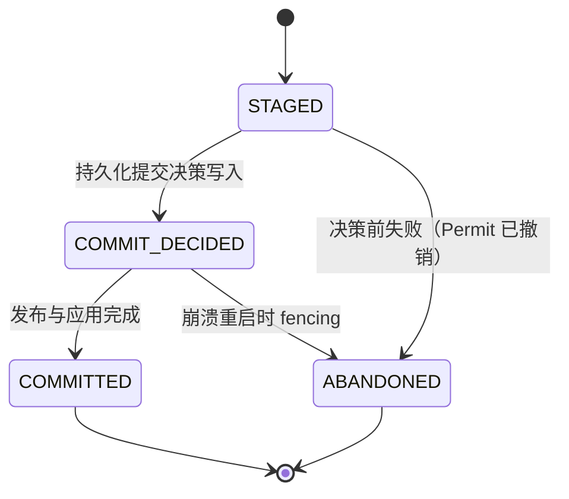

# Checkpoints（快照与恢复）

Source metadata 通过 `fluxway.common.metadata` 使用 canonical MessagePack，
包括 catalog cursor 校验和组件事务摘要。Planner checkpoint 第 2 版保存 canonical
request、待拼接尾部及编码 cursor；logical ledger 第 3 版保存 immutable epoch digest
和 committed cut。物理 Worker descriptor 为瞬态。用户二进制 metadata 经组件
prepare/apply/restore 后保持不变。

编码契约不等于连续读取恢复保证。Planner 接受有序不可变窗口，checkpoint 不保存物理
topology。Worker 接收已经发布的连续 source window；checkpoint API 不负责自动 adapter 补窗。
流式与 resharding 限制见 [Source 协调协议](source_coordination_zh.md)。能够序列化
cursor，不能证明 cursor 推进与 work 发布已经在同一个 cut 上提交。

快照（Checkpoint）是 Fluxway 在某一确定进度切面（Progress Cut）上的完整、可恢复状态。其公开标识（Public Identity）保持极简设计：

```text
checkpoint_id -> component_id -> checkpoint_object_id
```

* `checkpoint_id`：全局唯一标识一次已发布的快照事务；
* `component_id`：标识拥有该状态的子系统或组件，例如 `dense`、`reader` 或 `embedding`；
* `checkpoint_object_id`：当一个组件需要写入多个独立恢复的对象时用于区分。单对象组件默认使用 `"state"`。

Fluxway 拥有并裁决快照事务、进度切面（Cut）、拓扑结构、快照引用以及物理清理决策；而具体组件则负责序列化、物理存储、恢复映射以及物理清理执行。这种解耦使得 Fluxway 核心完全独立于具体的文件系统、对象存储、Lance 存储引擎、元数据 Catalog 及数据格式。

---

## 1. 保存与恢复（Saving & Restoring）

检查点发布由名为 `CheckpointTransactionState` 的持久化全局决策协调。
它属于 Controller/Repository 层，和 Worker 本地的 `CheckpointSaveState`
完全不同。Manifest 先进入 staged 状态，只有
写入 committed marker 后才对恢复可见。

Fluxway 采用 **Fail-Stop 协议**，共四个规范事务状态：



`COMMIT_DECIDED` 仅表示物理写入已经启动但尚未完成，并不是可重放的提交承诺。
进程崩溃会丢失组件 session、内存协调器和待发布上下文，因此无法重放发布操作。
重启时 Fluxway 对所有 `STAGED` 与 `COMMIT_DECIDED` 记录统一 fence 并转为
`ABANDONED`；物理产物交给 GC。只有 `COMMITTED` 记录才能进入
latest、引用解析、保留清理和恢复流程。

每次最新全局 snapshot 包含 `latest` alias、各引用、保存保留清理以及恢复流程。

Checkpointer 为每个全局 snapshot 生成单调 deadline，并按 Controller
snapshot 协议传递。自定义的 Controller 实现必须接受 `deadline` 参数，否则将违反当前
协议；忽略该参数或不带参数重试不是有效的回退机制。

Sparse embedding 集成将 `load_optimizer_state` 作为显式训练恢复选项，原样传给
sparse storage adapter。`true` 要求目标表启用 optimizer；`false` 只恢复 embedding
权重。推理不使用训练 checkpoint component，而是创建禁用 optimizer 的 sparse
store 并加载 weight snapshot。

继续 sparse 训练时，embedding 和 optimizer state 应由同一组件保存恢复。
Optimizer restore 默认为 `True`，显式注册方式如下：

```python
from fluxway.integrations.sparse_embedding.checkpoint import (
    LocalLanceStorageFactory,
    SparseEmbeddingCheckpointComponent,
    modulo_partition,
)

embedding_checkpoint = SparseEmbeddingCheckpointComponent(
    modulo_partition,
    LocalLanceStorageFactory(),
    load_optimizer_state=True,
).registration()
```

通过 `@spmd(checkpoint_components=(embedding_checkpoint,))` 传入注册对象。
算子 owner 的 `store` 属性提供 native embedding store。恢复状态应按逻辑 key
和维度比较；elastic restore 可以改变物理 page ID 和 slot。只恢复权重而不恢复
Adam moments 和 update step，不等于恢复了相同的训练状态。

若失败发生在 `COMMIT_DECIDED` **之前**（含 deadline 超时），本次尝试
立即被 fence：`CheckpointCommitPermit` 撤销，逻辑可见性永久阻断，
事务转为 `ABANDONED`。Staging 产物与未提交存储 fragment 的物理清理
延迟到 GC 处理，不是正确性前提。


参与者在 prepare 阶段完成所有可能失败的校验；apply 阶段只做已验证的内存
状态交换，不重新序列化检查点状态。

对于常规的同步训练任务，使用 `SaveCheckpointRequest.for_step(step)` 发起快照。它会自动创建唯一的保存尝试（Attempt ID）、Step 切面以及对应的 Step 引用。当某个快照需要同时被标记为 `best_model`、`final` 等别名时，可通过 `names` 指定：

```python
manifest = await checkpointer.save(
    SaveCheckpointRequest.for_step(1200, names=("best_model",))
)

await checkpointer.restore_step(1200)
await checkpointer.restore_named("best_model")
await checkpointer.restore_latest()
```

Step 引用是一种便捷的检索索引，而非强制的物理路径约定。文件系统组件通常会生成易读的 `steps/<step>/...` 目录结构，而其他组件亦可将同一快照持久化到 Catalog 或对象存储中。恢复时始终通过解析已发布的全局 Manifest 进行，应用层代码无需提供任何物理存储路径。

对于非纯 Step 驱动的流式计算任务，可构造带有 `CheckpointCut`（包含流切面与命名引用）的 `SaveCheckpointRequest`。切面是 Manifest 中唯一的全局进度事实。

### 持久化位点与瞬态运行状态（Durable Position & Transient Execution）

Cut 在运行期的核心语义是 `position`（全局持久化位点）：即所有算子持久化游标所对齐的单一确定边界。`CheckpointCut.position` 是 Manifest 的权威值；每个 SPMD 运行期投影将其记录为 `drain_boundary.committed_cut`，发布阶段将拒绝任何不一致的位点。Reader 消费游标、虚拟交错（Virtual-Interleave）单元以及模型更新步数可能采用不同的局部坐标系，各组件负责将持久化位点映射为自身的快照状态。

Worker 的运行期游标、Mailbox 邮箱、一致性租约（Coherence Leases）、Ready 就绪队列以及 Credit 观察值均属于**瞬态状态（Transient State）**。Drain 操作负责使持久化位点达到静止；Save 记录该静止位点；Restore 则在恢复时于该位点启动全新的空运行期环境。没有任何瞬态邮箱/一致性代际或信用重置属于快照契约的暴露接口。

### 数据源弹性与 Exactly-Once 语义

数据源（Source）快照定义在逻辑输出位点之上，而非绑定于具体的 Reader 类、物理 Rank 或迭代器实现。Source 组件持久化的状态必须能够精确重构其在 `CheckpointCut.position` 处的输出；Checkpointer 仅调用通用的组件 SPI，不对 Reader 进行任何特殊感知。对于 `GLOBAL_RESHARD` 组件，恢复状态与物理拓扑无关，当前的虚拟拥有者由 `(position, world_size, interleave_unit_size)` 动态推导。

这保证了快照相关的严格不变式：
$$\text{Committed} = [0, \text{position}) \quad \text{与} \quad \text{Replay} = [\text{position}, \infty)$$
两者交集严格为空，即使虚拟交错 Worker 的数量在恢复后发生改变依然成立。内部 Reader 的分批逻辑位于 Fluxway 的黑盒边界之外，其到逻辑输出位点的映射属于 Source 组件自身的状态契约。

---

### 执行归属与关闭顺序

Controller 拥有 checkpoint 编排和参与者的内存状态转换。
`prepare_checkpoint_transaction` 与 `apply_prepared_checkpoint_transaction`
在其事件循环执行。存储操作不得从其他线程修改 Controller ledger，或唤醒其 asyncio 等待者。

每个 Checkpointer 持有一个 `CheckpointRepositorySession`，拥有独立的 I/O
事件循环和线程。目录打开、coordinator generation 申请、manifest 与事务记录操作、
恢复查询及 retention 元数据读写均使用该会话。仓库元数据使用一个在途槽位保证串行顺序；
这个槽位不承载 tensor payload，也不共享调用方的默认 executor。
纯 Python 规划和用户计算不属于该 I/O 资源的职责。

内部协调器通过
`await FluxwayCheckpointer.create(controller, repository_dir, interval_steps=...)`
创建，`latest()` 与 `list_steps()` 也必须等待。应用通常通过图运行时配置 checkpoint，
由运行时创建并关闭协调器。

取消仓库操作的等待者后，已接收操作仍由会话持有直到结束，容量也只在结束时释放。
等待者取消后发生的异常会被保留，并由后续提交或关闭报告；已经交付给活跃等待者的异常，
则允许事务补偿继续使用该通道。

`close()` 先拒绝新保存事务，等待正在执行的保存，再收拢 cleanup、关闭组件资源，
最后停止仓库事件循环并等待线程退出。取消关闭等待者不会取消资源回收；
再次等待 `close()` 会观察同一个结果。后台 cleanup 即使已经退出运行任务集合，
其失败仍由生命周期持有并报告。

这层归属隔离的是仓库 I/O 调度和 executor 容量，不提供针对持有 GIL 的序列化、
原生全局锁或共享存储硬件的硬延迟保证，也不规定组件内部 executor 的实现。

## 2. 组件 SPI 与能力正交组合（Capability Composition）

`CheckpointComponent` 仅提供元数据描述符（Descriptor）。运行期行为由相互独立的正交 SPI 契约组合而成；组件无需暴露所有契约。

```python
class MyComponent(
    CheckpointComponent,
    CheckpointComponentLifecycle,
    CheckpointComponentFinalize,
    CheckpointComponentSave,
    CheckpointComponentRestore,
):
    @property
    def descriptor(self) -> CheckpointComponentSpec: ...

    async def open(self, runtime): ...
    async def close(self): ...
    async def finalize_save(self, session): ...
    async def prepare_save(self, session): ...
    async def save(self, session) -> WorkerSaveResult: ...
    async def finish_save(self, session): ...
    async def commit_save(self, session) -> CheckpointComponentPublication: ...
    async def rollback_save(self, session): ...
    async def publish_save(self, session): ...
    async def restore(self, session): ...
```

六大能力名称与六大 SPI 契约严格一一对应：
1. `COMPONENT_LIFECYCLE` (`open` / `close`)：组件资源生命周期；
2. `FINALIZE` (`finalize_save`)：本地运行态向规范静态的结清收敛；
3. `SAVE`：原子保存事务（`prepare` -> `save` -> `finish` -> `commit` -> `rollback` -> `publish`）；
4. `RESTORE` (`restore`)：状态加载与重构；
5. `OBJECT_LIFECYCLE`：快照对象的读取租约保护（Holds）与清理预留；
6. `OBJECT_CLEANUP` (`cleanup`)：物理快照废弃与垃圾回收。

---

## 3. Worker 事务生命周期：FINALIZING 与 PREPARED 的本质区别

在 Worker 内部，`WorkerCheckpointCoordinator.prepare_save()` 严格将 **内存算法状态规范化** 与 **外部存储资源预留** 分离：

```text
WorkerCheckpointCoordinator.prepare_save()
  │
  ├─ 1. FINALIZING 阶段 (CheckpointComponentFinalize.finalize_save)
  │      └─ 本地内存/显存模型规范化 (例如: 结清未满窗口的残余累积梯度)
  │         [执行范围: ALL_RANKS, 故障语义: Fail-Stop 强停, 存储 I/O: 无]
  │
  ├─ 2. 存储 Staging 预留阶段 (CheckpointComponentSave.prepare_save)
  │      └─ 创建临时 Staging 目录 / 预留云存储租约 (例如: mkdir, 排他锁)
  │         [执行范围: LEADER 或 ALL_RANKS, 故障语义: 可回滚, 存储 I/O: 有]
  │
  ├─ 3. 状态转为 PREPARED
  │
  ▼  [Driver SPMD-Local 屏障: 等待本 SPMD 内所有 Rank 全部达到 PREPARED]
SAVING 阶段 (CheckpointComponentSave.save)
  └─ 并发序列化并上传分片 (此时所有 Worker 显存/内存已 100% 冻结且自洽)
```

### 关键维度深度对比

| 评估维度 | FINALIZING 阶段 (`finalize_save`) | PREPARED 阶段 (`prepare_save`) |
| :--- | :--- | :--- |
| **操作对象** | 本地显存 / 内存 / 优化器一二阶动量 | 磁盘 Staging 目录 / 对象存储 Bucket / 租约 |
| **执行范围 (Scope)** | **必须为 `ALL_RANKS`**（全节点参与） | 可配置为 `LEADER`（仅 Rank 0）或 `ALL_RANKS` |
| **故障语义 (Failure)** | **Fail-Stop 强停**（`SNAPSHOT_FAILED -> ERROR`） | **可安全回滚**（Abort 并删除临时 Staging 目录） |
| **核心职责** | 将动态运算态（在途梯度）结清为静止规范态 | 为落盘数据预留物理存储资源与坑位 |
| **存储 I/O** | **绝对无存储 I/O** | 包含文件系统与远端网络 I/O |

* `FINALIZE` 必须在任何存储组件创建目录或写入字节前执行。它是已 Drain 的训练运行期在序列化模型之前应用**部分累加窗口（Partial Accumulation Window）**的标准扩展点；
* 完整 Worker 事务顺序为：
  ```text
  FINALIZING -> 所有本地 FINALIZE -> SAVE.prepare -> PREPARED -> SAVE.save -> SAVE.finish -> SAVE.commit -> SAVE.publish
  ```
* Driver 自然等待所有 Rank 达到 `PREPARED` 后才触发 `SAVE.save`，天然构成分布式本地屏障，无需 Controller 引入额外的全图调度阶段。

---

## 4. 分层 API 架构（Layered Developer Experience）

为了避免底层状态机与事务概念侵入业务层，Fluxway 采用严格的分层关注点分离：

```text
┌──────────────────────────────────────────────────────────────────────────┐
│ Level 1: 业务算法与模型开发者（95% 的用户）                                   │
│ 体验：零状态机概念。只传入普通的 Python Callables。                            │
│ 示例：OrbaxCheckpointComponent(..., finalize_state=flush_fn)              │
└────────────────────────────────────┬─────────────────────────────────────┘
                                     │ 框架自动能力派发
                                     ▼
┌──────────────────────────────────────────────────────────────────────────┐
│ Level 2: 存储插件开发者（5% 的用户，如扩展 Lance/Parquet 引擎）                │
│ 体验：按需实现 CheckpointComponentSave / CheckpointComponentFinalize SPI   │
└────────────────────────────────────┬─────────────────────────────────────┘
                                     │ 内部事务保护与防御断言
                                     ▼
┌──────────────────────────────────────────────────────────────────────────┐
│ Level 3: Fluxway 引擎内核（Coordinator / Orchestrator）                    │
│ 体验：FINALIZING、PREPARED、SAVING、COMMITTED 强防御性状态机断言              │
└──────────────────────────────────────────────────────────────────────────┘
```

### 业务端注册示例（以 Dense 模型为例）

业务方仅需按需声明回调，完全不感知底层事务状态：

```python
@spmd(
    resource_profile=ResourceProfile(base={"CPU": 1, "memory": 1024**3}),
    mesh_axis_names=("dp",),
    checkpoint_components=(
        OrbaxCheckpointComponent(
            "dense",
            save_state=lambda owner, ctx: owner.save_checkpoint_state(ctx),
            restore_state=lambda owner, state, ctx: owner.restore_checkpoint_state(
                state, ctx
            ),
            restore_layout=lambda owner, ctx: owner.restore_checkpoint_layout(ctx),
            finalize_state=lambda owner, ctx: owner.finalize_checkpoint_state(ctx),
        ).registration(),
    ),
)
class DenseSPMD:
    def finalize_checkpoint_state(self, context: SaveSession) -> None:
        if self._pending_accum_steps > 0:
            scale = 1.0 / self._pending_accum_steps
            params = nnx.state(self.model)
            # 按实际累积微步数 k 进行无偏均值更新
            updated = jtu.tree_map(
                lambda p, g: p - 0.01 * (g * scale), params, self.grad_accum
            )
            nnx.update(self.model, updated)
            self.grad_accum = jtu.tree_map(jnp.zeros_like, self.grad_accum)
            self._pending_accum_steps = 0
```

### 物理存储组件的职责分离（Separation of Concerns）

对于落盘到物理存储的状态，Fluxway 遵循严格的单一职责与正交解耦原则：

1. **全局模型与优化器状态（`OrbaxCheckpointComponent`）**：
   - 托管全局分布式的原生嵌套 PyTree（如 `{"model_state": nnx.state(self.model)}` 与优化器状态）；
   - 直接使用原生的 `ocp.args.StandardSave(state)` 进行集体保存（Collective Save），**禁止进行物理叶子展平或拆分**；
   - 声明 `GLOBAL_RESHARD` 拓扑模式，恢复时原生支持拓扑重排（Resharding）；下游评测与服务化可以直接调用标准 `ocp.Checkpointer.restore()` 读取 `model_state`，无需额外导出 model-only 产物。

2. **Rank 私有本地状态（`WorkerLocalCheckpointComponent`）**：
   - 托管真正属于单机节点的本地状态（如数据读取游标 Reader offset、本地 RNG 种子、节点私有指标）；
   - 序列化为节点私有物理文件（`state.pkl`），声明 `EXACT_TOPOLOGY` 严格拓扑模式。

---

## 5. 组件注册、租约与生命周期清理

采用有限保留策略 `CheckpointRetentionPolicy(retain_last=N)` 的 Fluxway artifact，
其所有拥有物理对象的组件必须同时注册 `CheckpointObjectLifecycle` 与
`CheckpointObjectCleanup` 能力，否则注册将拒绝通过（禁止静默忽略清理）。Retention
只通过 `CheckpointConfig` 的默认策略或 `retention_domains` 映射配置，不再出现在单个
`CheckpointObjectSpec` 上：

Retention 的 owner 是 Fluxway 的完整 restore artifact 协议层。构成同一可恢复 artifact
的所有 required object 共同服从 `CheckpointConfig` 选择的 artifact retention policy；组件
注册只暴露对象身份、恢复要求和自身的存储能力。Orbax 集成使用低层 `ocp.Checkpointer` 负责 state I/O，不应同时启用
组件可以声明 `retention_domain`，由 `CheckpointConfig` 统一将 domain 解析到策略；所有
domain 仍由同一个 retention coordinator 执行。一个可恢复 artifact 的 required object
不能跨 domain 独立清理。
Orbax `CheckpointManager` 的历史删除，因为它无法协调 sparse object、Fluxway lease、
manifest 和跨组件 cleanup intent。物理删除只能由 Fluxway retention coordinator 发起。

用户自定义组件可以拥有序列化格式以及读写 I/O，但必须显式选择生命周期模式。
`FLUXWAY_MANAGED`（可恢复 checkpoint 的默认模式）要求组件实现
`CheckpointObjectLifecycle`，并且只能在 Fluxway 持久化 cleanup reservation 的
maintenance lane 中删除；Fluxway 是唯一 retention/删除 owner。若组件坚持自行维护
物理删除和 catalog，必须显式选择 `EXTERNAL_MANAGED`；此时 Fluxway 只保存 opaque
locator，不承诺自动 retention、cleanup 或普通 `latest`/`StepReference` restore。
不能静默降级为永久保留。禁止同时启用 provider 自带历史清理（例如 Orbax
`CheckpointManager`）。

```python
CheckpointComponentSpec(
    component_id="dense",
    save=CheckpointSaveSpec(),
    restore=CheckpointRestoreSpec(),
    checkpoint_objects=(
        CheckpointObjectSpec("model_state"),
        CheckpointObjectSpec("optimizer_state"),
    ),
)
```

* 保留压力可以按声明的快照对象计算，但物理下线以完整 restore artifact 为单位；只有该 artifact 的全部必需恢复对象都被同一个持久化清理 intent 覆盖时，Manifest 才会被移出 active catalog；
* `CheckpointHold` 用于在其他消费者读取时提供共享读保护，带代际校验与自动续约；
* 当超出保留数量时，Fluxway 自动发起原子清理预留，检查 Hold，并在新 Manifest 发布后生成持久化 `CheckpointCleanupIntent`。一个 intent 对应完整可恢复 artifact，包含删除它所需的全部 provider reservation；物理清理只在 control maintenance lane 执行，与 worker 拓扑和训练步延迟解耦。被 Hold 阻塞的清理将抛出 `CheckpointCleanupBlocked` 并挂起重试，绝不静默假成功。

---

## 6. 提交许可（Commit Permits）与防脑裂

每次保存拥有三重独立身份标识：
* `checkpoint_id`：最终发布的逻辑快照 ID；
* `attempt_id`：当前单次保存尝试的 ID；
* `CheckpointCommitPermit`：当前 Coordinator 发布该尝试的权威代际 Token。

Fluxway 会持久化 Coordinator 代际。新主接管仓库将直接废除旧 Coordinator 的 Permit。组件在 Save Session 中获取 Permit，并可调用 `session.commit_authority(scope)` 将其传递给具备 CAS（Compare-And-Swap）或租约能力的底层存储后端。Permit Token 永远不会被持久化到 Manifest 中，Restore 与 `close()` 操作也无需 Permit。

Fail-Stop 执行细节：当 `_save()` 在 `COMMIT_DECIDED` 写入前超时或报错，
调用 `abandon_transaction` 会原子地撤销 Permit 并将记录转为 `ABANDONED`。
已在后台线程中完成 I/O 的延迟写线程若尝试调用 `decide_transaction`，
会发现 Permit 已消失并抛出 `PermissionError`，从而无法在取消后继续改变
仓库状态。

---

## 7. 拓扑模式（Topology Modes）

Manifest 记录源拓扑信息。恢复时组件显式选择以下三种拓扑模式之一：
* `EXACT_TOPOLOGY`：要求恢复时的 World Size 与切分严格等于保存时的拓扑，适用于 Rank 本地迭代器或硬绑定的进程状态；
* `LOGICAL_PARTITION_REMAP`：适用于逻辑分片稳定的系统（如 Embedding 查表按 Modulo 映射重组）；
* `GLOBAL_RESHARD`：适用于全局分布式张量（如 JAX / PyTorch DTensor），由组件自身在恢复时自动 Reshard 到新网格。

Fluxway 绝不对分区函数做隐式猜测，也绝不静默拷贝 Rank 本地状态。所有的弹性恢复语义均由组件适配层严格保证。

### 组件自有的运行时契约

Fluxway checkpoint controller 保持后端无关。具体后端组件自行校验运行时前置条件。Orbax 组件在保存拓扑包含多个 rank 时要求每个 SPMD rank 对应一个已初始化的 JAX process；单 rank 拓扑使用单进程 Orbax I/O。多 rank 拓扑若 JAX process group 未初始化或数量不匹配，组件必须在保存阶段直接失败，不能静默降级为 rank-one writer。


## Canonical logical ownership

`SourceWorkKey(epoch, step, assignment_id)` 标识 canonical logical work。
物理 segment 使用独立区间 lease，ACK 只确认对应区间；candidate cut 只越过连续
完整确认的 step。Committed cut 由已有协调 checkpoint 事务推进。

Logical ledger checkpoint 第 3 版保存 committed cut 与 immutable epoch digest，
不保存 rank、lease 或 ACK cache。Planner checkpoint 第 2 版保存 canonical request、
logical batch cardinality、待拼接尾部和 cursor，不保存 topology。Restore 验证固定
revision 和 logical batch 大小，再重新绑定；新的 lease ID 拒绝旧 attempt 延迟到达的 ACK。

Driver activation checkpoint 状态为空。Controller 先恢复 planner component、发布
重绑定分片，再恢复 committed logical cut。Worker 节点按分配的区间进行确切读取。恢复使用新的 Worker，顺序为拓扑就绪、
执行激活。Source 布局安装和 per-cut admission 是独立的授权。启动、取消和继续
示例见 [execution_lifecycle](execution_lifecycle_zh.md)。启动 API 不提供
adapter 自动 discovery/refill。各 checkpoint component 定义其允许的拓扑变化；source
ledger 正确性不能单独证明模型收敛或传输性能。
