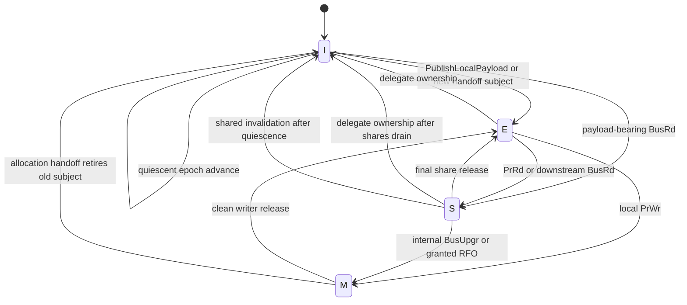
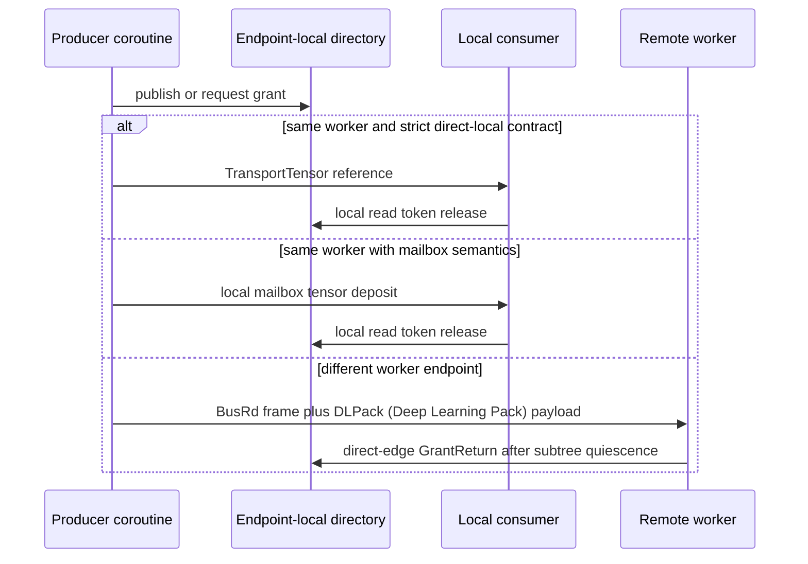

# Endpoint-Local MESI Directory Protocol

This document is the normative Fluxway coherence specification.

## Abbreviations And State Names

| Short name | Full name | Fluxway meaning |
|---|---|---|
| MESI | Modified, Exclusive, Shared, Invalid | Software access-authority state machine; it does not imply hardware cache coherence for Python or accelerator memory. |
| M | Modified | This endpoint has the sole write authority and the payload may contain modified bytes. |
| E | Exclusive | This endpoint is the sole valid holder and has not started modification. |
| S | Shared | One or more controlled local readers or direct-child shares may access the payload. |
| I | Invalid | This endpoint has no valid accessible payload for the tensor instance. |
| SPMD | Single Program, Multiple Data | Fluxway execution topology composed of ranked workers. |
| ABI | Application Binary Interface | Stable semantic or wire boundary between runtime components. |
| API | Application Programming Interface | Callable boundary exposed by a runtime component. |
| SSA | Static Single Assignment | A new logical tensor identity is created for a new data-flow value. |
| TUUID | Tensor Universally Unique Identifier | Canonical logical tensor identity assigned by the compiled graph. |
| PrRd | Processor Read | Local execution intent to acquire read authority. |
| PrWr | Processor Write | Local execution intent to acquire write authority. |
| BusRd / `BUS_RD` | Bus Read | Payload-bearing parent-to-child shared delegation. |
| BusRdX | Bus Read Exclusive | Hardware term for a read-for-ownership transaction; Fluxway expresses the intent as RFO. |
| RFO | Request For Ownership | Child-to-parent request for exclusive write authority. |
| BusUpgr / `BUS_UPGR` | Bus Upgrade | Local Shared-to-Modified upgrade; reserved and never emitted on the coherence wire. |
| `SNOOP_INVALIDATE` | Snoop Invalidate | Parent-to-child revocation of shared authority. |
| `GRANT_RETURN` | Grant Return | Child-to-parent release of shared or ownership authority. |
| `OWNERSHIP_GRANT` | Ownership Grant | Parent-to-child confirmation of exclusive write authority. |
| `OWNERSHIP_CANCEL` | Ownership Cancel | Pre-CALL cancellation of clean ownership authority. |
| DLPack | Deep Learning Pack | Cross-backend tensor payload interface used by remote transport. |
| GIL | Global Interpreter Lock | Python interpreter lock; it is not a tensor coherence primitive. |
| UB | Undefined Behavior | Contract violation whose effects Fluxway does not attempt to recover from. |

## Domains And Single Sources Of Truth

```text
Subject        = (owner_spmd_code, owner_rank, logical_tuuid)
TensorInstance = (Subject, Epoch)
tensor_of      : ENTRY_ROUTE_CODE -> logical_tuuid
slot_t         : direct-child endpoint <-> compact bitmap index
```

`logical_tuuid` and `tensor_of` come only from `CompiledTensorTransfer`. A route code
selects a compiled direct edge; it is not a tensor identity. `TransportTensor.source_step`
is lowered to the entry epoch. `FRAME_STEP` remains scheduler/delivery metadata for tensor
frames; homogeneous coherence frames use it as their common epoch. No mutable second epoch
counter, global directory, sibling holder list or cross-level broadcast exists.

For each logical tensor, child slots are assigned by sorting its finite set of
`(target_spmd_id, target_rank)` endpoints. The mapping is bijective and projections never
renumber an existing slot.

## Extended State And Invariants

One endpoint-local entry is:

```text
D = (epoch, mesi, parent_authority, read_grants, write_grant,
     ownership_child, child_bitmap, delivery_inflight,
     delivery_committed, return_pending, pending, allocation_binding)

parent_authority in {NONE, SHARED, OWNERSHIP}
mesi             in {
    I = Invalid,
    S = Shared,
    E = Exclusive,
    M = Modified,
}
```

The table above is normative for the state names. `S` includes a local reader, parent
share or direct-child share; it is not limited to wire-level copies.

Every transition preserves:

```text
I1 writer != NONE
   => readers = 0 and ownership_child = NONE and child_bitmap = 0

I2 ownership_child != NONE
   => writer = NONE and readers = 0 and child_bitmap = 0 and mesi = I

I3 parent_authority = OWNERSHIP
   => mesi in {M, I} and the direct parent is I

I4 mesi = I => PrRd, PrWr and BusRd delegation cannot become GrantReady

I5 epoch advance
   => no reader, writer, ownership child, child bit, delivery receipt,
      parent authority or pending continuation

I6 incoming_epoch < epoch => StaleEpochError and D is unchanged

I7 delivery_committed subset child_bitmap
   and return_pending subset child_bitmap
   and delivery_inflight(child) > 0 => child is in child_bitmap

I8 each read/write/delivery token is consumed exactly once
```

An unseen entry starts in I. Epoch advance always initializes the new epoch to I; version
change alone never makes bytes valid. Only `PublishLocalPayload`, payload-bearing `BusRd`,
or a valid ownership transfer can establish authority over bytes.



The diagram shows legal state classes; every arrow still requires the full preconditions
in the transition table below.

## Transition Relation

| Event | Preconditions | Result |
|---|---|---|
| `PublishLocal` | I, no parent authority, quiescent | I -> E |
| `PrRd` | Not I, not revoking, no owner child, no active/pending writer | issue read token; E -> S, or S/M -> S/M |
| `PrWr` | Not I, no active local/child shares/deliveries, parent_authority != SHARED | issue write token; E/S -> M, or M -> M |
| `TxBusRd` | E or S (or publishes_local_payload and I->E), not revoking, no writer, no owner child, no pending writer | set child bit; E -> S or S -> S |
| `RxBusRd` (Receive Bus Read) | I, no parent authority, no writer, no owner child | parent_authority = SHARED; I -> S |
| `TxGrantReturn` (Transmit Grant Return) | parent_authority != NONE, quiescent | parent_authority = NONE, revoking = False; Any -> I |
| `TxOwnershipGrant` (Transmit Ownership Grant) | no owner child, no local readers, no child shares/deliveries | ownership_child = child; Any -> I |
| `RxOwnershipGrant` (Receive Ownership Grant) | parent_authority == SHARED, no local/child shares, no owner child | parent_authority = OWNERSHIP |
| `TxOwnershipCancel` (Transmit Ownership Cancel) | parent_authority == OWNERSHIP, local_writer is None | parent_authority = NONE; Any -> I |
| `RxSnoopInval` (Receive Snoop Invalidate) | not revoking, parent_authority != OWNERSHIP, not M, no writer, no owner child | revoking = True |
| `AckSnoopInval` (Acknowledge Snoop Invalidate) | revoking = True, no local/child shares, no writer, no owner child | Any -> I |
| `EPOCH_ADVANCE` | I5 | Any -> I at the new epoch |

Pending writers have priority over later readers. Ready operations do not allocate a Future;
conflicts return an entry-local Future and suspend only the affected coroutine. Cancellation
removes the request before the next wakeup.

Invalid transitions fail immediately. In particular, M cannot respond to shared invalidation,
an I child cannot obtain missing bytes through header-only RFO, duplicate current-epoch return
is invalid, and ownership cannot be cancelled after CALL begins.

## Wire Actions And Communication

coherence protocol uses the existing 4-bit entry action field:

| Code | Action | Payload | Direction |
|---:|---|---|---|
| 0 | `NONE` | frame-dependent | none |
| 1 | `BusRd` | required | parent -> child |
| 2 | `RFO` | forbidden | child -> parent |
| 3 | reserved (`BUS_UPGR` is internal) | forbidden | invalid |
| 4 | `SnoopInval` | forbidden | parent -> child |
| 5 | `GrantReturn` | forbidden | child -> parent |
| 6 | reserved (`FLUSH`) | forbidden | invalid |
| 7 | `OwnershipGrant` | forbidden | parent -> child |
| 8 | `OwnershipCancel` | forbidden | child -> parent |
| 9-15 | reserved | forbidden | invalid |

Tensor transfer frames contain only BusRd. Coherence frames contain no payload and are
handled before mailbox deposit. All entries in one coherence frame have one action and epoch;
the sender groups them by `(target endpoint, action, epoch)`. Different targets are submitted
concurrently. Header-only remote actions reuse the Ray/Axon data-plane handler and never affect
mailbox arrival counts.

## Tensor Flow And Carrier Selection

One semantic tensor contract has three physical carriers. Carrier selection never creates
a second subject, epoch or authority table.



Remote workers use the protocol 9-column flat-frame ABI (Application Binary Interface);
same-worker delivery deliberately avoids wire encode/decode while preserving compiled
route, logical TUUID (Tensor Universally Unique Identifier), epoch and grant semantics.

The directory has one event-loop owner. Coroutines on that loop use the ready path
without a shared lock; conflicts suspend through an entry-local Future. Operating-system
threads must marshal intents through the host event loop's thread-safe submission
boundary and must not mutate entries directly. The current directory API (Application Programming Interface) remains
event-loop-only; Fluxway does not expose a second thread-mutating API. The GIL (Global Interpreter Lock) is not a
coherence primitive because backend kernels may release it and a MESI transition spans
multiple dependent fields.

### BusRd

1. A local producer publishes E.
2. Before enqueue, the sender sets the child bit and increments delivery inflight.
3. The payload frame carries BusRd, route code and epoch.
4. The receiver validates version, route, action and epoch before recording parent SHARED.
5. Only a valid frame enters the mailbox and obtains a local read token.
6. Delivery failure rolls back only the delegation created by that delivery.
7. Delivery success does not return the grant. The child returns after its local operator,
   allocation aliases and descendants are quiescent.

If a return overtakes an in-flight delivery, the parent marks return-pending. A failed delivery
then clears the grant. A successful delivery cancels the early return because the child must
return the successfully delivered authority again.

### RFO (Request For Ownership) And OwnershipGrant

1. Before CALL, the child queues a writer and blocks later readers.
2. It releases its execution read token and drains local aliases/children.
3. The child sends RFO to its direct parent and waits without blocking the actor thread.
4. The parent verifies that the requester already owns a current share.
5. The parent blocks new BusRd, waits delivery completion, and concurrently invalidates all
   other direct children in its sharing set.
6. After local readers and the bitmap reach zero, the parent becomes I with
   `ownership_child=requester` and sends OwnershipGrant.
7. The child changes parent authority from SHARED to OWNERSHIP, issues the write token, enters M,
   and resumes CALL.

### Invalidate, Return And Cancel

SnoopInval first marks the child revoking so no new reader or delegation can enter. Existing
controlled readers finish normally; the child recursively drains only its direct descendants.
It then invalidates wrapper access, enters I, and sends exactly one GrantReturn.

GrantReturn clears either a share bit or a dirty ownership child according to the parent's
authoritative entry. A share return may leave the parent's valid bytes E. A dirty ownership
return always leaves the parent I.

OwnershipCancel is legal only before CALL. It proves that the parent's old bytes are still valid,
so the parent returns to E and the child becomes I. Once CALL starts, failure fences the execution;
the protocol never guesses that modified bytes are clean.

## Allocation Handoff And Reclamation

Backend allocation identity contains backend, device, allocation-root address/size and owned view
address/size. The binding holds the real storage owner strongly; a pointer integer or DLPack capsule
is not an owner.

```text
B(old) = allocation
B(new) is undefined
old has the current execution write grant
relation(old, new) = EXACT
------------------------------------------------
B' = (B - {old}) union {new -> allocation}
```

EXACT requires the same root and byte span. OVERLAP and unsupported identities raise
`UnsupportedAllocationHandoffError`. Donation is a one-input/one-output contract. The old wrapper
becomes invalid; raw aliases outside Fluxway access paths are UB (Undefined Behavior). Cross-endpoint copied payloads
are new allocations, even when the logical graph routes the new SSA (Static Single Assignment) tensor back to an earlier node.

Each subject has a monotonic endpoint-local retirement watermark. A retired record can be removed
only if it has no local reader/writer, ownership child, child bit, delivery, parent authority,
pending continuation or live allocation binding. The retirement queue processes candidates only;
it does not scan the directory. An active record below the watermark raises
`RetirementInvariantError`; watermark never substitutes for authority proof.

## Safety, Progress And Fencing

Mutual exclusion follows by induction from I1-I3: reads and child bits enter only without a writer;
writers enter only after all reads and child bits leave; delegated ownership removes parent validity.
Epoch safety follows from I5-I6. Direct-edge authority conservation composes these endpoint-local
proofs over the tree without a global coordinator.

Progress is conditional on controlled readers releasing and direct children responding. Waiting
uses entry-local Futures; there is no polling, global lock or global scan. A pending writer prevents
new read traffic from starving it.

On an invariant violation, transport failure or execution error, Fluxway fences the entire run:

1. close worker frame admission and stop scheduling;
2. cancel prepare, CALL, send, delivery and pending coherence tasks;
3. close transport/runtime endpoints and invalidate controlled wrappers;
4. clear endpoint-local directory/allocation bindings;
5. acknowledge worker stop and explicitly terminate every Ray worker actor.

Only after this barrier may a new Controller create new workers from a checkpoint. Protocol does not
replace a rank inside the same execution, so it does not add an execution-incarnation field to the
flat frame header.

## Terminology Boundaries

| Layer | Canonical terms |
|---|---|
| User/operator | readonly, writable, donate |
| Runtime | ShareGrant, OwnershipGrant, GrantReturn, ParentAuthority, Epoch, Allocation Handoff |
| Wire/MESI | BusRd, RFO, SnoopInval, OwnershipGrant, OwnershipCancel |

`PrRd` (Processor Read) and `PrWr` (Processor Write) are processor-side read/write intents. `BusRd` announces a read. `BusRdX` or RFO
requests ownership before write. `BusUpgr` is a shared-to-modified upgrade and is internal in protocol.
`Snoop` is directory inspection; `Invalidate` or `BusInval` revokes a share. `Downgrade` is E/M to S
when valid data is shared. `SharingSet` or hardware `Copyset` is represented only by the direct-child
bitmap. `Epoch Advance` changes lifecycle version after the backpressure barrier. `Stale Epoch
Rejection` discards an older payload/action without mutation.

In hardware MESI, `Flush` writes modified bytes to a shared location. Fluxway coherence protocol deliberately does
not implement it: a header-only frame cannot restore copied parent bytes, while a payload FLUSH would
be a second transfer path and could corrupt mailbox counting. Remote writeback attempts raise
`UnsupportedRemoteWritebackError`; state updates are modeled as ordinary new SSA tensor flow.
