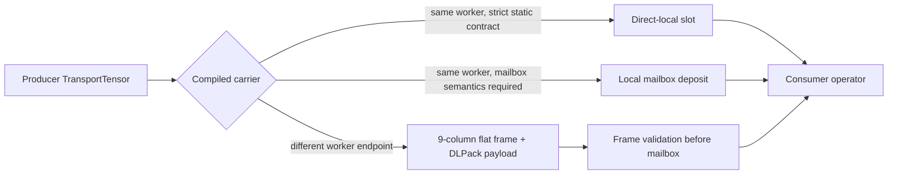

# Fluxway Data-Plane Runtime

This document describes the current worker-local data-plane path. The important
contract is that user `CALL` work and Fluxway tensor split/transfer/assemble work
must not block each other on the SPMD (Single Program, Multiple Data) worker actor
event loop.

## MESI Coherence Terms And Flat Metadata

MESI means Modified, Exclusive, Shared, Invalid. ABI means Application Binary
Interface. The first names access state; the second names a stable boundary between
components.

BUS_RD means Bus Read. RFO means Request For Ownership. SNOOP_INVALIDATE means a
directory snoop followed by invalidation of shared authority.

Fluxway 的 coherence action 使用现有 data-plane handler 传输，不建立第二套控制服务。
`TENSOR_TRANSFER` entry 只能携带 `BUS_RD` 和 payload；`COHERENCE` frame 必须
header-only，并在 mailbox deposit 前处理，因此不会改变 arrival 或 duplicate barrier。

BUS_RD 的顺序是：sender 在 enqueue 前登记 child bit 和 delivery inflight，发送 payload；
receiver 完成 route/action/epoch 校验并登记 parent shared authority 后才 deposit mailbox。
send completion 只结束 delivery receipt，不归还 ShareGrant；只有 downstream operator、alias
lineage 和 descendants 全部静止后才发送 `GRANT_RETURN`。

输入归还由 worker-local `InputCoherenceRelease` 统一完成。它先释放 local access token，
再等待 grant subject、allocation alias 和 direct descendants 的 quiescence，随后才失效
tensor runtime access、发送 `GRANT_RETURN`、释放 payload，并执行 returned-instance 或
current-entry retirement proof。remote grant 与 local-only grant 走同一条 awaited lifecycle；
local-only 只是没有 parent route。在 Worker 调度层，`_commit_finished_steps` 在 step 完成时
把 `InputCoherenceRelease.complete()` 放入受监管的后台生命周期任务并推进 Step 调度水印；
后台协程取得 release 资源所有权后才执行可能挂起的 quiescence await，调度水印推进不代表
输入归还已经完成。Directory 状态机继续严格保障零拷贝物理内存安全。

RFO 的顺序是：writer intent 先阻止新 reader，释放当前 read token，等待 local subtree；child
发送 RFO 后，parent 等待 delivery、并发 invalidate siblings、清空 sharing set，再进入 I 并发送
`OWNERSHIP_GRANT`。child 收到 grant 后才进入 M、解析 pending request result 并恢复 CALL。

`SNOOP_INVALIDATE` 只能撤销 S。receiver 设置 revoking、等待 controlled readers 和 direct
children，随后 wrapper fail-fast、进入 I 并发送一次 `GRANT_RETURN`。M holder 无法在没有
writeback 的情况下响应 invalidation，直接触发 execution failure。`OWNERSHIP_CANCEL` 仅允许
CALL 开始前使用；CALL 开始后的 dirty authority 只能退休，parent 保持 I。

coherence epoch 的唯一事实来源是 coherence-owned `CoherenceInstance(subject, epoch)`。
`TransportTensor` 只携带已绑定的 instance；`source_step` 是调度/来源元数据，不能推导
directory epoch。raw output 必须在进入 data-plane 前由 worker 绑定 canonical instance，
随后该 instance 的 epoch 才被 lower 到 `ENTRY_AUX`，而 `FRAME_STEP` 继续承担 delivery
barrier 的 exact-step 语义。

### Compressed Flat ABI Entry Row

Protocol version 1 (`PROTOCOL_VERSION = 1`) 使用固定 9 列、36 bytes 的
`entry_i32` 平铺 row，不兼容解析旧协议：

| 列 | 字段 | 语义 |
|---:|---|---|
| 0 | `ENTRY_ROUTE_CODE` | direct-edge protocol dispatch code |
| 1 | `ENTRY_STATE_FLAGS` | layout、ragged level、tensor kind、coherence action |
| 2 | `ENTRY_PAYLOAD_BEGIN` | payload table 起始行 |
| 3 | `ENTRY_PAYLOAD_COUNT` | payload table 行数 |
| 4 | `ENTRY_EXPECTED_COUNT` | arrival barrier 期望 sender 数 |
| 5 | `ENTRY_COMPACT_BEGIN` | compact origin 的起始位置 |
| 6 | `ENTRY_GLOBAL_SHAPE_BEGIN` | global shape 起始位置 |
| 7 | `ENTRY_GLOBAL_SHAPE_COUNT` | global shape 元素数 |
| 8 | `ENTRY_AUX` | 由 `FrameFlag` 判别的 tagged union |

`ENTRY_STATE_FLAGS` 的 bit layout：

| bits | 语义 |
|---|---|
| 0:2 | ragged / explicit origin / compact origin layout flags |
| 8:15 | ragged level count |
| 16:17 | `TensorEntryKind` |
| 20:23 | `CoherenceAction` |
| 24:31 | reserved，必须为 0 |

`ENTRY_AUX` 在 `TENSOR_TRANSFER` 和 `COHERENCE` frame 中是 canonical
`CoherenceInstance.epoch` 的 wire projection，在 `DEPENDENCY_DECISION` frame 中是
decision enum，在 `ORDERING_COMPLETION` 中必须为 0。`ENTRY_ROUTE_CODE` 只做协议分派。
receiver 必须通过 canonical compiled graph 的 `transfer_code -> logical_tuuid` 映射取得
coherence subject，并使用 frame 中携带的 coherence epoch；禁止把 route code、
`FRAME_STEP` 或 `source_step` 直接当作 directory identity。

coherence action code：`0=NONE`、`1=BUS_RD`、`2=RFO`、`4=SNOOP_INVALIDATE`、
`5=GRANT_RETURN`、`7=OWNERSHIP_GRANT`、`8=OWNERSHIP_CANCEL`。code 3、6、9-15
为 reserved，validator 直接抛异常。一个 coherence frame 内所有 entry 必须具有相同 action
和 epoch；sender 按 `(artifact, action, epoch)` 聚合 route codes。正常路径中 epoch 与
`FRAME_STEP` 可能数值相同，但二者语义独立，任何一方都不能推导另一方。

### Coherence Identity And Child Slots

endpoint-local directory subject 定义为：

```text
S = (owner_spmd_code, owner_rank, logical_tuuid)
```

其中 `logical_tuuid` 的唯一事实来源是 `CompiledTensorTransfer`。`CompiledSendPlan` 中的
索引只是对 canonical transfer routes 的只读投影，并在构造时验证其映射一致性。

对逻辑 tensor `t`，令它的 direct-child endpoint 集合为：

```text
E_t = {(artifact_spmd_id, artifact_rank)}
```

按 endpoint 字典序排列后，child slot 定义为：

```text
slot_t(e) = index(e, sorted(E_t))
```

因此 `slot_t: E_t -> {0, ..., |E_t|-1}` 是双射。不同 successor SPMD 的相同 rank
不会发生 bitmap 位碰撞；同一 logical tensor 到同一 endpoint 的多条 transfer 共享同一
slot。send-plan projection 只能删除 endpoint，不能重新编号已有 slot。

当 operator 输出与 donated input 共享 allocation 时，backend identity 给出
`EXACT/OVERLAP/DISJOINT`。只有相同 root 和 owned byte span 的 EXACT 可以 handoff；OVERLAP
和无法证明的类型直接失败。commit 先等待 send registration 和 output quiescence，再退休 old
parent authority。retirement queue 只访问已入队候选，不扫描 directory。

P99 ready path 只允许 O(1) dict lookup、bitmap/count 更新和 frame append，不创建 Future。
input grants 使用 identity-keyed dict；同 parent 的 RFO/GRANT_RETURN 聚合为 multi-entry frame，
不同 parent 和 sibling invalidation 并发发送。Future、deadline 和 continuation 只存在于 conflict
path。

## End-To-End Path

```mermaid
flowchart LR
  A["LocalStepPlan SEND"] --> B["LocalSendToken"]
  B --> C["OutboundDeliveryRuntime"]
  C --> D["data_plane.frame_build"]
  D --> E["TransportBatchPlan"]
  E --> F["data_plane.enqueue_batch"]
  F --> G["Ray/Axon RPC or local worker delivery"]
  G --> H["receive_transport_frames"]
  H --> I["WorkerMailbox exact-step deposit"]
  I --> J["LocalInputPrepareRuntime"]
  J --> K["LocalStepPlan WAIT"]
```



`SEND` only registers a token and schedules delivery. It does not wait for frame
build, batch RPC, receiver deposit, or downstream assemble. `BARRIER` observes
the token registration and commits the local step watermark. Full delivery is
fenced only by drain/checkpoint/export/stop.

## Ownership

| Layer | Owner | Responsibility |
|---|---|---|
| Worker scheduler | `SPMDWorker` | choose ready `(op, step)`, enforce pipeline depth, submit `LocalStepPlan` |
| Local DAG | `LocalStepPlanExecutor` | execute `WAIT -> CALL -> SEND -> BARRIER` dependencies and resource ids |
| Prepare runtime | `LocalInputPrepareRuntime` | own prepare tokens, background assemble execution, consume/cancel/drain |
| Call runtime | `WorkerProcessCallRuntime` | asynchronously submit ordinary Python callables away from the actor event loop |
| Delivery runtime | `OutboundDeliveryRuntime` | own `LocalSendToken`, delivery tasks, semaphore, poison, delivery fence |
| Assembly | `CompiledAssemblePlan` | cache worker-local input topology and static assemble metadata |
| Transport | `TransportFrameTemplate`, `TransportBatchPlan` | own frame schema/template, routing batch plan, artifact grouping |
| Data-plane executor | `DataPlaneBackendExecutor` | consume compiled send plan and transport batches, call remote or local backend |

The worker must not duplicate transport artifact grouping or frame construction.
The data-plane executor must not duplicate sharding/split logic. Remote edges,
local-only self edges, normal send, and empty propagation use the same compiled
send plan and transport frame builder path.

## Routing Batch Identity

`select_routing_source()` is the only selector used by sender batching and
transport planning. It distinguishes source-layout, routing-index,
origin-index, tensor-value, and receipt routing. A routing batch may reuse one
sort/count plan only when its source and artifact layouts, routing-source
identity, routing kind, and routing entity count are equal. Two tensors that
eventually reach the same set of ranks still use separate plans when their
per-entity destination assignments differ.

Receipt tags lower directly to `DestinationAssignment`; receipt routing does
not own a second sorting or ragged-slicing algorithm. Scalar receipts produce
an O(1) constant-rank plan. Vector receipts use stable rank grouping and the
same multi-payload ragged projection as algebraic routing. A tag equal to the
artifact rank count is a routing sentinel for a payload slot with no destination;
it is not an empty tensor and not an execution-error marker.

The receipt rank domain is the original sender domain carried by
`SymmetryReceipt`, not the mesh size of the operator that most recently passed
the reference tensor through. A reference received from a two-rank sparse SPMD
can therefore cross a four-rank dense SPMD and route gradients back to the same
two sparse ranks. Compilation fixes the expected domain to the gradient artifact
mesh; the sender validates the runtime receipt against it before distribution.

## AsyncPolicy Quickstart

`AsyncPolicy` describes algorithm semantics; runtime backpressure and lifecycle
remain framework-internal.

```python
from fluxway.common.operator_policy import AsyncPolicy, SchedulePolicy, StatePolicy


class SparseEmbeddingSPMD:
    @operator(
        async_policy=AsyncPolicy.bounded_stale(
            depth=8,
            max_staleness=7,
            schedule=SchedulePolicy.deadline_boost(),
            state=StatePolicy.thread_safe(),
        ),
    )
    def lookup(...): ...

    @operator(
        async_policy=AsyncPolicy.bounded_stale(
            depth=8,
            max_staleness=7,
            schedule=SchedulePolicy.deadline_boost(boost_priority=200),
            state=StatePolicy.thread_safe(),
        ),
    )
    def update(...): ...


class DenseSPMD:
    _PHASE_ORDER = (
        "prepare_dense_inputs",
        "train_core",
        "scatter_sparse_grads",
        "update",
    )
    _PHASE_DEPENDENCIES = (
        ("prepare_dense_inputs", "train_core", 0),
        ("train_core", "scatter_sparse_grads", 0),
        ("train_core", "update", 0),
        ("update", "train_core", 1),
    )

    @operator(
        async_policy=AsyncPolicy.pipelined(
            depth=2,
            schedule=SchedulePolicy.phase_graph(
                phase="prepare_dense_inputs",
                phase_order=_PHASE_ORDER,
                dependencies=_PHASE_DEPENDENCIES,
            ),
            state=StatePolicy.thread_safe(),
        ),
    )
    def prepare_dense_inputs(...): ...

    @operator(...)
    def train_core(...): ...

    @operator(...)
    def scatter_sparse_grads(...): ...

    @operator(...)
    def update(...): ...
```

Rules for algorithm users:

- Use `AsyncPolicy.sync()` when unsure.
- Use `AsyncPolicy.pipelined(depth=N)` for exact-step operators whose local
  steps may overlap.
- Use `AsyncPolicy.bounded_stale(depth=N, max_staleness=M)` for bounded operator
  lag, such as sparse embedding lookup/update.
- `max_staleness` is not a tensor version selector. Tensors, state, and control
  arguments remain exact-step.
- Use `StatePolicy.thread_safe()` only when the underlying state/store supports
  concurrent access for the called methods.
- Use `SchedulePolicy.phase_order(...)` when several operators are truly full
  ordered phases of one logical training step.
- Use `SchedulePolicy.phase_graph(...)` when phase relations are a partial
  order. A dependency `(before, after, delta)` means `after(step)` waits for
  `before(step - delta)`. Negative required steps are ignored. Invalid phase
  names, duplicate dependencies, negative deltas, and same-step cycles raise.

## Local-Only Edges

Functional graph calls can mark an edge as worker-local:

```python
h_prepare = dense.prepare_dense_inputs(...)
h_core = dense.train_core(
    f1_rec=h_prepare.f1_rec,
    f2_rec=h_prepare.f2_rec,
    local=True,
)
```

`local=True` lowers to `Edge.local_only=True`. The builder accepts it only when
`source_node == artifact_node`; cross-node local-only edges raise immediately.
The scheduler skips local-only edges when establishing global SPMD topology, so
drivers do not wait for self-loop Ray/Axon handlers.

Local-only shares the canonical `TransportTensor` semantic ABI with remote delivery,
but it does not encode the remote flat-frame carrier. A statically eligible edge writes
the same `TransportTensor` reference into a direct-local slot. Other local-only tensor
edges call `WorkerMailbox.deposit_local_tensor(...)` directly. Both paths preserve
logical TUUID (Tensor Universally Unique Identifier), exact step, route validation,
coherence grants, duplicate rejection and readiness barriers. If the compiled route
artifacts any rank other than the sender rank, Fluxway raises instead of falling back to
remote transport.

The direct-local slot is enabled only when every expected transfer has one shard, all
routes artifact the same worker/rank, assemble geometry is static, and the operator has no
control arguments, ordering counts or dependency decisions. Otherwise Fluxway uses the
local mailbox path; it does not silently switch to remote transport.

DLPack means Deep Learning Pack.



The three carriers are not separate tensor identity systems: compiled route metadata,
logical TUUID, epoch and directory authority remain the single sources of truth.

### Coroutine And Thread Ownership

`CoherenceDirectory` is owned by one worker event loop. Multiple coroutines on that loop
may share a tensor through the ready path: one dictionary lookup and bounded entry-local
counter/bitmap updates, with no Future allocation, polling or operating-system thread
block. A conflict returns explicit pending state; `coherence_runtime.py` registers a
progress listener and suspends only the requesting coroutine.

The data plane does not perform coherence admission or delegation. `CoherenceSequencer` orders
canonical `CoherenceInstance` tickets; the coherence runtime adapter awaits quiescence and invokes
`CoherenceDirectory.admit()` before the pure queue is given a frame batch. `source_step` and
`FRAME_STEP` remain scheduling metadata, never directory epoch sources.

```mermaid
flowchart LR
  I["issue intent"] --> B["concurrent frame build"]
  B --> C["ROB commit_payload"]
  C --> K["all payload tickets registered"]
  K --> X["close_intent admission cut"]
  X --> R["runtime admission adapter"]
  R --> A["ordered Directory.admit"]
  A --> Q["pure target queue"]
  Q --> S["send / RPC"]
  S --> E["delivery completion"]
  E --> Z["ticket completion"]
```



`commit_payload()` performs ticket registration synchronously. A sealed head ticket uses the
inline retire path; blocked predecessors allocate a Future and suspend only their coroutine.
Frame and payload objects remain borrowed zero-copy references throughout this handoff.

Operating-system threads must not mutate the directory directly. They must marshal an
intent through the host event loop's thread-safe submission primitive; the owner loop
performs the state transition and resolves the result. The current directory API remains
event-loop-only. Fluxway deliberately does not add a shared directory lock. The GIL
(Global Interpreter Lock) is insufficient because tensor backends may release it while
executing kernels, and it does not make a multi-step MESI transition atomic.

## LocalStepPlan Semantics

Fluxway lowers one ready operator step to:

```text
WAIT -> CALL -> SEND -> BARRIER
```

- `WAIT` consumes prepared kwargs. For async policies, mailbox ready starts a
  prepare token before the step reaches the front of the scheduler.
- `CALL` executes user code through `UserCallableExecutor`.
- `SEND` registers `LocalSendToken` and starts background delivery.
- `BARRIER` observes token registration, clears exact-step mailbox data, and
  advances committed watermark when previous steps are committed.

Drain boundaries and source refill are separate responsibilities. A boundary update only
changes admission, cancels or discards speculative source work at or beyond the cut, and wakes
the drain condition; it never refills the source pipeline. `_fill_source_pipeline()` is the
sole source-admission loop and checks running state, terminal observation, pipeline depth, and
the finite `max_steps` target before enqueueing another step.

Local DAG does not encode forward/backward/update algorithm ordering. Cross
operator scheduling lives in `SchedulePolicy`, worker priority keys, and
`AsyncStepManager`.

## Input Prepare And Assemble

`LocalInputPrepareRuntime` is the only prepare lifecycle owner. It starts
mailbox-triggered prepare for non-sync operators, runs heavy assemble work in
its thread runtime, exposes ready/pending state to the scheduler, and fences on
drain/checkpoint/export/stop.

`CompiledAssemblePlan` caches:

- input layout
- predecessor topology
- provider SPMD ids
- dynamic-to-static provider flags

The hot path still consumes only step-local shards, arrivals, routing/origin
indices, counts, receipt metadata, and `TransportTensor` payloads. Dynamic
unique/inverse/grad data is never reused across steps.

## Frame Build And Batch

`CompiledSendPlan` is built per operator and cached by the worker. It stores
static successor routes, compiled effective sharding geometry, declared mirror
references, transfer-code diagnostic names, sender rank/world, dependency
conditions, and a transport template cache. `GraphCompiler` resolves the full
referential-sharding closure once; Worker initialization does not build another
TUUID registry or repeat the graph traversal.

Each tensor route carries a `TransportRoutingMode`. `ALGEBRAIC` uses the
effective source and artifact layouts. `RECEIPT` uses the same effective geometry
but selects the inherited `SymmetryReceipt` as the routing fact. A referential
`PhysicalLayout` is rejected by transport, so geometry and mirror semantics
cannot be inferred from the same object.

The transport layer owns:

- `TransportFrameTemplate` for reusable header/table skeletons.
- `TransportBatchPlan` for batch grouping from frame groups.
- `build_step_frame_groups()` for tensor output and routing misses.
- `build_completed_without_tensor_step_frame_groups()` for a successful step
  that produced no tensor.
- `build_dependency_decision_only_frame_groups()` for a step that only
  propagates dependency decisions.

All three builders reuse `_build_causal_frame_groups()` for ordering completion
and dependency decisions.

`TransportFrame.entry_i32` is the fixed-width manifest table. Each frame has
exactly one `FrameFlag` category:

- `TENSOR_TRANSFER`: entries identify transfer codes and payload metadata.
- `ORDERING_COMPLETION`: header-only entries identify dependency codes.
- `DEPENDENCY_DECISION`: header-only entries carry
  `DependencyDecision.PROCEED` or `DependencyDecision.SKIP` for dependency
  codes.

A condition callable is only one source of a dependency decision. Every source
rank evaluates it once per dependency and step. The artifact waits for the
declared source count and rejects mixed decisions. `SKIP` satisfies that
dependency without manufacturing a tensor, but the artifact still waits for its
other causal dependencies. A skipped operator registers the same asynchronous
send task as a successful operator and propagates `SKIP` across every downstream
dependency, including dependencies without tensor transfer. A conditional
dependency without tensor transfer emits one dependency decision instead of an
ordering completion; `PROCEED` completes that dependency and `SKIP` marks the
artifact step skipped. A condition may return an exact `bool` directly or an
awaitable that resolves to an exact `bool`. Graph execution uses the async
evaluator ABI; a graph step with no condition bypasses coroutine creation, and a
future eager adapter reuses the same plan interface.
Every tensor-transfer entry has one `TensorEntryKind`:

- `TensorEntryKind.TENSOR` carries a tensor; a zero-element tensor is still a
  tensor.
- `TensorEntryKind.ROUTING_MISS` means the sender has a tensor but this artifact
  rank receives no shard.
- `TensorEntryKind.COMPLETED_WITHOUT_TENSOR` means the upstream step completed
  successfully without producing a tensor.
- `TensorEntryKind.NOT_APPLICABLE` is reserved for ordering-completion and
  dependency-decision entries because those entries do not describe tensors.

An operator exception is never represented by a tensor entry.

static-to-static paths patch step and payload refs. Dynamic paths cache only
stable schema/tuuid/role skeletons; shape/count/routing/origin/inverse/payload
remain step-local inputs. Unsupported plan states raise directly.

For Dense `scatter_sparse_grads`, current profiling shows that
`data_plane.frame_build` is dominated by transport route/split work, not the
RPC submit path:

- `data_plane.frame_build`: 117.5ms mean on the 2026-07-09 split trace.
- nested `transport.distribute` child sum: 109.7ms mean.
- frame header/template residual: 7.8ms mean.
- `data_plane.frame_submit`: 0.6ms mean.
- `data_plane.ray_payload_serialize`: 0.6ms mean.

This points to a transport-level optimization: reuse or batch route/split work
across successor routes when source payload groups and routing metadata are
identical. A Dense-specific bypass would duplicate logic owned by
`AsyncDataDistributor` and couple the example to the transport ABI.

## Ray And Axon Wire ABI

Ray and Axon remote delivery use the batch-first wire entry point:

```python
receive_transport_frames(frames: tuple[TransportFrameEnvelope, ...])
```

The backend adapter is responsible for invoking the physical endpoint. Ray uses
actor `.remote(...)`, and Axon invokes its native endpoint. Local-only tensor delivery
uses the direct-local or local-mailbox carriers described above. The transport/data-plane
layer decides
batch contents by successor context and artifact rank; it does not merge frames
across different concrete endpoints.

Every payload segment is a tensor implementing both `__dlpack__()` and
`__dlpack_device__()`, with `dtype` and `shape` metadata. This is the remote transport
payload ABI for Ray and Axon; array interfaces alone are
not accepted. The validator does not export a DLPack capsule. Axon additionally
uses `__dlpack_device__()` to require that every payload in one invocation has
the same CPU or CUDA device class and matches the receiver device class. Empty
payload tuples remain valid for ordering-only frames. Header metadata always
stays in the host/object lane.

## Commit And Fence

`LocalSendToken` means delivery was registered. It does not mean delivery
finished.

- `local_step.send_output`: foreground token registration.
- `local_step.await_send`: BARRIER token observation.
- `local_step.commit`: mailbox clear, watermark advance, driver report.
- `data_plane.delivery_fence`: drain/checkpoint/export/stop waiting on registered
  delivery.

## Failure Channel

`ExecutionFailure` is the only runtime failure fact. The first failure wins and
retentions its SPMD, rank, operator, step, phase, exception type, message, and Python
traceback. User CALL, SEND registration, background delivery, and scheduler
exceptions all enter the same Worker latch.

The latch stops new step admission, wakes every execution lane, cancels pending
plan/SEND/background tasks, and calls `receive_worker_failure` on the Driver.
The Worker heartbeat carries the same object for state synchronization; it does
not create a second error string. Driver worker-heartbeat timeout and Controller
driver-heartbeat timeout create the same structured type with their respective
phases.

The Controller stops all SPMDs concurrently after the first Driver failure.
`wait_for_completion()` returns `True` after successful reclaim, raises
`ExecutionFailedError` with the collected failures after failed reclaim, and
raises the built-in `TimeoutError` if its caller-supplied timeout expires.

An exception is never represented by a tensor entry. Consequently the graph
success path adds no failure frame, mailbox polling, or per-tensor branch. A
future eager submission path reuses this control-plane failure ABI.

## Profiler

Use these spans to verify nonblocking overlap:

- `local_step.call_user`
- `user_callable.execute`
- `local_step.wait_inputs`
- `local_step.send_output`
- `local_step.await_send`
- `data_plane.frame_build`
- `data_plane.enqueue_batch`
- `data_plane.batch_rpc`
- `data_plane.receiver_wait`
- `delivery.register_token`
- `delivery.semaphore_wait`
- `delivery.run`
- `delivery.fence`

`send_output` and `await_send` correlate by
`(source_spmd_code, source_rank, op_id, step)`. Batch spans add
`artifact_spmd_id`, `artifact_rank`, and `batch_seq`.
`user_callable.execute` includes `graph_id`, `spmd_id`, `op_id`,
`function_id`, `step`, `input_signature_id`, `output_signature_id`, and
`execution_mode`. The static identifiers come directly from the compiled
`SPMDGraphView`; the trace wrapper does not reconstruct them from runtime
callables. Worker configs and the profiler share the same frozen
`CompiledOperator` object.

For short runs:

- `--profiler-skip-initial-steps N` drops step-level events before `N`.
- `--profiler-steady-state-only` hides driver/controller lifecycle tracks in the
  exported trace.

Profiler filtering is centralized in the recorder/export layer. Call sites do
not branch on step filters.

For user-defined subregions inside an operator, use
[`fw.profiler.scope/event`](user_profiler.md). These records appear below
`compute/user_custom/<execution_mode>` and are interpreted as subphases of the surrounding
`user_callable.execute` span. Do not wrap the whole operator with a custom
scope; Fluxway already records that outer call.
