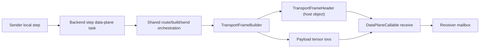
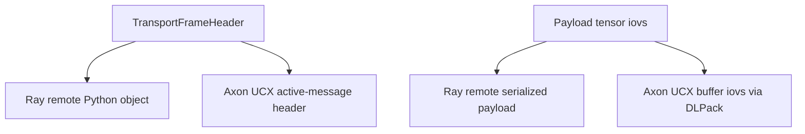
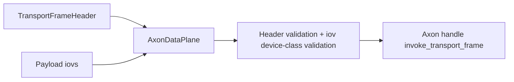
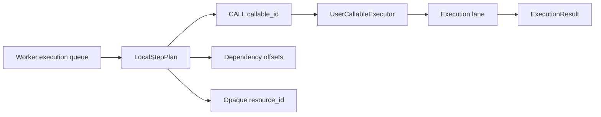

# Fluxway DataPlane Runtime

Fluxway data-plane messages have one runtime ABI and one runtime build
granularity:

- `TransportFrameHeader` is a host-side Python object. It carries frame, edge,
  payload, shape, global-shape, and compact metadata tables.
- Payload iovs are tensor objects passed separately from the header.
- A worker submits one data-plane task per local logical step.
- Data-plane executors build frames and send them to receivers before returning.
- A sender emits one bundled frame per `(sender, step, successor target rank)`.

`per-target` and `per-successor` are benchmark strategies only. Runtime keeps
the step-level fused build/send boundary so there is no parallel implementation
of the same sender-side route/pack/send feature.

The route/build/send orchestration is shared by backend executors. Ray uses a
remote task as the scheduling shell; Axon uses the same orchestration through
its adapter boundary. Backend-specific executors validate handler type before
submitting work, so a wrong P2P backend fails deterministically at the executor
boundary.

## Transport Mapping

Ray and Axon implement the same Fluxway ABI.

For Axon, metadata must stay in the Python-object/header lane even when a host
metadata array exposes `__dlpack__`. Only payload iovs are candidates for Axon
DLPack buffers. All DLPack payload iovs in one transfer must be valid for the
same source and destination device class.

`AxonDataPlane` does not import Axon directly. It adapts to a narrow handle
contract:

- `payload_device_class`: the destination iov class, currently `cpu` or `cuda`.
- `completion_mode`: must be `receiver_success`.
- `invoke_transport_frame(header, payload_device_class, sender_spmd_code, *payload_iovs)`.
- `invoke_control(op_name, step, names, values, sender_spmd_code)`.

The adapter validates the host header first, then validates that all payload
iovs share one source device class and match the destination class. Unsupported
or unverifiable payload objects raise immediately; they are never copied through
a Python copy path.

`send_enqueued` completion is rejected even though it has lower call latency in
the synthetic benchmark. It can hide receiver deposit or eager-assemble failures
from the current step, so it violates Fluxway's Local Deposit Boundary.

The Ray fused step executor accepts only `RayActorDataPlane` handlers. Passing
another data-plane implementation to the Ray fused executor is a deterministic
type error. The Axon fused step executor accepts only `AxonDataPlane` handlers
and reuses the same shared route/build/send orchestration without importing the
Axon package.

## Local DAG

Fluxway does not encode training semantics such as gradient accumulation,
forward/backward phases, or optimizer steps. User code or a planner emits a
worker-local flat DAG. Fluxway executes opaque `callable_id` nodes and enforces
only dependency order plus local `resource_id` serialization.

Cross-worker ordering is carried by P2P frames, mailbox slots, barriers, and
`step + tuuid + sender_spmd_code + sender_rank + expected_count` validation.

The local DAG executor is event-loop friendly for async callables: dependency
waits, resource locks, and data-plane awaits yield to the actor event loop.

User callables and data-plane work use separate executors. `CALL` nodes never
invoke synchronous user code directly on the worker actor event loop after lane
selection:

- async callables run in the inline async lane
- free-threaded Python may use a local free-thread lane when the interpreter
  reports `Py_GIL_DISABLED` and `sys._is_gil_enabled() == False`
- stateful synchronous operators run in Ray execution actors and keep their
  checkpoint state in the actor process
- heavy stateless synchronous callables migrate to Ray execution actors after
  the fixed sampling window
- native/backend callables are an extension lane and must fail clearly when no
  native executor is installed

Execution actors are keyed by `(callable_id, resource_id)`. The `resource_id`
still controls local serialization; different resource ids may overlap. Actor
creation registers the operator owner class in the actor process, then reuses
the normal `OperatorManager.execute_async` path so Fluxway has one operator
invocation implementation.

## Validation Contract

The data-plane runtime is validated against these invariants:

- same-target multi-tensor outputs remain one bundled frame per target rank
- route/build/send orchestration exists once and is reused by backend executors
- unsupported or wrong-backend handlers fail before transport submission
- Axon payload iovs are not copied by the adapter
- Axon source and destination device classes must match
- `send_enqueued` completion is rejected because it can hide receiver failures
- awaiting data-plane completion does not block the actor event loop
- user DAG async callables can await data-plane work without blocking the actor
  event loop
- stateful sync operators execute in actor-owned lanes and checkpoint through
  the same owner
- runtime hot paths do not keep a second direct synchronous operator execution
  lane
