# Fluxway Data-Plane Runtime

This document describes the current worker-local data-plane path. The important
contract is that user `CALL` work and Fluxway tensor split/transfer/assemble work
must not block each other on the SPMD worker actor event loop.

## End-To-End Path

```mermaid
flowchart LR
  A["LocalStepPlan SEND"] --> B["LocalSendToken"]
  B --> C["OutboundDeliveryRuntime"]
  C --> D["data_plane.frame_build"]
  D --> E["TransportBatchPlan"]
  E --> F["data_plane.enqueue_batch"]
  F --> G["Ray/Axon RPC or local worker delivery"]
  G --> H["receive_transport_frames"]
  H --> I["WorkerMailbox exact-step deposit"]
  I --> J["LocalInputPrepareRuntime"]
  J --> K["LocalStepPlan WAIT"]
```



`SEND` only registers a token and schedules delivery. It does not wait for frame
build, batch RPC, receiver deposit, or downstream assemble. `BARRIER` observes
the token registration and commits the local step watermark. Full delivery is
fenced only by drain/checkpoint/export/stop.

## Ownership

| Layer | Owner | Responsibility |
|---|---|---|
| Worker scheduler | `SPMDWorker` | choose ready `(op, step)`, enforce pipeline depth, submit `LocalStepPlan` |
| Local DAG | `LocalStepPlanExecutor` | execute `WAIT -> CALL -> SEND -> BARRIER` dependencies and resource ids |
| Prepare runtime | `LocalInputPrepareRuntime` | own prepare tokens, background assemble execution, consume/cancel/drain |
| Call runtime | `WorkerProcessCallRuntime` | asynchronously submit ordinary Python callables away from the actor event loop |
| Delivery runtime | `OutboundDeliveryRuntime` | own `LocalSendToken`, delivery tasks, semaphore, poison, delivery fence |
| Assembly | `CompiledAssemblePlan` | cache worker-local input topology and static assemble metadata |
| Transport | `TransportFrameTemplate`, `TransportBatchPlan` | own frame schema/template, routing batch plan, target grouping |
| Data-plane executor | `DataPlaneBackendExecutor` | consume compiled send plan and transport batches, call remote or local backend |

The worker must not duplicate transport target grouping or frame construction.
The data-plane executor must not duplicate sharding/split logic. Remote edges,
local-only self edges, normal send, and empty propagation use the same compiled
send plan and transport frame builder path.

## Routing Batch Identity

`select_routing_source()` is the only selector used by sender batching and
transport planning. It distinguishes source-layout, routing-index,
origin-index, tensor-value, and receipt routing. A routing batch may reuse one
sort/count plan only when its source and target layouts, routing-source
identity, routing kind, and routing entity count are equal. Two tensors that
eventually reach the same set of ranks still use separate plans when their
per-entity destination assignments differ.

Receipt tags lower directly to `DestinationAssignment`; receipt routing does
not own a second sorting or ragged-slicing algorithm. Scalar receipts produce
an O(1) constant-rank plan. Vector receipts use stable rank grouping and the
same multi-payload ragged projection as algebraic routing. A tag equal to the
target rank count is a routing sentinel for a payload slot with no destination;
it is not an empty tensor and not an execution-error marker.

The receipt rank domain is the original sender domain carried by
`SymmetryReceipt`, not the mesh size of the operator that most recently passed
the reference tensor through. A reference received from a two-rank sparse SPMD
can therefore cross a four-rank dense SPMD and route gradients back to the same
two sparse ranks. Compilation fixes the expected domain to the gradient target
mesh; the sender validates the runtime receipt against it before distribution.

## AsyncPolicy Quickstart

`AsyncPolicy` describes algorithm semantics; runtime backpressure and lifecycle
remain framework-internal.

```python
from fluxway.common.operator_policy import AsyncPolicy, SchedulePolicy, StatePolicy


class SparseEmbeddingSPMD:
    @operator(
        async_policy=AsyncPolicy.bounded_stale(
            depth=8,
            max_staleness=7,
            schedule=SchedulePolicy.deadline_boost(),
            state=StatePolicy.thread_safe(),
        ),
    )
    def lookup(...): ...

    @operator(
        async_policy=AsyncPolicy.bounded_stale(
            depth=8,
            max_staleness=7,
            schedule=SchedulePolicy.deadline_boost(boost_priority=200),
            state=StatePolicy.thread_safe(),
        ),
    )
    def update(...): ...


class DenseSPMD:
    _PHASE_ORDER = (
        "prepare_dense_inputs",
        "train_core",
        "scatter_sparse_grads",
        "update",
    )
    _PHASE_DEPENDENCIES = (
        ("prepare_dense_inputs", "train_core", 0),
        ("train_core", "scatter_sparse_grads", 0),
        ("train_core", "update", 0),
        ("update", "train_core", 1),
    )

    @operator(
        async_policy=AsyncPolicy.pipelined(
            depth=2,
            schedule=SchedulePolicy.phase_graph(
                phase="prepare_dense_inputs",
                phase_order=_PHASE_ORDER,
                dependencies=_PHASE_DEPENDENCIES,
            ),
            state=StatePolicy.thread_safe(),
        ),
    )
    def prepare_dense_inputs(...): ...

    @operator(...)
    def train_core(...): ...

    @operator(...)
    def scatter_sparse_grads(...): ...

    @operator(...)
    def update(...): ...
```

Rules for algorithm users:

- Use `AsyncPolicy.sync()` when unsure.
- Use `AsyncPolicy.pipelined(depth=N)` for exact-step operators whose local
  steps may overlap.
- Use `AsyncPolicy.bounded_stale(depth=N, max_staleness=M)` for bounded operator
  lag, such as sparse embedding lookup/update.
- `max_staleness` is not a tensor version selector. Tensors, state, and control
  arguments remain exact-step.
- Use `StatePolicy.thread_safe()` only when the underlying state/store supports
  concurrent access for the called methods.
- Use `SchedulePolicy.phase_order(...)` when several operators are truly full
  ordered phases of one logical training step.
- Use `SchedulePolicy.phase_graph(...)` when phase relations are a partial
  order. A dependency `(before, after, delta)` means `after(step)` waits for
  `before(step - delta)`. Negative required steps are ignored. Invalid phase
  names, duplicate dependencies, negative deltas, and same-step cycles raise.

## Local-Only Edges

Functional graph calls can mark an edge as worker-local:

```python
h_prepare = dense.prepare_dense_inputs(...)
h_core = dense.train_core(
    f1_rec=h_prepare.f1_rec,
    f2_rec=h_prepare.f2_rec,
    local=True,
)
```

`local=True` lowers to `Edge.local_only=True`. The builder accepts it only when
`source_node == target_node`; cross-node local-only edges raise immediately.
The scheduler skips local-only edges when establishing global SPMD topology, so
drivers do not wait for self-loop Ray/Axon handlers. The sending worker creates
a `LocalWorkerDataPlane` for its own rank and calls
`receive_transport_frames(...)` directly in the same process.

Local-only still uses the transport frame ABI and `WorkerMailbox` exact-step
deposit. It does not bypass TUUID routing, mailbox barriers, or step watermarks.
If the compiled route targets any rank other than the sender rank, Fluxway raises
instead of falling back to remote transport.

## LocalStepPlan Semantics

Fluxway lowers one ready operator step to:

```text
WAIT -> CALL -> SEND -> BARRIER
```

- `WAIT` consumes prepared kwargs. For async policies, mailbox ready starts a
  prepare token before the step reaches the front of the scheduler.
- `CALL` executes user code through `UserCallableExecutor`.
- `SEND` registers `LocalSendToken` and starts background delivery.
- `BARRIER` observes token registration, clears exact-step mailbox data, and
  advances committed watermark when previous steps are committed.

Local DAG does not encode forward/backward/update algorithm ordering. Cross
operator scheduling lives in `SchedulePolicy`, worker priority keys, and
`AsyncStepManager`.

## Input Prepare And Assemble

`LocalInputPrepareRuntime` is the only prepare lifecycle owner. It starts
mailbox-triggered prepare for non-sync operators, runs heavy assemble work in
its thread runtime, exposes ready/pending state to the scheduler, and fences on
drain/checkpoint/export/stop.

`CompiledAssemblePlan` caches:

- input layout
- predecessor topology
- provider SPMD ids
- dynamic-to-static provider flags

The hot path still consumes only step-local shards, arrivals, routing/origin
indices, counts, receipt metadata, and `TransportTensor` payloads. Dynamic
unique/inverse/grad data is never reused across steps.

## Frame Build And Batch

`CompiledSendPlan` is built per operator and cached by the worker. It stores
static successor routes, compiled effective sharding geometry, declared mirror
references, transfer-code diagnostic names, sender rank/world, dependency
conditions, and a transport template cache. `GraphCompiler` resolves the full
referential-sharding closure once; Worker initialization does not build another
TUUID registry or repeat the graph traversal.

Each tensor route carries a `TransportRoutingMode`. `ALGEBRAIC` uses the
effective source and target layouts. `RECEIPT` uses the same effective geometry
but selects the inherited `SymmetryReceipt` as the routing fact. A referential
`PhysicalLayout` is rejected by transport, so geometry and mirror semantics
cannot be inferred from the same object.

The transport layer owns:

- `TransportFrameTemplate` for reusable header/table skeletons.
- `TransportBatchPlan` for batch grouping from frame groups.
- `build_step_frame_groups()` for tensor output and routing misses.
- `build_completed_without_tensor_step_frame_groups()` for a successful step
  that produced no tensor.
- `build_dependency_decision_only_frame_groups()` for a step that only
  propagates dependency decisions.

All three builders reuse `_build_causal_frame_groups()` for ordering completion
and dependency decisions.

`TransportFrame.entry_i32` is the fixed-width manifest table. Each frame has
exactly one `FrameFlag` category:

- `TENSOR_TRANSFER`: entries identify transfer codes and payload metadata.
- `ORDERING_COMPLETION`: header-only entries identify dependency codes.
- `DEPENDENCY_DECISION`: header-only entries carry
  `DependencyDecision.PROCEED` or `DependencyDecision.SKIP` for dependency
  codes.

A condition callable is only one source of a dependency decision. Every source
rank evaluates it once per dependency and step. The target waits for the
declared source count and rejects mixed decisions. `SKIP` satisfies that
dependency without manufacturing a tensor, but the target still waits for its
other causal dependencies. A skipped operator registers the same asynchronous
send task as a successful operator and propagates `SKIP` across every downstream
dependency, including dependencies without tensor transfer. A conditional
dependency without tensor transfer emits one dependency decision instead of an
ordering completion; `PROCEED` completes that dependency and `SKIP` marks the
target step skipped. A condition may return an exact `bool` directly or an
awaitable that resolves to an exact `bool`. Graph execution uses the async
evaluator ABI; a graph step with no condition bypasses coroutine creation, and a
future eager adapter reuses the same plan interface.
Every tensor-transfer entry has one `TensorEntryKind`:

- `TensorEntryKind.TENSOR` carries a tensor; a zero-element tensor is still a
  tensor.
- `TensorEntryKind.ROUTING_MISS` means the sender has a tensor but this target
  rank receives no shard.
- `TensorEntryKind.COMPLETED_WITHOUT_TENSOR` means the upstream step completed
  successfully without producing a tensor.
- `TensorEntryKind.NOT_APPLICABLE` is reserved for ordering-completion and
  dependency-decision entries because those entries do not describe tensors.

An operator exception is never represented by a tensor entry.

static-to-static paths patch step and payload refs. Dynamic paths cache only
stable schema/tuuid/role skeletons; shape/count/routing/origin/inverse/payload
remain step-local inputs. Unsupported plan states raise directly.

For Dense `scatter_sparse_grads`, current profiling shows that
`data_plane.frame_build` is dominated by transport route/split work, not the
RPC submit path:

- `data_plane.frame_build`: 117.5ms mean on the 2026-07-09 split trace.
- nested `transport.distribute` child sum: 109.7ms mean.
- frame header/template residual: 7.8ms mean.
- `data_plane.frame_submit`: 0.6ms mean.
- `data_plane.ray_payload_serialize`: 0.6ms mean.

This points to a transport-level optimization: reuse or batch route/split work
across successor routes when source payload groups and routing metadata are
identical. A Dense-specific bypass would duplicate logic owned by
`AsyncDataDistributor` and couple the example to the transport ABI.

## Ray And Axon ABI

Ray, Axon, and worker-local delivery all use batch-first delivery:

```python
receive_transport_frames(frames: tuple[TransportFrameEnvelope, ...])
```

The backend adapter is responsible for invoking the physical endpoint. Ray uses
actor `.remote(...)`, Axon invokes its native endpoint, and local-only self edges
call the current worker object directly. The transport/data-plane layer decides
batch contents by successor context and target rank; it does not merge frames
across different concrete endpoints.

Every payload segment is a tensor implementing both `__dlpack__()` and
`__dlpack_device__()`, with `dtype` and `shape` metadata. This is the transport
payload ABI for Ray, worker-local delivery, and Axon; array interfaces alone are
not accepted. The validator does not export a DLPack capsule. Axon additionally
uses `__dlpack_device__()` to require that every payload in one invocation has
the same CPU or CUDA device class and matches the receiver device class. Empty
payload tuples remain valid for ordering-only frames. Header metadata always
stays in the host/object lane.

## Commit And Fence

`LocalSendToken` means delivery was registered. It does not mean delivery
finished.

- `local_step.send_output`: foreground token registration.
- `local_step.await_send`: BARRIER token observation.
- `local_step.commit`: mailbox clear, watermark advance, driver report.
- `data_plane.delivery_fence`: drain/checkpoint/export/stop waiting on registered
  delivery.

## Failure Channel

`ExecutionFailure` is the only runtime failure fact. The first failure wins and
keeps its SPMD, rank, operator, step, phase, exception type, message, and Python
traceback. User CALL, SEND registration, background delivery, and scheduler
exceptions all enter the same Worker latch.

The latch stops new step admission, wakes every execution lane, cancels pending
plan/SEND/background tasks, and calls `receive_worker_failure` on the Driver.
The Worker heartbeat carries the same object for state synchronization; it does
not create a second error string. Driver worker-heartbeat timeout and Controller
driver-heartbeat timeout create the same structured type with their respective
phases.

The Controller stops all SPMDs concurrently after the first Driver failure.
`wait_for_completion()` returns `True` after successful cleanup, raises
`ExecutionFailedError` with the collected failures after failed cleanup, and
raises the built-in `TimeoutError` if its caller-supplied timeout expires.

An exception is never represented by a tensor entry. Consequently the graph
success path adds no failure frame, mailbox polling, or per-tensor branch. A
future eager submission path reuses this control-plane failure ABI.

## Profiler

Use these spans to verify nonblocking overlap:

- `local_step.call_user`
- `user_callable.execute`
- `local_step.wait_inputs`
- `local_step.send_output`
- `local_step.await_send`
- `data_plane.frame_build`
- `data_plane.enqueue_batch`
- `data_plane.batch_rpc`
- `data_plane.receiver_wait`
- `delivery.register_token`
- `delivery.semaphore_wait`
- `delivery.run`
- `delivery.fence`

`send_output` and `await_send` correlate by
`(source_spmd_code, source_rank, op_id, step)`. Batch spans add
`target_spmd_id`, `target_rank`, and `batch_seq`.
`user_callable.execute` includes `graph_id`, `spmd_id`, `op_id`,
`function_id`, `step`, `input_signature_id`, `output_signature_id`, and
`execution_mode`. The static identifiers come directly from the compiled
`SPMDGraphView`; the trace wrapper does not reconstruct them from runtime
callables. Worker configs and the profiler share the same frozen
`CompiledOperator` object.

For short runs:

- `--profiler-skip-initial-steps N` drops step-level events before `N`.
- `--profiler-steady-state-only` hides driver/controller lifecycle tracks in the
  exported trace.

Profiler filtering is centralized in the recorder/export layer. Call sites do
not branch on step filters.

For user-defined subregions inside an operator, use
[`fw.profiler.scope/event`](user_profiler.md). These records appear below
`compute/user_custom/<execution_mode>` and are interpreted as subphases of the surrounding
`user_callable.execute` span. Do not wrap the whole operator with a custom
scope; Fluxway already records that outer call.
