# Fluxway Data-Plane Runtime

This document describes the current worker-local data-plane path. The important
contract is that user `CALL` work and Fluxway tensor split/transfer/assemble work
must not block each other on the SPMD worker actor event loop.

## End-To-End Path

```mermaid
flowchart LR
  A["LocalStepPlan SEND"] --> B["LocalSendToken"]
  B --> C["OutboundDeliveryRuntime"]
  C --> D["data_plane.frame_build"]
  D --> E["TransportBatchPlan"]
  E --> F["data_plane.enqueue_batch"]
  F --> G["Ray/Axon RPC or local worker delivery"]
  G --> H["receive_transport_frames"]
  H --> I["WorkerMailbox exact-step deposit"]
  I --> J["LocalInputPrepareRuntime"]
  J --> K["LocalStepPlan WAIT"]
```



`SEND` only registers a token and schedules delivery. It does not wait for frame
build, batch RPC, receiver deposit, or downstream assemble. `BARRIER` observes
the token registration and commits the local step watermark. Full delivery is
fenced only by drain/checkpoint/export/stop.

## Ownership

| Layer | Owner | Responsibility |
|---|---|---|
| Worker scheduler | `SPMDWorker` | choose ready `(op, step)`, enforce pipeline depth, submit `LocalStepPlan` |
| Local DAG | `LocalStepPlanExecutor` | execute `WAIT -> CALL -> SEND -> BARRIER` dependencies and resource ids |
| Prepare runtime | `LocalInputPrepareRuntime` | own prepare tokens, background assemble execution, consume/cancel/drain |
| Call runtime | `WorkerProcessCallRuntime` | run process-affine synchronous user code off the actor event loop |
| Delivery runtime | `OutboundDeliveryRuntime` | own `LocalSendToken`, delivery tasks, semaphore, poison, delivery fence |
| Assembly | `CompiledAssemblePlan` | cache worker-local input topology and static assemble metadata |
| Transport | `TransportFrameTemplate`, `TransportBatchPlan` | own frame schema/template, routing batch plan, target grouping |
| Data-plane executor | `DataPlaneBackendExecutor` | consume compiled send plan and transport batches, call remote or local backend |

The worker must not duplicate transport target grouping or frame construction.
The data-plane executor must not duplicate sharding/split logic. Remote edges,
local-only self edges, normal send, and empty propagation use the same compiled
send plan and transport frame builder path.

## AsyncPolicy Quickstart

`AsyncPolicy` describes algorithm semantics; runtime backpressure and lifecycle
remain framework-internal.

```python
from fluxway import AsyncPolicy, SchedulePolicy, StatePolicy


class SparseEmbeddingSPMD:
    @operator(
        async_policy=AsyncPolicy.bounded_stale(
            depth=8,
            max_staleness=7,
            schedule=SchedulePolicy.deadline_boost(),
            state=StatePolicy.thread_safe(),
        ),
    )
    def lookup(...): ...

    @operator(
        async_policy=AsyncPolicy.bounded_stale(
            depth=8,
            max_staleness=7,
            schedule=SchedulePolicy.deadline_boost(boost_priority=200),
            state=StatePolicy.thread_safe(),
        ),
    )
    def update(...): ...


class DenseSPMD:
    _PHASE_ORDER = (
        "prepare_dense_inputs",
        "train_core",
        "scatter_sparse_grads",
        "update",
    )
    _PHASE_DEPENDENCIES = (
        ("prepare_dense_inputs", "train_core", 0),
        ("train_core", "scatter_sparse_grads", 0),
        ("train_core", "update", 0),
        ("update", "train_core", 1),
    )

    @operator(
        async_policy=AsyncPolicy.pipelined(
            depth=2,
            schedule=SchedulePolicy.phase_graph(
                phase="prepare_dense_inputs",
                phase_order=_PHASE_ORDER,
                dependencies=_PHASE_DEPENDENCIES,
            ),
            state=StatePolicy.thread_safe(),
        ),
    )
    def prepare_dense_inputs(...): ...

    @operator(...)
    def train_core(...): ...

    @operator(...)
    def scatter_sparse_grads(...): ...

    @operator(...)
    def update(...): ...
```

Rules for algorithm users:

- Use `AsyncPolicy.sync()` when unsure.
- Use `AsyncPolicy.pipelined(depth=N)` for exact-step operators whose local
  steps may overlap.
- Use `AsyncPolicy.bounded_stale(depth=N, max_staleness=M)` for bounded operator
  lag, such as sparse embedding lookup/update.
- `max_staleness` is not a tensor version selector. Tensors, state, and control
  arguments remain exact-step.
- Use `StatePolicy.thread_safe()` only when the underlying state/store supports
  concurrent access for the called methods.
- Use `SchedulePolicy.phase_order(...)` when several operators are truly full
  ordered phases of one logical training step.
- Use `SchedulePolicy.phase_graph(...)` when phase relations are a partial
  order. A dependency `(before, after, delta)` means `after(step)` waits for
  `before(step - delta)`. Negative required steps are ignored. Invalid phase
  names, duplicate dependencies, negative deltas, and same-step cycles raise.

## Local-Only Edges

Functional graph calls can mark an edge as worker-local:

```python
h_prepare = dense.prepare_dense_inputs(...)
h_core = dense.train_core(
    f1_rec=h_prepare.f1_rec,
    f2_rec=h_prepare.f2_rec,
    local=True,
)
```

`local=True` lowers to `Edge.local_only=True`. The builder accepts it only when
`source_node == target_node`; cross-node local-only edges raise immediately.
The scheduler skips local-only edges when establishing global SPMD topology, so
drivers do not wait for self-loop Ray/Axon handlers. The sending worker creates
a `LocalWorkerDataPlane` for its own rank and calls
`receive_transport_frames(...)` directly in the same process.

Local-only still uses the transport frame ABI and `WorkerMailbox` exact-step
deposit. It does not bypass TUUID routing, mailbox barriers, or step watermarks.
If the compiled route targets any rank other than the sender rank, Fluxway raises
instead of falling back to remote transport.

## LocalStepPlan Semantics

Fluxway lowers one ready operator step to:

```text
WAIT -> CALL -> SEND -> BARRIER
```

- `WAIT` consumes prepared kwargs. For async policies, mailbox ready starts a
  prepare token before the step reaches the front of the scheduler.
- `CALL` executes user code through `UserCallableExecutor`.
- `SEND` registers `LocalSendToken` and starts background delivery.
- `BARRIER` observes token registration, clears exact-step mailbox data, and
  advances committed watermark when previous steps are committed.

Local DAG does not encode forward/backward/update algorithm ordering. Cross
operator scheduling lives in `SchedulePolicy`, worker priority keys, and
`AsyncStepManager`.

## Input Prepare And Assemble

`LocalInputPrepareRuntime` is the only prepare lifecycle owner. It starts
mailbox-triggered prepare for non-sync operators, runs heavy assemble work in
its thread runtime, exposes ready/pending state to the scheduler, and fences on
drain/checkpoint/export/stop.

`CompiledAssemblePlan` caches:

- input layout
- predecessor topology
- provider SPMD ids
- dynamic-to-static provider flags

The hot path still consumes only step-local shards, arrivals, routing/origin
indices, counts, receipt metadata, and `TransportTensor` payloads. Dynamic
unique/inverse/grad data is never reused across steps.

## Frame Build And Batch

`CompiledSendPlan` is built per operator and cached by the worker. It stores
static successor routes, sharding specs, output tuuid/name metadata, sender
rank/world, and a transport template cache.

The transport layer owns:

- `TransportFrameTemplate` for reusable header/table skeletons.
- `TransportBatchPlan` for batch grouping from frame groups.
- `build_step_frame_groups()` and `build_empty_step_frame_groups()` as the
  single frame-building path.

static-to-static paths patch step and payload refs. Dynamic paths cache only
stable schema/tuuid/role skeletons; shape/count/routing/origin/inverse/payload
remain step-local inputs. Unsupported plan states raise directly.

For Dense `scatter_sparse_grads`, current profiling shows that
`data_plane.frame_build` is dominated by transport route/split work, not the
RPC submit path:

- `data_plane.frame_build`: 117.5ms mean on the 2026-07-09 split trace.
- nested `transport.distribute` child sum: 109.7ms mean.
- frame header/template residual: 7.8ms mean.
- `data_plane.frame_submit`: 0.6ms mean.
- `data_plane.ray_payload_serialize`: 0.6ms mean.

This points to a transport-level optimization: reuse or batch route/split work
across successor routes when source payload groups and routing metadata are
identical. A Dense-specific bypass would duplicate logic owned by
`AsyncDataDistributor` and couple the example to the transport ABI.

## Ray And Axon ABI

Ray, Axon, and worker-local delivery all use batch-first delivery:

```python
receive_transport_frames(frames: tuple[TransportFrameEnvelope, ...])
```

The backend adapter is responsible for invoking the physical endpoint. Ray uses
actor `.remote(...)`, Axon invokes its native endpoint, and local-only self edges
call the current worker object directly. The transport/data-plane layer decides
batch contents by successor context and target rank; it does not merge frames
across different concrete endpoints.

Axon payload iovs may use DLPack-compatible buffers when the adapter validates
device class and payload shape. Header metadata stays in the host/object lane.

## Commit And Fence

`LocalSendToken` means delivery was registered. It does not mean delivery
finished.

- `local_step.send_output`: foreground token registration.
- `local_step.await_send`: BARRIER token observation.
- `local_step.commit`: mailbox clear, watermark advance, driver report.
- `data_plane.delivery_fence`: drain/checkpoint/export/stop waiting on registered
  delivery.

Delivery task failures poison the worker through `OutboundDeliveryRuntime`.
Drain/checkpoint/export/stop re-raise the failure through the same fence path.

## Profiler

Use these spans to verify nonblocking overlap:

- `local_step.call_user`
- `user_callable.execute`
- `local_step.wait_inputs`
- `local_step.send_output`
- `local_step.await_send`
- `data_plane.frame_build`
- `data_plane.enqueue_batch`
- `data_plane.batch_rpc`
- `data_plane.receiver_wait`
- `delivery.register_token`
- `delivery.semaphore_wait`
- `delivery.run`
- `delivery.fence`

`send_output` and `await_send` correlate by
`(source_spmd_code, source_rank, op_id, step)`. Batch spans add
`target_spmd_id`, `target_rank`, and `batch_seq`.
`user_callable.execute` includes `manifest_id`, `spmd_id`, `op_id`,
`function_id`, `step`, `input_signature_id`, `output_signature_id`, and
`execution_mode`. The static identifiers come directly from the computation graph
manifest used by Model Explorer; the trace wrapper does not reconstruct them
from runtime callables. Worker configs carry the same frozen SPMD facts and a
compact `ManifestOperatorFacts` binding; execution fails if either disagrees
with the manifest ID before a trace record is written.

For short runs:

- `--profiler-skip-initial-steps N` drops step-level events before `N`.
- `--profiler-steady-state-only` hides driver/controller lifecycle tracks in the
  exported trace.

Profiler filtering is centralized in the recorder/export layer. Call sites do
not branch on step filters.

For user-defined subregions inside an operator, use
[`fw.profiler.scope/event`](user_profiler.md). These records appear below
`compute/user_custom/<execution_mode>` and are interpreted as subphases of the surrounding
`user_callable.execute` span. Do not wrap the whole operator with a custom
scope; Fluxway already records that outer call.
