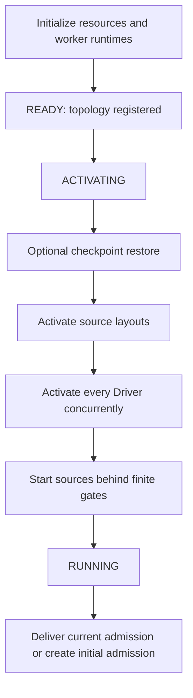
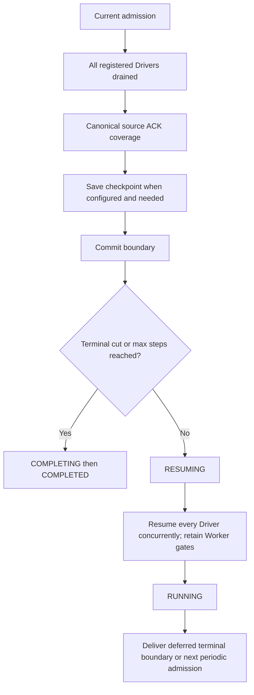

# Distributed Execution Lifecycle

`fluxway/control_plane/lifecycle.py::ExecutionLifecycle` coordinates
startup, restore, admission delivery, drain completion, checkpoint publication,
resume and failure routing. Controller RPC methods validate requests and invoke
this coordinator. Numerical boundary reduction remains in `DrainBoundary`.

## Owners

| Owner | Responsibility | Does not authorize |
| --- | --- | --- |
| Controller FSM | Global lifecycle phases and terminal cleanup | Per-step work identities |
| ExecutionLifecycle | Ordering and concurrent Driver fan-out | Independent progress or source ownership |
| SPMDManager | Live Driver registry, RPC endpoint validation and enqueue | Lifecycle ordering or admission values |
| DrainBoundary reducer | Observed, admitted, drained and committed cuts | Driver readiness |
| Driver FSM and SnapshotOrchestrator | Local activation and application of an admission revision | Global continuation before Controller decision |
| Worker | Finite execution gate, local queues and checkpoint fences | A new global admission during restore/resume |
| LogicalWorkLedger | Canonical source assignments, leases and ACK coverage | Tensor routing |
| CompiledSendPlan and DataPlane | Payload routing and delivery | Startup, discovery or checkpoint decisions |

Worker heartbeat distinguishes INITIALIZING, READY, RESTORING, RUNNING, BLOCKED,
STOPPED and ERROR. Driver heartbeat aggregates `workers_ready` (initialization)
and `topology_ready` (registered communication topology). Neither authorizes START.
Topology readiness cannot change a committed checkpoint cut. The manager installs
topology before registering Drivers and passes it to their constructors; replacement
after registration is rejected before mutation.

## Startup and restore



`ACTIVATING` includes restore, source layout activation, Driver `activate_execution`
and source startup. A Driver moves READY → ACTIVATING before issuing concurrent
Worker activation RPCs, then ACTIVATING → RUNNING after every acknowledgement.
`RESTORE_REQUESTED` is invalid during Driver ACTIVATING. Controller ACTIVATING
includes restore while Drivers are still READY, before Driver activation begins.
Component notification follows
activation without starting Controller-managed source production. Controller reaches
RUNNING after those activation calls finish. Controlled or checkpointed Workers keep
their finite gate closed until admission; ordinary graphs without drain gating start
sources after all Drivers have been activated.

Terminal observations during activation update the existing reducer. They cannot
send admission to partially activated Drivers. A terminal cut of zero still activates
Drivers, skips source startup when known before that stage, and delivers the zero
boundary. If zero is discovered during source startup, the closed gate prevents
controlled source execution beyond that boundary.

Restore reconstructs canonical plans and current physical layouts, restores the
committed cut, and restores Worker state before activation. The public restore method
requires a pre-execution READY/ACTIVATING state. Rewinding a running graph is rejected;
there is no implicit live-rewind protocol.

Recovery creates a new execution with fresh Driver and Worker actors. A Driver
accepts restore only in READY; a Worker enters RESTORING from READY and accepts it before execution starts and
before source activation. A failed restore leaves execution admission closed.
Checkpoint save/resume continues the same actors and preserves valid prefetched
source grants. Actor identities separate delayed messages from earlier executions;
source epoch numbers identify data windows and do not identify execution lifetimes.

`WorkerExecutionLifecycle` owns the Worker phase and activation event. Topology
registration moves INITIALIZING → READY without opening the event. Restore moves
READY → RESTORING → READY; failure retires execution into FAILED. Activation alone
moves READY → ACTIVE. Local scheduling reads ACTIVE without a Controller RPC.
Closing and failure reject activation, including delayed commands. Operator blocking,
checkpoint activity, source leases and cut admission retain their separate owners.
Driver shutdown moves through STOPPING → STOPPED in its existing FSM. A delayed
activation acknowledgement cannot transition a stopped Driver to RUNNING. Driver
and Worker each retain their local resource-release task; repeated stop calls join
the same operation and observe its errors.

`SourceExecutionScope` is a child resource of Worker, not another execution state
machine. It owns installed source windows, their active-step index, grant caches,
installation operations and executing lease batches. Matching activation deliveries
share a supervised operation. Caller cancellation does not abandon installation,
and publication follows successful Reader installation. No lock is held while the
Reader callback runs. The scope cannot change admission or decide a checkpoint cut.

To resume after changing physical Worker counts, build a new graph with the same
canonical source and logical batch cardinality, then call
`await fluxway.start(graph, ..., resume="latest")` against the checkpoint repository.
Stop the previous execution before admitting the replacement. Do not invoke Worker
restore on an already-used actor to rewind its local queues or model state.

## Drain, checkpoint and continuation



Driver resume resets checkpoint bookkeeping and synchronizer drain state. It does
not clear the Worker execution gate. Observations during RESUMING are reduced but
delivery waits until every Driver has resumed. If the current admission changes
while waiting for source ACK coverage, the old boundary cannot initiate a snapshot.

Startup, admission, save and resume failures enter the same Controller failure path.
Exceptions remain visible. Worker/Driver errors also enter that FSM failure path;
cleanup owns resource reclamation. No retry or CPU-copy fallback hides a failure.

## Admission handoff

The lifecycle selects the current immutable admission. `SPMDManager.enqueue_driver_calls`
validates every registered participant and remote endpoint, then enqueues the RPCs
before returning an aggregate Future. Missing actor handles or invalid RPC endpoints
fail the entire preflight; participants are never silently skipped. The manager
keeps no copy of Driver readiness: the receiving Driver FSM validates whether the
operation is legal in its current state. Submission and remote failures
raise when awaited, rather than being returned as ordinary result values. The
manager's existing registry is the only recipient source; lifecycle code does not
adapt Ray handles or keep a second registry.

Concurrent callers share one aggregate Future for that
revision. A new revision can be dispatched while an older RPC is outstanding, so
terminal shortening does not wait behind a slow recipient. Driver/Worker revision
checks reject stale or conflicting requests.

A Driver validates its local state before remembering the admission. Concurrent
identical requests await the same application task, including its failure. Recording
receipt alone does not constitute successful application. The lifecycle retains all
pending supervisors and caches only the latest delivery result for duplicate callers.
These delivery objects are transient and are not checkpoint authorities.

The lifecycle owns a supervision task for each outstanding admission operation.
Callers shield that task; cancelling a caller does not cancel the command or its
failure handling. Completed operations leave the pending set; the latest revision's
result remains available for duplicate waiters. Manager tracks every submitted RPC,
including slow peers after aggregate failure.

FSM transitions commit phase/failure state and hand entry effects to the lifecycle.
COMPLETING, FAILING and CANCELLING register one owned terminal cleanup task and return immediately.
Resource finalization proceeds even if terminal component notification fails.
After resource reclamation, Manager cancels and joins remaining local RPC waits and
the lifecycle settles its admission supervisors. Local cancellation does not prove
remote cessation; actor shutdown and resource reclamation remain responsible for it.
A failure during COMPLETING changes the outcome to FAILED without starting another
cleanup. Cleanup reports CLEANUP_FINISHED or CLEANUP_FAILED through the same FSM.

`GraphExecution.cancel()` requests CANCELLING and joins that cleanup through a shielded
wait. Repeated cancellation joins the same result, including after completion.
Cancelling a waiter does not cancel cleanup. Successful reclamation produces CANCELLED;
a cleanup failure produces FAILED. `wait()` raises `asyncio.CancelledError` for a
cancelled execution and `ExecutionFailedError` for failure. Cancellation does not
create a checkpoint; recovery uses the latest committed coordinated checkpoint.
Startup is also lifecycle-owned. Failure or cancellation settles any pending startup
before reclamation, so a readiness wait cannot outlive a terminal execution. A
cancelled placement wait releases its allocated placement group.

Reducer mutation locks contain no RPC, checkpoint I/O or source ACK wait. Driver
fan-out is concurrent; Worker execution and tensor traffic remain distributed.
This design establishes ordering and bounded retained delivery state, not measured
Controller scalability or cross-node throughput.

## Usage

The following function accepts a compiled `graph` and a `PlacementRecipe`. Initialize
Ray on the submitting process before calling it. Every node needs compatible runtime
dependencies and access to the configured checkpoint repository.

```python
import fluxway
from fluxway.common.types import AsyncStepConfig, CheckpointConfig

async def train(graph, recipe, *, resume=None):
    execution = await fluxway.start(
        graph,
        placement_recipe=recipe,
        async_step_config=AsyncStepConfig(max_steps=37),
        checkpoint_config=CheckpointConfig(
            repository_dir="/shared/checkpoints/training",
            interval_steps=17,
        ),
        resume=resume,
    )
    try:
        await execution.wait()
    finally:
        await execution.cancel()
```

Use `resume="latest"` or a committed checkpoint step to start a new execution.
Topology changes must preserve the logical batch and satisfy each checkpoint
component's topology contract. `wait(timeout=...)` limits the wait; it does not
cancel execution. Call `cancel()` explicitly to stop early. A completed execution
already owns its cleanup; the final `cancel()` safely observes that result.

The public entry point accepts compiled graphs. Source-free graphs use the same
authorization sequence and omit source layout preparation. A standalone dynamic
eager graph submission API is not provided.
Eager numerical computation inside an operator uses the same execution authorization.

## Verification scope

`tests/control_plane/test_execution_lifecycle.py` exercises actual Controller and
Driver state machines and admission receiver methods with controlled async barriers.
It covers startup stages, out-of-order Driver activation, zero/nonzero terminal cuts,
restore order, concurrent revisions, duplicate application, save/resume failures and
checkpoint continuation. Ray graph tests separately exercise actor transport.

Automatic discovery/refill for unbounded source adapters is outside the supported
startup API. See [source coordination](source_coordination.md) for ingestion scope.
