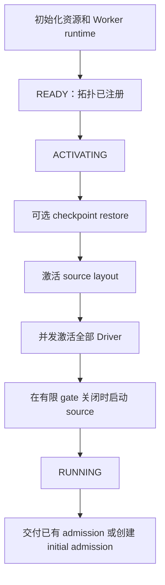
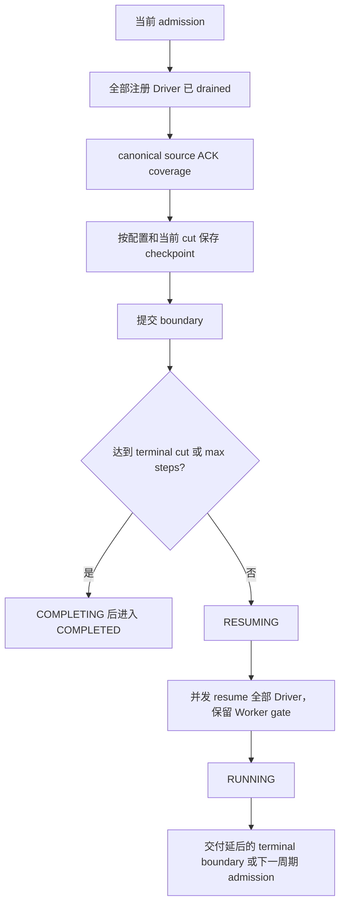

# 分布式执行生命周期

`fluxway/control_plane/lifecycle.py::ExecutionLifecycle` 是启动、恢复、
admission 交付、drain 完成、checkpoint 发布、resume 与错误处理顺序的统一入口。
Controller RPC 方法校验请求并调用该编排器；数值边界仍由 `DrainBoundary` reducer 决定。

## 职责归属

| Owner | 职责 | 不负责 |
| --- | --- | --- |
| Controller FSM | 全局生命周期阶段和终态清理 | 逐 step 的工作身份 |
| ExecutionLifecycle | 阶段顺序、并发 Driver fan-out | 独立进度或 source ownership |
| SPMDManager | 活跃 Driver registry、RPC endpoint 校验与排队 | 生命周期顺序或 admission 数值 |
| DrainBoundary reducer | observed、admitted、drained、committed cut | Driver 就绪状态 |
| Driver FSM 与 SnapshotOrchestrator | 本地激活和 admission revision 应用 | 自行决定全局继续执行 |
| Worker | 有限执行 gate、本地队列、checkpoint fence | 在 restore/resume 时创建全局 admission |
| LogicalWorkLedger | canonical assignment、lease、ACK coverage | tensor 路由 |
| CompiledSendPlan 与 DataPlane | payload 路由和交付 | 启动、发现或 checkpoint 决策 |

Worker heartbeat 区分 INITIALIZING、READY、RESTORING、RUNNING、BLOCKED、STOPPED 和
ERROR。Driver heartbeat 分别聚合 `workers_ready`（初始化）与 `topology_ready`
（通信拓扑注册完成），两者均不触发 Driver START。
拓扑就绪不能改变 committed checkpoint cut。

## 启动与恢复



ACTIVATING 包含 restore、source layout activation、Driver `activate_execution` 和
source startup。Driver 在并发发送 Worker 激活 RPC 前进入 ACTIVATING，收到全部确认后
才进入 RUNNING 并通知组件。Driver 的 ACTIVATING 拒绝 restore；Controller 的
ACTIVATING 则在 Driver 仍处于 READY 时执行 restore，然后才开始激活 Driver。
激活不启动由 Controller 管理的
source 生产。全部 activation 调用完成后 Controller 才进入 RUNNING。
受控 source 或启用 checkpoint 的 Worker 在 admission 到达前保持有限 gate 关闭；
没有 drain gate 的普通图在全部 Driver 激活后启动 source。

activation 期间到达的 terminal observation 只更新现有 reducer，不向部分就绪的
Driver 发送 admission。terminal cut 为零也要先激活 Driver；若在 source startup
阶段前已知零边界，就跳过 source startup 并交付零边界。若在 source startup
期间才发现零边界，关闭的 gate 阻止受控 source 越界执行。

restore 先重建 canonical plan 与当前物理布局，再恢复 committed cut 和 Worker
状态，最后激活执行。公开 restore 方法要求处于执行前的 READY/ACTIVATING；运行中的
图直接拒绝 rewind，不隐含实现另一套在线回退协议。

恢复创建新的执行实例及 Driver、Worker actor。Driver 仅在 READY 接受 restore；
Worker 仅在启动执行和安装 source activation 之前接受 restore。恢复失败时执行
准入保持关闭。普通 checkpoint save/resume 继续使用原 actor，保留有效的预取授权。
Actor 身份隔离旧执行实例的延迟消息；source epoch 标识数据窗口，不标识执行实例。

`WorkerExecutionLifecycle` 唯一持有 Worker phase 与激活事件。拓扑注册仅将
INITIALIZING 转换为 READY，不打开事件。恢复执行 READY → RESTORING → READY；
只有显式激活执行 READY → ACTIVE。本地调度读取 ACTIVE，无需逐 step 请求 Controller。
关闭和失败阶段拒绝迟到激活。算子背压、checkpoint activity、source lease 和 cut
admission 保持各自独立的状态所有权。
Driver 使用原 FSM 的 STOPPING → STOPPED 完成关闭，迟到的激活确认不能令已关闭的
Driver 重新进入 RUNNING。Driver 与 Worker 各自持有本地资源释放任务，重复 stop
等待同一个操作并观察其异常。

`SourceExecutionScope` 是 Worker 的子资源，不另设执行状态机。它持有已安装窗口、
活跃 step 索引、授权缓存、安装操作和执行中的 lease。相同 activation 共享一个
受监管的操作；调用者取消不放弃安装，Reader 安装成功后才发布窗口。等待 Reader
回调时不持有状态锁。该作用域无权改变 admission 或决定 checkpoint cut。

改变物理 Worker 数量后继续训练，应使用相同 canonical source 和 logical batch
cardinality 构建新图，并向同一 checkpoint repository 调用
`await fluxway.start(graph, ..., resume="latest")`。新执行实例开放准入前先停止旧实例。
不能对已经使用过的 Worker 直接调用 restore 来回退本地队列或模型状态。

## Drain、checkpoint 与继续执行



Driver resume 重置 checkpoint bookkeeping 和 synchronizer drain 状态，不清除
Worker 执行 gate。RESUMING 期间的 observation 继续参与 reducer，但等待全部 Driver
resume 完成后才交付。等待 source ACK coverage 期间如果 admission 已改变，旧边界
不能再发起 snapshot。

启动、admission、save、resume 失败进入同一 Controller failure 路径，异常保持可见。
Worker/Driver 错误也进入该 FSM 的失败路径，由 cleanup 回收资源，不通过重试或
CPU-copy fallback 隐藏失败。

## Admission 交接

生命周期选择当前 immutable admission，由 `SPMDManager.enqueue_driver_calls`
先校验全部注册参与者和 remote endpoint，再将 RPC 排队并返回聚合 Future。
缺失 actor handle 或无效 RPC endpoint 使整个预检失败，参与者不会被静默跳过。
Manager 不保存 Driver 就绪状态副本：操作是否合法，由接收端 Driver FSM 判断。
拓扑在注册 Driver 前建立并经构造参数传入，注册后修改会在变更前被拒绝。
提交异常和远端异常在
await 时抛出，不作为普通结果值返回。接收者唯一来源是 manager 的现有 registry，
生命周期不再适配 Ray handle 或维护另一份 registry。

在第一次 await 前完成全部 RPC 排队。
同 revision 的并发调用共享一个聚合 Future。旧 RPC 尚未结束时可以交付新 revision，
terminal 收缩无需等待慢接收端。Driver/Worker 拒绝 stale 或 conflicting revision。

Driver 先校验本地状态，再记录接受的 admission。并发相同请求等待同一个 application
task，其失败也会被共享；不能仅凭记录了 receipt 就返回应用成功。生命周期保留所有
未完成监督任务，并仅缓存最新 delivery 结果供重复调用者等待。这些对象属于瞬态执行状态，
不参与持久进度判定。

生命周期持有每个未完成 admission 的监督任务，调用者通过 shield 等待该任务。
取消调用者不会取消已发命令或其失败处理。完成任务离开 pending 集合；最新 revision
结果保留给重复等待者。Manager 跟踪每个已发 RPC，包括聚合调用失败后仍在等待的同伴。

FSM 提交 phase/failure 状态，再将状态进入副作用交给生命周期。COMPLETING、FAILING、CANCELLING
登记唯一的终止清理任务后立即返回。终止 component 通知失败也不会跳过资源回收。
资源回收后 Manager 取消并等待剩余本地 RPC 等待对象，生命周期结算 admission
监督任务。本地取消不证明远端停止，远端执行仍依赖 actor 停止和资源回收终止。
COMPLETING 期间的失败改变终态为 FAILED，不重复启动清理。清理通过同一 FSM 提交
CLEANUP_FINISHED 或 CLEANUP_FAILED。

`GraphExecution.cancel()` 请求 CANCELLING，通过 shield 等待同一个清理任务。重复取消和
完成后的取消都观察同一结果；取消等待者不会取消清理。成功回收进入 CANCELLED，清理失败
进入 FAILED。`wait()` 对取消抛出 `asyncio.CancelledError`，对失败抛出
`ExecutionFailedError`。取消不会额外创建 checkpoint；恢复以已提交的协调 checkpoint 为准。
生命周期也持有 startup 任务。失败或取消先结算未完成 startup，再回收资源，避免等待
READY 的任务在终态后悬挂。取消 placement 等待会释放已创建的 placement group。

reducer 状态锁内不等待 RPC、checkpoint I/O 或 source ACK。Driver fan-out 并发，
Worker 执行和 tensor 流量保持分布式。该设计证明时序与交付状态保留范围，不等于
已经测得 Controller 可扩展性或跨节点吞吐。

## 使用方式

下面的函数接收编译后的 `graph` 和 `PlacementRecipe`。调用前在提交进程初始化 Ray。
各节点需要兼容的运行环境，并能够访问配置中的 checkpoint repository。

```python
import fluxway
from fluxway.common.types import AsyncStepConfig, CheckpointConfig

async def train(graph, recipe, *, resume=None):
    execution = await fluxway.start(
        graph,
        placement_recipe=recipe,
        async_step_config=AsyncStepConfig(max_steps=37),
        checkpoint_config=CheckpointConfig(
            repository_dir="/shared/checkpoints/training",
            interval_steps=17,
        ),
        resume=resume,
    )
    try:
        await execution.wait()
    finally:
        await execution.cancel()
```

新执行实例可传入 `resume="latest"` 或已提交的 checkpoint step。拓扑变化必须保持
logical batch，并满足各 checkpoint component 的拓扑契约。`wait(timeout=...)` 仅限制
等待时间，不取消执行；提前停止需显式调用 `cancel()`。完成后的 `cancel()` 观察已有
清理结果，不重复回收资源。

公开启动入口接收编译图。无 source 图使用相同授权顺序，省略 source layout 准备。
框架不提供独立的动态 eager 图提交 API；算子内部的 eager 计算使用同一执行授权契约。

## 验证边界

`tests/control_plane/test_execution_lifecycle.py` 使用真实 Controller/Driver 状态机
和 admission 接收方法，通过异步屏障控制交错，覆盖启动各阶段、Driver 乱序激活、
零/非零 terminal cut、restore 顺序、并发 revision、重复应用、save/resume 失败及
checkpoint 后继续执行。Ray 图测试另外验证 actor transport。

公开启动 API 不提供无界 source adapter 的自动 discovery/refill。
摄取能力范围见 [Source 协调协议](source_coordination_zh.md)。
