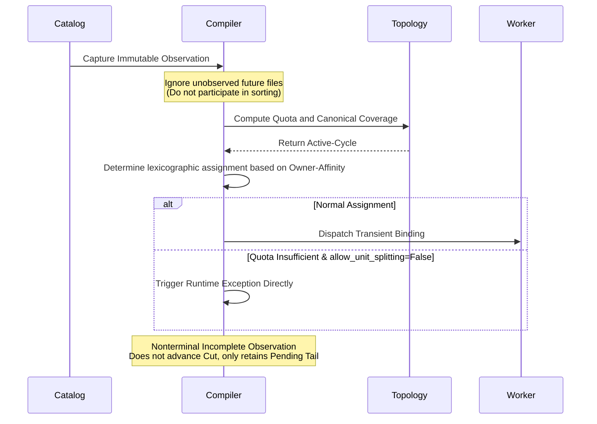

# Source Coordination

## Typed Layout Activation

Source-specific adapters implement `IngestionSourceAdapter.capture_view` and own
immutable revision discovery, locators and cursor encoding. Custom structured
metadata uses canonical MessagePack. Workers must read the captured revision and
locator, never substitute the latest table state during replay.

`IngestionLayoutPlanningComponent` owns ordered immutable compile windows.
Descriptor plan construction and adapter capture use a dedicated `IOLane`, separate
from heartbeat, payload transport and checkpoint storage. Pure layout compilation
uses a persistent process executor with the `spawn` start method. Threads isolate
blocking I/O; they do not provide parallel execution of Python CPU work under the
GIL. Repeated publication must match the existing epoch; conflicting requests fail.

The component owns submitted operation tasks. Cancelling a caller stops its wait;
it does not cancel an accepted observation or publication. `close()` rejects new
submissions, joins accepted operations, joins the compiler processes on a separate
lifecycle lane, and closes the adapter lane. Concurrent close callers await one
shielded cleanup task. Failures abandoned by cancelled waiters are reported after
resource cleanup. A blocking adapter must eventually return for shutdown to finish.

`AlgebraicLayoutCompiler` first builds logical step assignments from the immutable
units captured in the current observation, then lowers each step to the current
reader quotas. A 1,000-row historical file followed by two
10-row append files, with one 1,020-row logical batch and quotas 340/340/340, yields:

| Worker | Source Intervals | Rows |
| --- | --- | --- |
| 0 | historical `[0,340)` | 340 |
| 1 | historical `[340,680)` | 340 |
| 2 | historical `[680,1000)`, append1 `[0,10)`, append2 `[0,10)` | 340 |

This is interval planning, not whole-file assignment. The default lowering keeps
each Reader on its current contiguous unit prefix and minimizes physical-unit
transitions subject to exact quotas and canonical coverage. It does not require
the adapter to know future files. Byte cardinality is also supported by the
compiler; actual byte-range readability depends on the adapter.

Adapters may observe a stream while a source is still being written. Each
`capture_view` result is an immutable bounded observation, and its tuple order is
the only ordering authority for that observation. Fluxway retains incomplete units
as a pending tail; a nonterminal observation smaller than one global batch publishes
no layout and does not advance the source cut. The next observation is stitched to
that tail. Unseen future files are never inferred or reordered.

Controller publishes the canonical epoch and validates physical coverage.
`IngestionLayoutActivationComponent` reuses DriverComponent worker control for
concurrent delivery of encoded `WorkerLayoutDescriptor` values. Worker indexes
the installed segments by active step and requests chunks bounded by operator
pipeline depth. Each invocation receives only its step's interval work items.

## Streaming Windows

`plan_adapter_window` accepts empty nonterminal observations without publishing an
epoch or advancing the cut. An incomplete batch is retained and combined with the
next observation. Nonempty complete windows advance epoch and step boundaries;
terminal empty windows seal the stream without manufacturing source records.

Planner checkpoint includes immutable requests, pending tail and encoded cursor.
Its restore requires the current reader topology and validates the unchanged
logical batch cardinality and canonical epoch digests. Physical layout is rebuilt.
This component API does not itself run a discovery polling loop or activate workers.

## Ownership and ACKs

`LogicalWorkLedger` owns interval leases, ACK validation, observed candidate cut and
committed cut. `SourceWorkKey` uses `(epoch, step, assignment_id)`. `receive(position)`
and worker-local durable cursors are not ownership APIs.

Physical segments of a shared assignment have distinct runtime lease IDs. Only
complete interval coverage advances a step. Worker ACK batching is bounded by its
configured pipeline capacity and participates in outbound checkpoint drain.
`SourceWorkRuntime` caches Controller-issued grants and shares an owned fetch task
within each chunk. Controller returns the nonempty complete-step prefix allowed
by current credit; a future credit wait does not prevent consuming cached earlier
steps. Cancelled callers leave fetch supervision with Worker background tasks.
The cache grants no execution permission and allocates no independent ownership.
A cache miss still waits for a Controller RPC. A full in-flight
window waits for a committed checkpoint cut; checkpoint cadence must permit progress.

After compilation, publication validates the planner window and ledger bindings
before installing the window, tail, cursor, observation identity and ledger epoch
in one Controller event-loop section without an `await`. Acquisition and ACK
operations cannot interleave within that section. Ledger coverage validation,
descriptor decoding and installation still perform work proportional to the window
on the owner loop. `SourceControlConfig.max_planning_units` and
`max_planning_descriptor_bytes` bound accepted Controller layout publications;
these limits are acceptance checks, not a constant-time publication guarantee.

Driver activation checkpoints are empty; physical layouts are transient. Controller restore rebuilds canonical
plans with the current reader topology, publishes the rebound segments, then
restores the logical ledger's committed cut. Driver activation redistributes
the resulting descriptors to fresh workers.

Restore requires fresh Worker actors before source activation. An already-used
Worker rejects restore before changing its scheduler watermark. Normal save/resume
retains the same source scope and its valid future grants.

## Fault Tolerance and Elasticity Guarantees

The system architecture provides the following core guarantees:

- **Comprehensive Boundary Handling**: Natively supports empty observations, seamless tail stitching across revisions, and graceful termination of terminal windows.
- **Protocol Robustness**: Guarantees deterministic behavior for out-of-order ACKs, lease fencing to prevent re-entrancy, and precise state restoration of the Canonical Planner.
- **Dynamic Concurrency Scaling**: Supports arbitrary scaling out or scaling in of Readers during Checkpoint restore (e.g., safely scaling from 6 concurrent readers down to 3, or 3 down to 2). As long as the logical batch cardinality remains unchanged, the system redistributes physical intervals without data loss or duplicate delivery.
- **Exact-Once Provenance**: During Controller restore, the protocol strictly follows a "restore Canonical Plan first, then restore Committed Ledger" sequence, ensuring that the data lineage (Provenance) derived from Work Items remains absolutely stable.

Controller startup activates one layout. Worker source scopes accept contiguous
immutable windows per operator; BaseReader provides installation without duplicating
activation identity. Custom adapters can express idle observations, pending tails and
immutable revisions. Automatic discovery and replenishment of unbounded sources are
not part of the public startup API. External publisher integrations require their own
validation against the adapter contract.

Admission delivery uses the existing boundary revision and validates completion
participant membership. Driver RPC and source ACK coverage waits occur outside the
Controller reducer lock. Restore retains the Worker gate at committed cut; resume
does not clear it. Source ownership and payload routing are separate: the latter
uses [compiled transfer relations](transfer_planning.md).

Acquisition and ACK queues are bounded. Committed planning windows and physical
binding history are retained for canonical reconstruction; retention grows with the
number of installed windows. Account for this metadata when sizing a workload.

`PlacementPolicy` is the solver input value object. It expresses generic layout invariants and locality preferences; it is not a Parquet-specific file-owner API. The default policy preserves unit order, contiguous prefixes, splittable-unit support, and minimum physical transitions. Callers may pass a validated policy when compiling a placement plan, while the physical cost model remains an internal compiler detail. Source adapters provide stable unit identity, split capability, locality metadata, and cursor fences. Affinity and zero-copy must still be checked separately through actual placement and transport. No 256-Input/768-Source throughput or multi-node zero-copy result follows from compiler or ledger tests. See [formal protocol](source_spmd_formal_protocol.md).

## PlacementPolicy and Physical Worker Allocation (Owner-Affinity)

`PlacementPolicy` acts as the immutable input configuration for the Ingestion Solver, controlling physical worker assignment and affinity:
- `require_sequential_order`
- `affinity_contiguous_chunks`
- `affinity_same_file`
- `allow_unit_splitting`

> [!NOTE]
> This policy no longer supports string aliases like "ordered_prefix". It is strictly a strongly typed Value Object composed of configuration flags. The Canonical Interval of a `SourceWorkKey` from the same source is immune to Transient Bindings (ephemeral physical assignments) caused by topological or resource variations.

### Allocation Lexicographic Scoring Function

Given a physical segment $P_i$, the allocation key for a candidate Worker $w$ is formally projected as:

$$ Key(w, P_i) = \left( \mathbb{I}_{w.\text{prev} \neq P_i},\; \mathbb{I}_{w \notin \text{owners}(P_i)},\; \text{rank}(w, P_i),\; \text{cycle\_order}(w) \right) $$

The scheduler optimizes the assignment by selecting the Worker with the lexicographically smallest key:
1. **$k_1 \in \{0, 1\}$ (Contiguous Prefix):** Prioritizes the Reader that is currently continuously reading the same physical identity.
2. **$k_2 \in \{0, 1\} \times \mathbb{N}$ (Owner Set Reunion):** Next, reuses Readers that have already read this physical identity within the current window.
3. **$k_3 \in \mathbb{N}$ (Cycle Order):** Finally, selects according to the deterministic order within the active-cycle.
4. It splits to more Readers only when the quota is exhausted. If `allow_unit_splitting=False`, splitting triggers a direct exception.

### Streaming Source Contract Execution Flow

> [!TIP]
> The complex logical requirements above (including Quota, Canonical Coverage, Active-cycle, and Owner-affinity) are unified and implemented within the same Lowering solver to avoid scattered hardcoding. Moreover, because it is a Transient Binding, the system can cleanly reconstruct the assignment upon Restore without violating the Canonical Source contract.
