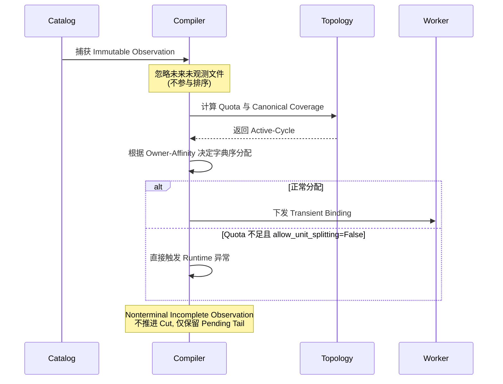

# Source 协调

## Typed Layout Activation

Source adapter 实现 `IngestionSourceAdapter.capture_view`，负责 immutable revision
发现、locator 和 cursor 编码。自定义结构化 metadata 使用 canonical MessagePack。
重放必须读取捕获的 revision/locator，不能替换成最新表状态。

`IngestionLayoutPlanningComponent` 管理有序不可变编译窗口。Descriptor 构造和
adapter capture 使用专用 `IOLane`，与心跳、payload 传输和 checkpoint 存储分离。
纯布局编译使用持久的进程池，以 `spawn` 启动。线程隔离阻塞 I/O，但在 GIL 下
不能提供 Python CPU 计算的并行执行。重复发布必须匹配已有 epoch，冲突直接失败。

组件持有已接收的操作任务。取消调用者只停止其等待，不取消已接收的 observation
或 publication。`close()` 拒绝新提交，等待已接收操作结束，在独立 lifecycle lane
上等待编译进程退出，再关闭 adapter lane。并发调用者通过 `shield` 等待同一个
清理任务。被取消的等待者未接收的操作异常在资源清理后报告；阻塞 adapter 必须
最终返回，关闭才能完成。

`AlgebraicLayoutCompiler` 只使用当前 observation 捕获到的 immutable units，先生成
logical step assignment，再按当前 Worker 配额分配物理区间。一个 1,020 行 logical batch
包含 historical 的 1,000 行和两个各 10 行
追加文件，配额为 340/340/340 时，结果为：

| Worker | 读取区间 | 行数 |
| --- | --- | --- |
| 0 | historical `[0,340)` | 340 |
| 1 | historical `[340,680)` | 340 |
| 2 | historical `[680,1000)`、append1 `[0,10)`、append2 `[0,10)` | 340 |

这是区间规划，不是整文件分配。默认 lowering 会在满足精确 quota 和 canonical coverage
的前提下，让每个 Reader 尽量连续消费自己的 unit 前缀并减少 physical unit 切换；adapter
不需要知道未来文件。Compiler 也支持 byte cardinality；具体格式是否可以按 byte 区间
读取由 adapter 保证。

Source 可以在写入的同时读取。每次 `capture_view` 返回一个 immutable、有界 observation，
只有该 observation 的 tuple 顺序具有排序语义。Fluxway 会保留不足一个 global batch 的
pending tail；非 terminal observation 不发布 layout，也不推进 source cut，下一次 observation
会继续拼接。未观测到的未来文件不会被推断或重排。

Controller 发布 canonical epoch 并验证物理覆盖。Driver 通过已有
`IngestionLayoutActivationComponent` 和 worker control 并发分发
`WorkerLayoutDescriptor`。Worker 按活跃 step 索引已安装的 segment，以 operator
pipeline depth 为上限分批申请；每次调用只通过 operator context 获得本 step 的区间任务。

## 流式 Window

`plan_adapter_window` 接受空的非终止 observation，不创建 epoch，也不推进 cut。
不足一个 batch 的尾部保留并与下一 observation 拼接；完整 window 推进 epoch 和 step；
空 terminal window 封闭流，不制造虚拟源记录。

Planner checkpoint 保存 immutable request、待拼接尾部和编码 cursor。Restore
要求提供当前 topology，并验证 logical batch cardinality 不变、canonical digest
一致，再重新生成物理布局。此组件 API 本身不会运行持续 discovery loop 或激活 Worker。

## Ownership 与 ACK

`LogicalWorkLedger` 负责 interval lease、ACK 校验、candidate cut 和 committed cut。
`SourceWorkKey` 使用 `(epoch, step, assignment_id)`；`receive(position)` 和 Worker
本地 durable cursor 不再是 ownership API。

同一 assignment 的物理分片具有不同 lease ID。只有完整区间覆盖才能完成 step。
ACK 队列按 Worker pipeline 容量有界，纳入已有 outbound checkpoint drain。
`SourceWorkRuntime` 缓存 Controller 授予的 lease，同一批次共享一个受监管的 fetch
任务。Controller 返回当前信用窗口内非空、完整的 step 前缀；后续 step 等待额度
不妨碍已有前缀消费。调用者取消后，Worker 后台任务仍监管 fetch。缓存不授予执行
权限，也不独立分配 ownership；缓存未命中时仍需等待 Controller RPC。
窗口耗尽后等待 committed checkpoint cut，checkpoint 周期必须允许窗口继续推进。

编译完成后，publication 先校验 planner window 和 ledger binding，再在 Controller
事件循环中不含 `await` 的区段安装 window、tail、cursor、observation identity 与
ledger epoch。Acquire 和 ACK 协程不能在该区段内交错。Ledger 覆盖校验、descriptor
解码和安装仍在 owner loop 上执行，其工作量随 window 规模增长。
`SourceControlConfig.max_planning_units` 与 `max_planning_descriptor_bytes`
限制 Controller 接受的布局发布；这些是接受条件，不是常数时间发布保证。

旧分发 ledger 已删除，Driver activation 的 checkpoint 状态为空，物理布局仅为瞬态。
Controller restore 先用当前 Reader topology 重建 canonical plan，发布重新绑定的
segment，再恢复 logical ledger 的 committed cut。Driver activation 将结果描述符
重新分发给新 Worker。

Restore 要求新建 Worker，且发生在 source activation 之前。已经使用过的 Worker
会在修改 scheduler 水位前拒绝 restore。普通 save/resume 保留同一 source 作用域和
其中有效的后续授权。

## 容错与动态伸缩保障 (Fault Tolerance & Elasticity)

系统设计提供了以下核心保障：

- **完备的边界处理**：原生支持空 Observation、跨 Revision 尾部无缝拼接、Terminal Window 的平滑终结。
- **协议级健壮性**：支持乱序 ACK、Lease 隔离防重入以及 Canonical Planner 的精准状态恢复。
- **动态并发伸缩**：支持在 Checkpoint 恢复期间任意缩容或扩容 Reader（例如从 6 个并发安全缩减至 3 个，或 3 个缩减至 2 个），只要逻辑 Batch 的基数不变，系统将重新分配物理区间而绝不会丢失数据或重复投递。
- **Exact-Once 语义保障**：Controller 恢复时严格按照“先恢复 Canonical Plan、后恢复 Committed Ledger”的顺序，确保从 Work Item 派生的数据血缘（Provenance）稳定不变。

Controller 启动激活一个 layout。Worker source scope 接受每个算子的连续不可变窗口；
BaseReader 提供安装 hook，不重复维护 activation identity。自定义 adapter 可以表达 idle
observation、pending tail 和 immutable revision。公开启动 API 不提供无界 source 的
自动 discovery/refill。外部 publisher 集成需要独立验证 adapter 契约。

Admission 下发使用既有 boundary revision，completion 校验 participant 身份。
Driver RPC 和 source ACK coverage 等待不占用 Controller reducer 锁。
Restore 将 Worker gate 保持在 committed cut，resume 不清除此 gate。
Source ownership 与 payload 路由分层；后者使用[编译传输关系](transfer_planning_zh.md)。

Acquire 和 ACK 队列有界。已提交的 planning window 和物理 binding history 保留用于
canonical 重建；所占元数据随安装窗口数增长。工作负载容量规划需要包含这部分开销。

`PlacementPolicy` 是 solver 的输入值对象，表达通用布局不变量和 locality 偏好，不是
Parquet 专用的文件 owner API。默认 policy 保持 unit 顺序、连续 prefix、splittable-unit 支持，
并尽量减少 physical transition。调用方在编译 placement plan 时可以传入经过校验的 policy，
但 physical cost model 仍是 compiler 内部细节。Source adapter 只提供稳定 unit identity、
split capability、locality metadata 和 cursor fence。亲和性和零拷贝仍需通过实际 placement/transport 验证；Compiler/ledger 测试
不能代替 256 Input/768 Source 的吞吐、多机零拷贝结果。参见[正式协议](source_spmd_formal_protocol_zh.md)。

普通 source 直接使用默认 policy：

```python
from fluxway.control_plane.ingestion import PlacementPolicy

policy = PlacementPolicy.default()
request = observation.layout_request(
    topology=topology,
    tail_layout_mode="retain_pending",
    placement_policy=policy,
)
```

只接受经过校验的 `PlacementPolicy`；不能关闭有序 source interval 或 splittable-unit 支持，
因为这些是协议不变量。

Lowering 会记录当前 window 已经读取某个 physical identity 的 Reader，并优先复用这些 Reader；
正在连续读取同一 physical unit 的 Reader 优先级更高。这是调度偏好，不是 durable ownership：
restore 后 physical segment 和 Reader binding 会重建，canonical assignment ID 不变。若 quota
强制切分，compiler 会把切分集中到约束允许的最少 Reader。

## PlacementPolicy 与物理 Worker 分配 (Owner-Affinity)

`PlacementPolicy` 作为 Ingestion Solver 的不可变输入配置，控制着 Worker 物理分配和亲和性：
- `require_sequential_order`
- `affinity_contiguous_chunks`
- `affinity_same_file`
- `allow_unit_splitting`

> [!NOTE]
> 该策略不再支持 "ordered_prefix" 这样的字符串别名，现在纯粹是由配置组成的强类型 Value Object。同源的 `SourceWorkKey` Canonical Interval 不会被由于拓扑/资源变化引起的 Transient Binding (瞬时物理绑定) 污染。

### Allocation 字典序评分函数

给定一个物理分片 $P_i$，候选 Worker $w$ 的评分键（Allocation Key）被正式投射为：

$$ Key(w, P_i) = \left( \mathbb{I}_{w.\text{prev} \neq P_i},\; \mathbb{I}_{w \notin \text{owners}(P_i)},\; \text{rank}(w, P_i),\; \text{cycle\_order}(w) \right) $$

调度器通过选择字典序最小的 Worker 使得分配最优化：
1. **$k_1 \in \{0, 1\}$ (Contiguous Prefix):** 优先选择当前仍在连续读取同一 physical identity 的 Reader。
2. **$k_2 \in \{0, 1\} \times \mathbb{N}$ (Owner Set Reunion):** 其次复用当前 window 已经读取过该 physical identity 的 Reader。
3. **$k_3 \in \mathbb{N}$ (Cycle Order):** 最后按 active-cycle 中的确定性顺序选择。
4. 只有当配额耗尽时，才会切分到更多的 Reader。如果 `allow_unit_splitting=False`，切分则直接抛异常。

### Streaming Source Contract 执行流



> [!TIP]
> 上述复杂的逻辑要求（包括 Quota、Canonical Coverage、Active-cycle 和 Owner-affinity）统一在相同的 Lowering 求解器中实现，避免多处硬编码。并且由于是 Transient Binding，系统可以在 Restore 后干净地重建分配，不打破 Canonical Source 规范。
