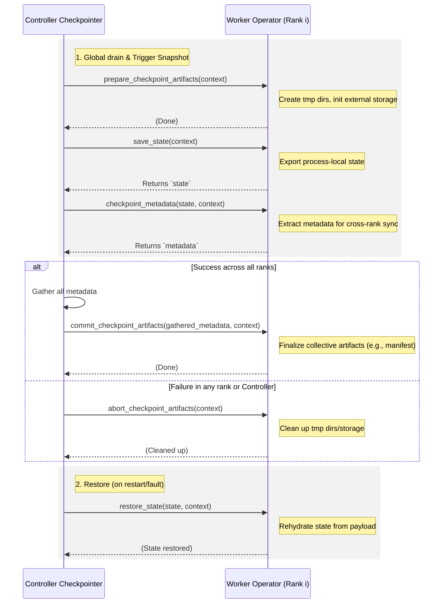

# Worker-Process Operators

Fluxway normally keeps user code away from the `SPMDWorker` actor event loop.
The scheduler, mailbox receiver, prepare runtime, and delivery runtime must keep
making progress while user operators run.

Every stateful operator class is instantiated once inside its planned SPMD
worker process. Use `@fluxway.requires_worker_process` when construction
depends on worker topology or initializes process-local runtime state.

```python
import jax
import fluxway


@fluxway.requires_worker_process
class Trainer:
    def __init__(self):
        jax.distributed.initialize(
            coordinator_address=self.rank0_address,
            num_processes=self.world_size,
            process_id=self.rank,
        )
```

Common reasons:

- `jax.distributed.initialize`
- process-local GPU or accelerator runtime state
- libraries that must be initialized in the same process as the SPMD worker
- native handles whose construction requires final rank and node information

Ordinary stateful operators need no marker because their owner instance already
belongs to the SPMD worker. The marker makes the construction requirement
explicit and enables validation of process-local initialization.

## Runtime Semantics

Stateful ownership does not mean inline execution on the Ray actor event loop.
Fluxway asynchronously submits every ordinary Python `CALL` node to its named
lane in `WorkerProcessCallRuntime` from the first invocation. Stateful and
process-affine callables use the same path even when they return an awaitable:

- the actor event loop submits work and awaits a future
- ordinary Python callables run in the same process on worker-local threads
- if the callable returns an awaitable, the runtime completes it inside the
  worker thread
- `contextvars` such as rank/world/step are propagated
- exceptions propagate back to the LocalStepPlan and poison the worker normally

Fluxway selects the execution lane once per call. With profiling enabled,
`user_callable.execute` records end-to-end latency including queue wait, while
`user_callable.function_run` records the actual operator function invocation,
excluding lane queueing and worker context setup. For worker execution,
`worker_process_call.thread_run` records the exact worker-thread execution
interval. Profiling observes the selected lane and does not dispatch it again.

Every coroutine function uses the `COROUTINE_ASYNC` execution mode and may run
cooperatively on the actor event loop. State and process affinity do not change
this selection: `StatePolicy` controls access to mutable state, while
`@requires_worker_process` controls object construction and lifetime. A
coroutine must yield during waits and must not hide blocking work inside
`async def`; ordinary Python functions are submitted asynchronously to their
named worker-process lane from the first invocation.

This preserves event-loop progress for:

- `receive_transport_frames`
- mailbox deposit and ready callbacks
- `LocalInputPrepareRuntime`
- `OutboundDeliveryRuntime`
- scheduler wakeups and drain fences

Pure Python CPU-heavy user code still competes for the CPython GIL. The runtime
is an event-loop isolation mechanism, not a promise of CPU parallel speedup.
JAX, CuPy, native kernels, Ray RPC waits, and many I/O paths can still overlap
because they release the GIL or are backend driven.

On free-threaded CPython 3.14 and later, the same named worker-process lanes can
run Python bytecode in parallel. Fluxway does not expose a second execution
mode for this interpreter capability; lane isolation and scheduling semantics
remain identical across CPython builds.

## State And Resource Rules

`AsyncPolicy` controls concurrency:

- `StatePolicy.exclusive()` serializes access through LocalStepPlan resource ids.
- `StatePolicy.thread_safe()` removes the class-instance lock and requires the
  underlying state/store to be safe for concurrent calls.
- `local_pipeline_depth` comes from `AsyncPolicy.depth`.

If a process-affine class has mutable Python state and is not explicitly
thread-safe, use the default `AsyncPolicy.sync()` or `StatePolicy.exclusive()`.

Process-affine construction does not forbid local overlap. A
`@requires_worker_process` class
may expose stateless helper operators with `StatePolicy.thread_safe()` while
keeping model/state mutating operators exclusive. The recommendation
`DenseSPMD` uses this split:

- `prepare_dense_inputs` and `scatter_sparse_grads` run on thread-safe local
  async lanes because they do not read or write dense model state.
- `train_core` and `update` keep exclusive state access because they read or
  mutate the dense model/gradient accumulator.
- `SchedulePolicy.phase_graph` allows `scatter_sparse_grads(step=N)` and
  `update(step=N)` to overlap, while preventing `train_core(step=N+1)` from
  starting before `update(step=N)` commits.

Internal handoff between those phases can use functional graph `local=True`.
That is a same-worker transport edge, not a remote call.

## Failure Mode

Fluxway fails fast when a class calls `jax.distributed.initialize` but is not
decorated:

```text
Fluxway Worker Process Error: ... calls jax.distributed.initialize but is not marked with @fluxway.requires_worker_process.
```

The internal protocol field `__fluxway_process_affine__` is intentionally hidden
behind the decorator. User code should use `@fluxway.requires_worker_process`.

## Checkpoint Participant Protocol

Stateful operators can participate in the whole-job checkpointing and restoration process by implementing the participant protocol. The Controller-orchestrated global checkpointer delegates artifact preparation, state persistence, and aborts/commits to each operator instance via these optional methods. 

Because these methods run in the SPMD worker during the checkpoint fence, they are decoupled from the asynchronous execution lanes (`AsyncPolicy`).

### Lifecycle Workflow

The following diagram illustrates the lifecycle of a checkpoint, covering both the save and restore phases:



*(Note: The `alt` block in the diagram represents a conditional branch, similar to an `if/else` statement. It shows two alternative execution paths: one for when the save phase succeeds across all ranks, and another for when a failure occurs.)*

### Method Descriptions

- **`prepare_checkpoint_artifacts(self, context: CheckpointContext) -> None`**: 
  Called first to prepare any local staging directories or external storage.
- **`save_state(self, context: CheckpointContext) -> Any`**: 
  Called to export process-local state (e.g., in-memory data, cursor, or storage URIs). The returned object is persisted in the global payload.
- **`checkpoint_metadata(self, saved_state: Any, context: CheckpointContext) -> Mapping[str, Any]`**: 
  Optionally extract and return a validated dictionary of metadata from the `saved_state`.
- **`commit_checkpoint_artifacts(self, gathered_metadata: Mapping[int, Mapping[str, Any]], context: CheckpointContext) -> None`**: 
  A cross-rank phase. It receives a dictionary mapping rank to the returned `checkpoint_metadata` from all participating ranks, allowing collective finalization (e.g., manifest consolidation).
- **`abort_checkpoint_artifacts(self, context: CheckpointContext) -> None`**: 
  Called if any phase of the global checkpoint fails. Cleans up staging directories created during `prepare_checkpoint_artifacts`.
- **`restore_state(self, state: Any, context: CheckpointContext) -> None`**: 
  Called during fault recovery. Receives the `state` originally returned by `save_state`.
