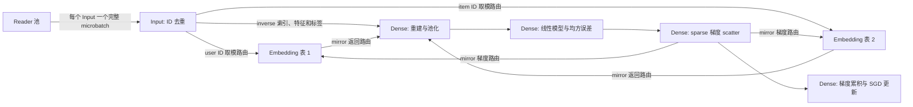

# Recommendation 训练示例

[English](README.md)

本示例使用有限的合成推荐数据训练小型模型。Input 和 Dense 使用数据并行，两张 CPU
embedding 表使用分片存储，覆盖完整 microbatch 交付、去重、CPU/GPU 传输以及
source/model 协调 checkpoint 恢复。

## 执行架构



| 阶段 | 计算与所有权 |
| --- | --- |
| Reader | 读取从 `LogicalWorkLedger` 获取的 canonical 区间；物理 rank 不是持久化数据游标。 |
| Input | 使用 `async_unique` 对自身 microbatch 内的 ID 去重，保留 inverse 索引和样本 provenance。 |
| Embedding 表 | 按 `key % shard_count` 拥有 key，执行 lookup 和 sparse Adam 更新。两 shard 时，shard 0 拥有偶数 key，shard 1 拥有奇数 key。 |
| Dense | 重建与池化 embedding，拼接 dense 特征，计算单层线性输出和均方误差；参数使用梯度累积与 SGD 更新。 |
| Checkpoint | 协调 source cut、Dense 模型状态以及 sparse 参数和优化器状态；恢复时先还原新 actor，再授权执行。 |

去重范围是各个 Input 的 batch；不同 Input 仍可能提供相同 key。Mirror 路由依据
transfer receipt 返回值和梯度。去重与节点亲和性都不能证明传输零拷贝。

## 环境

每个 Ray 节点都需要安装 Fluxway 和示例依赖。本示例导入 JAX、Flax、CuPy、Grain、
Orbax，以及支持 Lance checkpoint 的 `sparse_embedding`；GPU 包必须与 CUDA 环境
匹配。[pyproject.toml](../../../pyproject.toml) 声明了 `recommendation`、`jax`、
`cuda12x`、`cuda13x`、`visualization` 和 `profiler` extras。模型还需要 Flax。

连接已有 Ray 集群时，launcher 使用 `RAY_ADDRESS`。若没有已初始化的集群且未设置该
变量，sandbox 会在本机初始化 Ray。为 Reader、Input 和 embedding Worker 提供足够
CPU 资源；以下命令为每个 Dense rank 分配一张 GPU，四 rank 作业共需四张 GPU。
所有节点必须能通过相同路径访问 checkpoint 目录。

## 启动训练

始终显式指定合法的 Reader/DP 拓扑。Reader 数量必须为正、是 DP 的整数倍，且每个
Input 至少对应一个 Reader。DP 必须整除本示例的逻辑 batch size 24。
`--num-gpus` 表示每个 Dense rank 的 GPU 分配量。

解析器默认使用 Reader=4、DP=4，能够构成合法图；除非 CPU smoke run 显式使用
`--num-gpus 0`，否则仍需要四张可用 GPU。多机实验建议显式指定拓扑参数。

```bash
python -m fluxway.example.recommendation.train \
  --reader-shards 16 --dp 4 --num-gpus 1 \
  --max-steps 10 --checkpoint-interval 2 --source-max-in-flight 40 \
  --checkpoint-dir /shared/checkpoints/recommendation-smoke
```

新实验应选择新的 checkpoint 路径。启用 checkpoint 时，示例使用 `resume="latest"`；
空仓库从头运行。`--clear-ckpt` 会在启动前显式删除已有 checkpoint 目录。

## Checkpoint 与更改 Worker 数量

启动替代执行前先停止旧执行。保持合成数据配置、逻辑 batch size 和 source identity
不变。`--max-steps` 是包含已恢复步骤的总目标。全部模型 checkpoint component 都必须
支持所选拓扑变化；以下命令保持 sparse 表 shard 数量不变。

```bash
python -m fluxway.example.recommendation.train \
  --reader-shards 16 --dp 4 --num-gpus 1 \
  --max-steps 17 --checkpoint-interval 17 --source-max-in-flight 40 \
  --checkpoint-dir /shared/checkpoints/recommendation

python -m fluxway.example.recommendation.train \
  --reader-shards 4 --dp 2 --num-gpus 1 \
  --max-steps 23 --checkpoint-interval 23 --source-max-in-flight 40 \
  --checkpoint-dir /shared/checkpoints/recommendation

python -m fluxway.example.recommendation.train \
  --reader-shards 16 --dp 4 --num-gpus 1 \
  --max-steps 37 --checkpoint-interval 37 --source-max-in-flight 40 \
  --checkpoint-dir /shared/checkpoints/recommendation
```

Source ACK 确认 Reader 已生产数据；协调 checkpoint 发布建立 source/model 的持久化
边界。恢复会重放未提交后缀，因此故障后的物理读取可能重复。外部副作用需要自身的事务
或幂等契约。

Dense 在 checkpoint finalize 时应用未满批的累积梯度，并保存 `model_state`；恢复后
累积器为空。Dense 不维护 Adam 或 momentum 状态；sparse checkpoint component
包含自身的 Adam 状态。数值比较需要使用相同数据和 finalize 边界。

## 验证续训

每次实验使用新的 checkpoint 仓库并保留训练日志。不同执行保持相同的 source identity、
合成数据配置和全局 batch size。改变 Reader 或 DP 数量只应改变物理分配，不能改变逻辑
样本序列。

1. 使用每个 Input 对应多个 Reader 的拓扑，训练到已提交边界，例如 17。选择不能被配置的
   梯度累积长度整除的边界，覆盖未满批累积梯度的 finalize。
2. 使用不同 Reader 和 DP 数量创建新执行，指向相同仓库；接受新进度前核验报告的恢复位置。
3. 验证故障恢复时，在某个 Input 已观察到 committed cut 之后的数据、下一次 checkpoint
   发布之前终止该进程。核验收到的失败确实属于该进程，且最新 committed cut 未变化。
4. 再次恢复并完成其余边界，检查以下证据。

| 属性 | 所需证据 |
| --- | --- |
| 数据集续读 | 每个成功区间 `[a, b)` 的 Input origins 多重集合等于 `[24a, 24b)`，每个 origin 恰好一次。失败尝试的观察记录单独计数，未提交后缀允许再次读取。 |
| 完整 microbatch 交付 | 每次 Input 调用接收某一次 Reader 调用提供的 `24 / dp` 行。按 step 和 Input rank 比较 origins，不能只核对总行数。 |
| 亲和性 | 记录各 Reader、目标 Input、对应 Dense rank 的运行时 NodeID，三者必须一致。 |
| Checkpoint 状态 | 比较 Dense 保存副本和每个恢复副本；在新工作执行前按逻辑 key 比较 sparse 值、优化器状态和 step 计数，并确认没有未完成的 checkpoint 事务。 |
| 复制行为 | 检查 frame 构造、Input assembly 的 value-buffer alias，以及 RPC 提交前的显式复制。节点亲和性和 payload 数值相同本身不能证明传输零拷贝。 |

进程正常退出或 checkpoint 目录存在都不能单独证明这些属性。同机多个 Ray 节点可验证
不同 NodeID 和 actor 的协议；物理多机网络性能需要单独部署测试。上述命令保持 sparse 表
shard 数量不变；测试 sparse 重分片时，还需按逻辑 key 比较新旧分区中的状态。

## Reader 池、placement 与 credit

`--reader-shards 16 --dp 4` 的编译路由使用以下 Reader 池：

| Input rank | 在一个周期内向它供给数据的 Reader rank |
| --- | --- |
| 0 | 0, 1, 2, 3 |
| 1 | 4, 5, 6, 7 |
| 2 | 8, 9, 10, 11 |
| 3 | 12, 13, 14, 15 |

每个周期 slot 从各池激活一个 Reader，向对应 Input 提供一个完整 microbatch；Input
不会把整个池的多个 microbatch 拼成一次执行。图显式声明 `WholeUnitRouting`，并从
编译后的关系推导 Reader/Input placement 约束。每个 Reader 与目标 Input 共享
NodeID，各 Input 与对应 Dense rank 共享 NodeID。运行时使用编译后的 execution-group
binding，不通过 rank 重新猜算分组。

Input assembly 可以直接引用收到的完整 payload，但这不证明 Ray 跨进程交付没有
复制。内存边界见[传输计划](../../../docs/transfer_planning_zh.md)和
[数据面运行时](../../../docs/dataplane_runtime_zh.md)。

`--source-max-in-flight` 限制 source 领先 committed cut 的逻辑步数，应确保下一次
checkpoint 边界能够到达。Source 按批获取 work，但 grant 大小还受 credit 和 Reader
执行周期限制；credit 固定时，增加 Reader 数量可能降低批量效率。

## 数值与 API 契约

Sparse lookup 和 update 使用 `max_staleness=7` 的 bounded-stale 执行。该限制不会
为每次 lookup 指定固定参数版本。即使 Worker 数量相同，两次从相同 checkpoint 恢复
的执行也可能在某次较早的 update 之前或之后读取。GPU sparse-gradient scatter 对
重复索引也可能产生不同的浮点累加结果。

保存与恢复状态精确一致、已提交样本序列相同，不代表后续训练轨迹逐位相同。应分别验证
状态恢复、样本身份和数值行为。本示例不提供确定性重放模式，也不是收敛 benchmark。

公共入口提交编译后的 `FunctionalGraph`。算子内部的 eager 计算遵守相同执行授权，
但没有独立的动态 eager 图提交 API。合成 source 是有限数据集。自定义 adapter 支持
以及尚无自动无界 discovery/refill 的范围见[BaseReader](../../../docs/base_reader_zh.md)。

## 图导出与 profiling

图导出需要 `visualization` extra，并在正常训练启动过程中执行。使用新的输出目录；
替换已有图 bundle 时需显式传入 `--overwrite-graph-visualization`。

```bash
python -m fluxway.example.recommendation.train \
  --reader-shards 16 --dp 4 --num-gpus 1 \
  --max-steps 10 --source-max-in-flight 40 \
  --checkpoint-dir /shared/checkpoints/recommendation-graph \
  --graph-visualization-dir /tmp/recommendation-graph
```

Perfetto profiling 需要 `profiler` extra，并指定 trace 根目录：

```bash
python -m fluxway.example.recommendation.train \
  --reader-shards 16 --dp 4 --num-gpus 1 \
  --max-steps 10 --source-max-in-flight 40 \
  --checkpoint-dir /shared/checkpoints/recommendation-profile \
  --profiler-trace-dir /tmp/recommendation-traces
```

导出文件的查看方式见[图可视化](../../../docs/graph_visualization.md)和
[profiler 使用说明](../../../docs/user_profiler.md)。

## Sparse checkpoint 维护

Sparse storage compaction 是显式操作。仅整理已有仓库、不启动训练时使用：

```bash
python -m fluxway.example.recommendation.train \
  --compact-only --checkpoint-dir /shared/checkpoints/recommendation
```

`--compact-checkpoints` 在训练结束后执行相同维护。Compaction 与 source-window
历史回收是不同职责。框架契约见[checkpoint 使用说明](../../../docs/checkpoint_zh.md)
和[执行生命周期](../../../docs/execution_lifecycle_zh.md)。
